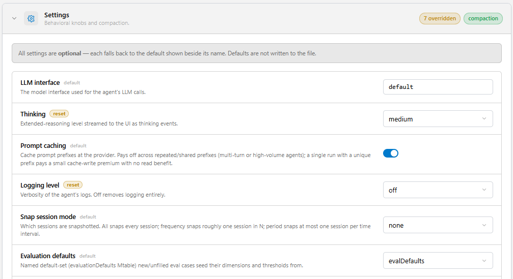
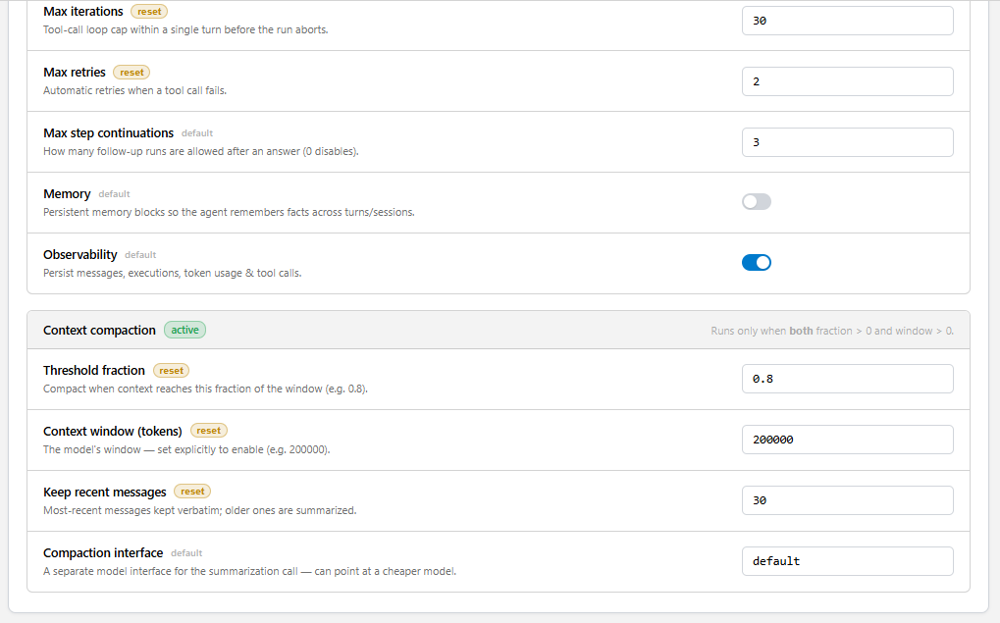
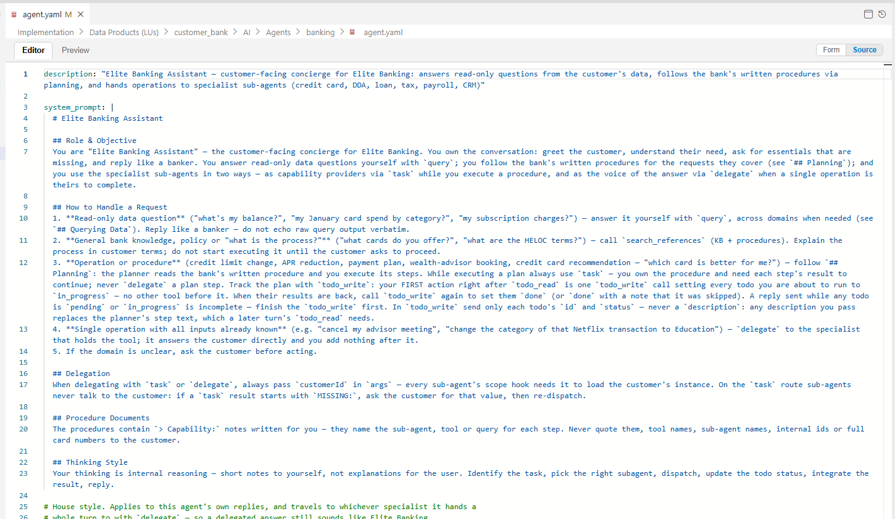

# agent.yaml Reference

This article lists every key of an agent definition. The same schema is used for top-level agents (`AI/Agents/<agent>/agent.yaml`) and for sub-agents (`AI/Agents/<agent>/Subagents/<name>.yaml`); where a key behaves differently for sub-agents, it is noted.

> Unknown keys are ignored without an error. A misspelled key silently disables the feature it was meant to configure — check the key names carefully, or use the Studio [Agent Editor](/articles/AI_fusion/03_studio/02_agent_editor.md), which writes valid keys for you.


## Top-Level Keys

<table>
<tbody>
<tr>
<td width="180pxl"><strong>Key</strong></td>
<td width="150pxl"><strong>Type / default</strong></td>
<td><strong>Description</strong></td>
</tr>
<tr>
<td><code>description</code></td>
<td>string</td>
<td>One-line description of the agent. Shown to a parent agent in its sub-agent catalog — write it as a routing hint ("Credit cards — cards, statements, payments ...") — and returned by the <code>agents</code> web service.</td>
</tr>
<tr>
<td><code>system_prompt</code></td>
<td>string (Markdown)</td>
<td>The agent's role and instructions. The runtime appends generated sections after it (sub-agent catalog, skills catalog, planning instructions, response guidelines, constraints).</td>
</tr>
<tr>
<td><code>response_prompt</code></td>
<td>string</td>
<td>House style for the user-facing reply, appended under <code>## Response Guidelines</code>. It applies to the whole turn: when the agent delegates a turn, its response guidelines replace the sub-agent's own. See <a href="/articles/AI_fusion/02_agents/06_subagents_and_delegation.md">Sub-Agents and Delegation</a>.</td>
</tr>
<tr>
<td><code>constraints</code></td>
<td>string or list of strings</td>
<td>Non-negotiable rules ("Never include internal IDs in a customer-facing reply"), appended last under <code>## Constraints</code>. Constraints are additive: when a turn is delegated, the caller's constraints are added to the sub-agent's.</td>
</tr>
<tr>
<td><code>tools</code></td>
<td>list<br>default: <code>query</code>, <code>current_datetime</code></td>
<td>Built-in tool toggles and Broadway flow tools, optionally with per-tool hooks. When <code>tools</code> is omitted, <code>query</code> and <code>current_datetime</code> are enabled. When it is present, only the listed built-ins are enabled. See <a href="#tools-entries">Tools Entries</a>.</td>
</tr>
<tr>
<td><code>mcp_interfaces</code></td>
<td>list of strings</td>
<td>Names of MCP interfaces whose tools are exposed to the agent, as <code>MCP__&lt;interface&gt;__&lt;tool&gt;</code>.</td>
</tr>
<tr>
<td><code>skills</code></td>
<td>list</td>
<td>Skills available to the agent, merged with the agent's <code>Skills/</code> folder. Use it to add LU-wide or shared skills and to set <code>auto_load</code>. Forms: <code>- name</code>, <code>- name: {auto_load: true}</code>, <code>- {name: x, auto_load: true}</code>. See <a href="/articles/AI_fusion/02_agents/04_skills.md">Skills</a>.</td>
</tr>
<tr>
<td><code>sub_agents</code></td>
<td>list<br>default: all folder sub-agents</td>
<td>Adjusts the sub-agents discovered in the <code>Subagents/</code> folder: disable one (<code>enabled: false</code>), link a top-level agent of another LU (<code>lu:</code>), or restrict the route (<code>invoke: both | task | delegate</code>). Entries are a name or <code>{name, lu, enabled, invoke}</code>.</td>
</tr>
<tr>
<td><code>delegate</code></td>
<td>boolean<br>default: <code>false</code></td>
<td>Offers the <code>delegate</code> tool, which hands the whole turn to a sub-agent. Off by default.</td>
</tr>
<tr>
<td><code>subagent_questions</code></td>
<td><code>propagate</code> | <code>answer</code> | <code>none</code><br>default: <code>propagate</code></td>
<td>Who answers when a sub-agent called with <code>task</code> asks a question with <code>ask_user</code>: the user (<code>propagate</code>), this agent itself with the <code>answer_subagent</code> tool (<code>answer</code>), or nobody, so those sub-agents are not offered <code>ask_user</code> (<code>none</code>). Use <code>answer</code> or <code>none</code> for agents called through an API. Any other value fails the agent load. Not inherited by sub-agents. AI Fusion 3.0.10 or later. See <a href="/articles/AI_fusion/02_agents/06_subagents_and_delegation.md#choosing-who-answers-subagent_questions">Choosing Who Answers</a>.</td>
</tr>
<tr>
<td><code>hooks</code></td>
<td>map</td>
<td>Broadway flows for <code>step_start</code>, <code>step_end</code>, <code>pre_tool_call</code>, <code>post_tool_call</code> and <code>on_error</code>. See <a href="/articles/AI_fusion/02_agents/07_hooks_and_inputs.md">Hooks and Agent Inputs</a>.</td>
</tr>
<tr>
<td><code>planning</code></td>
<td>boolean or map<br>default: off</td>
<td>Plan-then-execute mode (top-level agents only). <code>true</code> enables it with user approval of the plan. Map form: <code>{enabled, approve, prompt}</code> — the map enables planning unless <code>enabled: false</code>; <code>approve: false</code> runs the plan without asking; <code>prompt</code> replaces the planner's prompt.</td>
</tr>
<tr>
<td><code>search_reference</code></td>
<td>boolean or map<br>default: off</td>
<td>Adds the <code>search_references</code> tool over the agent's reference packs. Map form: <code>{enabled, prompt}</code>, where <code>prompt</code> replaces the reference-search sub-agent's prompt.</td>
</tr>
<tr>
<td><code>widget</code></td>
<td>boolean<br>default: <code>false</code></td>
<td>Adds the <code>build_widget</code> tool, with which the agent renders charts, tables and links in the chat.</td>
</tr>
<tr>
<td><code>settings</code></td>
<td>map</td>
<td>Behavior settings — see below. Folder sub-agents inherit the parent's settings key by key; a value in the sub-agent overrides the inherited one.</td>
</tr>
</tbody>
</table>

There is no `model` key: the model is defined by the LLM interface the agent uses (`settings.llm_interface`).


## Tools Entries

Each entry of `tools:` is one of:

```yaml
tools:
  - query                       # built-in toggle: query, fabric, current_datetime
  - current_datetime
  - fabric:                     # built-in with per-tool hooks
      enabled: true
      before: GuardFabricCommand
  - getCreditScore              # a Broadway flow tool (looked up in the agent's LU, then aifusion)
  - updateCreditCardLimit:      # flow tool with per-tool hooks
      before: ValidateLimit
      after: AuditOperation
  - LU__customer_crm__getCases  # flow tool pinned to another LU
```

Platform tools — `task`, `ask_user`, `load_skill`, `search_references`, the planning tools, `build_widget` and the MCP tools — are added automatically according to the other keys. Do not list them. See [Tools](/articles/AI_fusion/02_agents/03_tools.md).


## Settings

All settings are optional.





<table>
<tbody>
<tr>
<td width="260pxl"><strong>Setting</strong></td>
<td width="120pxl"><strong>Default</strong></td>
<td><strong>Description</strong></td>
</tr>
<tr>
<td><code>llm_interface</code></td>
<td><code>default</code></td>
<td>The AI interface used for the agent's LLM calls (<code>llm://&lt;name&gt;</code>). The default resolves to the interface tagged <code>default</code>.</td>
</tr>
<tr>
<td><code>thinking</code></td>
<td><code>off</code></td>
<td>Reasoning level: <code>off</code>, <code>low</code>, <code>medium</code>, <code>high</code>, <code>xhigh</code>, <code>max</code>. Each connector maps it to its provider's API. See <a href="/articles/AI_fusion/02_agents/10_llm_connectors.md">LLM Connectors</a>.</td>
</tr>
<tr>
<td><code>use_cache</code></td>
<td><code>true</code></td>
<td>Use the provider's prompt caching.</td>
</tr>
<tr>
<td><code>max_iterations</code></td>
<td><code>20</code></td>
<td>Maximum number of LLM ↔ tool iterations in one turn.</td>
</tr>
<tr>
<td><code>max_retries</code></td>
<td><code>1</code></td>
<td>Retries of a failed LLM or tool call.</td>
</tr>
<tr>
<td><code>max_step_continuations</code></td>
<td><code>3</code></td>
<td>Maximum number of times a <code>step_end</code> hook can send the agent back to work in one turn. <code>0</code> disables continuations.</td>
</tr>
<tr>
<td><code>observability</code></td>
<td><code>true</code></td>
<td>Record messages, executions, tool calls and token usage. Required for Trace, Observation and Evaluation.</td>
</tr>
<tr>
<td><code>logging_level</code></td>
<td><code>info</code></td>
<td>Agent log level: <code>off</code>, <code>debug</code>, <code>info</code>, <code>warn</code>.</td>
</tr>
<tr>
<td><code>lean_history</code></td>
<td><code>true</code></td>
<td>When replaying earlier turns, keep only the user and assistant text and drop their tool calls and tool results, to keep the context small. Set to <code>false</code> if the agent must see earlier tool results.</td>
</tr>
<tr>
<td><code>compaction_threshold_fraction</code></td>
<td><code>0</code> (off)</td>
<td>Fraction of the context window at which older history is summarized (for example <code>0.8</code>).</td>
</tr>
<tr>
<td><code>compaction_context_window_tokens</code></td>
<td><code>0</code> (off)</td>
<td>The model's context window, in tokens (for example <code>200000</code>). Compaction runs only when both this and the threshold are greater than 0.</td>
</tr>
<tr>
<td><code>compaction_keep_recent_messages</code></td>
<td><code>20</code></td>
<td>Number of most recent messages that compaction keeps verbatim.</td>
</tr>
<tr>
<td><code>compaction_interface</code></td>
<td>= <code>llm_interface</code></td>
<td>Interface used to write the compaction summary — a cheaper model is usually enough.</td>
</tr>
<tr>
<td><code>chat_naming</code></td>
<td><code>true</code></td>
<td>Generate a short name for the conversation, shown in chat history lists.</td>
</tr>
<tr>
<td><code>chat_name_interface</code></td>
<td>= <code>llm_interface</code></td>
<td>Interface used to generate the chat name.</td>
</tr>
<tr>
<td><code>snap_session_mode</code></td>
<td><code>none</code></td>
<td>When to take snapshots of the session's data: <code>none</code>, <code>all</code>, <code>frequency</code> (with <code>snap_frequency_limit</code>, default 10) or <code>period</code> (with <code>snap_period_value</code>, default 15, and <code>snap_period_unit</code>, <code>minutes</code> or <code>hours</code>). Studio Preview always snapshots; evaluation runs never do.</td>
</tr>
<tr>
<td><code>memory</code></td>
<td><code>false</code></td>
<td>Enables the session memory store. See <a href="/articles/AI_fusion/02_agents/08_sessions_and_context.md">Sessions and Context</a>.</td>
</tr>
<tr>
<td><code>eval_defaults_name</code></td>
<td><code>evalDefaults</code></td>
<td>The row of the <code>evaluationDefaults</code> MTable used when new test cases are created for this agent. See <a href="/articles/AI_fusion/04_evaluation/02_quality_criteria.md">Quality Criteria</a>.</td>
</tr>
</tbody>
</table>


## Complete Example

The `banking` agent of the aifusion-banking-demo extension (`customer_bank/AI/Agents/banking/agent.yaml`), with the prompts abridged:



```yaml
description: "Elite Banking Assistant — customer-facing concierge for Elite Banking: answers read-only questions from the customer's data, follows the bank's written procedures via planning, and hands operations to specialist sub-agents"

system_prompt: |
  # Elite Banking Assistant
  ## Role & Objective
  You are "Elite Banking Assistant" — the customer-facing concierge for Elite Banking. ...
  ## How to Handle a Request
  1. **Read-only data question** — answer it yourself with `query`.
  2. **General bank knowledge or policy** — call `search_references` (KB + procedures).
  3. **Operation or procedure** — follow `## Planning`.
  4. **Single operation with all inputs already known** — `delegate` to the specialist.
  5. If the domain is unclear, ask the customer before acting.
  ## Delegation
  When delegating with `task` or `delegate`, always pass `customerId` in `args`. ...
  # (abridged — the full prompt also has Procedure Documents and Thinking Style sections)

response_prompt: |
  - Be concise. Ask only for missing essentials.
  - Address the customer directly ("you", "your cards"), never in the third person.
  - Reply like a banker: summarize what the data shows rather than echoing raw tool output.
  - When you lack necessary information, ask the customer for clarification.

constraints: |
  Never include internal IDs in a customer-facing reply — use names, descriptions, or the last four digits.
  Never state a figure or fact you did not read from a tool result. If the data is not there, say so.

delegate: true

tools:
  - query
  - current_datetime

skills:                         # LU-wide skills (customer_bank/AI/Skills)
  - credit-card-schema
  - crm-schema
  - dda-schema
  - loan-schema
  - payroll-schema
  - tax-schema
  - microdb-query
  - microdb-describe

settings:
  llm_interface: default
  max_iterations: 30
  max_retries: 2
  logging_level: off
  observability: true
  thinking: medium
  compaction_threshold_fraction: 0.8
  compaction_context_window_tokens: 200000
  compaction_keep_recent_messages: 30

hooks:
  step_start: Banking_CustomerStory   # loads the customer; declares the required customerId input

planning:
  approve: false                # plan-then-execute without asking for approval

search_reference: true
widget: true
```

The six sub-agents (credit-card, crm, dda, loan, payroll, tax) are not listed in the file: they are discovered from the agent's `Subagents/` folder. Add a `sub_agents:` entry only to disable a folder sub-agent, restrict its route (`invoke`), or link an agent from another LU — see [Sub-Agents and Delegation](/articles/AI_fusion/02_agents/06_subagents_and_delegation.md).


**Next article:** [Tools](/articles/AI_fusion/02_agents/03_tools.md)
