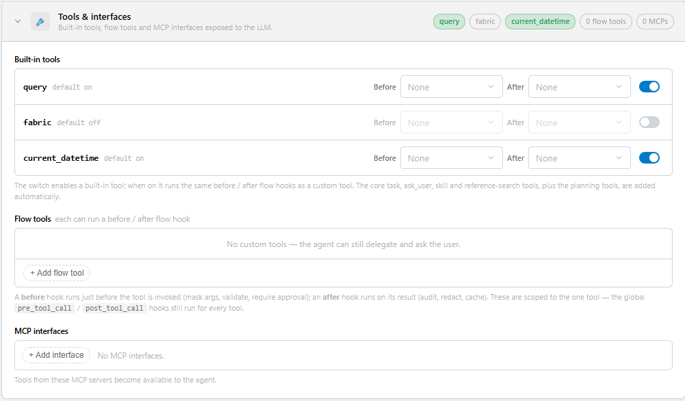
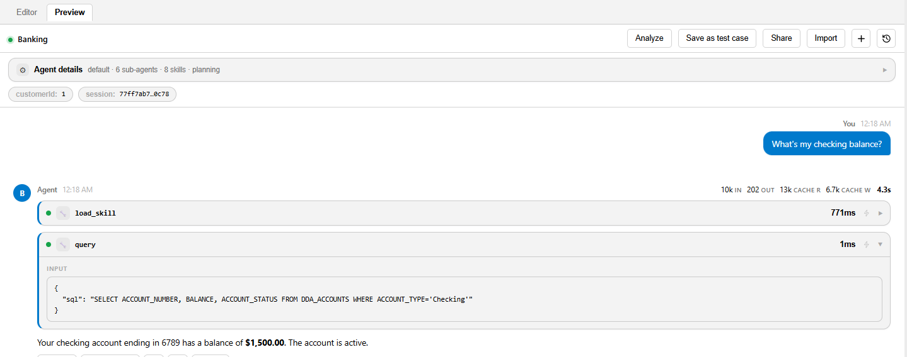
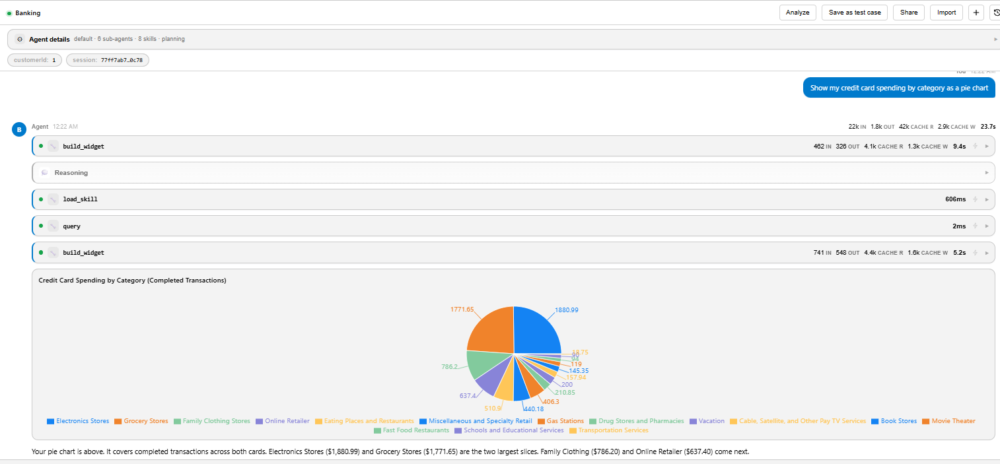

# Tools

Tools are the actions an agent's LLM can take: reading the customer's data, running a business operation, asking the user a question, or calling another agent. The LLM decides which tool to call and with which arguments; the runtime executes it and returns the result to the LLM.

AI Fusion provides three kinds of tools:

- **Built-in tools** that you enable by name.
- **Broadway flow tools** — any flow in your project can be a tool.
- **MCP tools** — the tools of an MCP server, through an MCP interface.

In addition, platform tools such as `task`, `ask_user` and `load_skill` are added automatically according to the agent's configuration.


## Built-in Tools You Enable

<table>
<tbody>
<tr>
<td width="180pxl"><strong>Tool</strong></td>
<td width="120pxl"><strong>Default</strong></td>
<td><strong>Description</strong></td>
</tr>
<tr>
<td><code>query</code></td>
<td>On</td>
<td>Runs a SQL query (SQLite dialect) against the entity micro-database loaded for the turn — typically the customer instance loaded by the <code>step_start</code> hook. Arguments: <code>sql</code> and optional <code>params</code>. Returns CSV, up to 1,000 rows. Pair it with <a href="/articles/AI_fusion/02_agents/04_skills.md">schema skills</a> so the model knows the tables.</td>
</tr>
<tr>
<td><code>current_datetime</code></td>
<td>On</td>
<td>Returns the date and time of the current turn (UTC, ISO-8601). Lets the agent answer relative-date questions ("last month") consistently.</td>
</tr>
<tr>
<td><code>fabric</code></td>
<td>Off</td>
<td>Runs a Fabric command and returns the result as CSV. This is a privileged tool — enable it only for internal, trusted agents and guard it with a <code>before</code> hook.</td>
</tr>
</tbody>
</table>



When `tools:` is omitted, `query` and `current_datetime` are enabled. When `tools:` is present, a built-in is enabled only if it is listed — `tools: [getTransactions]` turns `query` off.

> The `query` tool does not enforce read-only SQL. Business changes should go through flow tools that validate their inputs, and the agent's instructions should limit `query` to reading.




## Broadway Flow Tools

Any Broadway flow can be exposed as a tool by listing its name under `tools:`. This is how agents perform business operations — update a credit limit, open a case, calculate an offer — with your validated logic.

### How the Tool Is Described to the LLM

The runtime builds the tool's definition from the flow itself:

- The flow's **description** becomes the tool description. Write it for the model: what the tool does, when to use it, and what each input means.
- Each **external input** of the flow becomes a tool parameter. Its schema type becomes the parameter type, its **remark** becomes the parameter description, and **mandatory** inputs become required parameters.
- The flow's **output externals** are returned to the LLM as a JSON object.

For example, the demo flow `updateCreditCardLimit` declares the mandatory externals `card_number` and `credit_limit`, and its description explains that it must be called only after the limit was validated. The LLM sees a tool `updateCreditCardLimit(card_number, credit_limit)` with that description.

### Resolution and Execution

- A flow name is looked up in the agent's Data Product, then in the `aifusion` Data Product. To use a flow from another Data Product, write `LU__<lu>__<flow>`.
- A tool that cannot be resolved is skipped with a warning in the log.
- The flow runs with the LLM's arguments plus the agent inputs (`initParams`) as externals. To read trusted inputs that the LLM cannot override, use the `AgentInitParams` actor inside the flow — see [Hooks and Agent Inputs](/articles/AI_fusion/02_agents/07_hooks_and_inputs.md).
- Injected externals are available to the tool flow itself, not to inner flows it calls; pass them on explicitly.
- If the flow fails, the error is returned to the LLM ("Error executing tool ...") after the configured retries, so the agent can recover or explain.

### Per-Tool Hooks

A flow tool or built-in can have its own `before` and `after` hook flows, for validation, guarding or auditing of that tool only:

```yaml
tools:
  - updateCreditCardLimit:
      before: ValidateLimit      # can BLOCK the call
      after: AuditOperation
```

They use the same contract as the global `pre_tool_call` and `post_tool_call` hooks. Global hooks run first, and a global block wins.

### Streaming from a Flow Tool

From AI Fusion 3.0.9, a flow that the agent runs — a flow tool or a hook flow — can stream to the client. When an `LLMInvoke` actor in the flow has streaming to the chat turned on, or the flow writes an event with the `WriteSseEvent` actor, the output is sent as regular SSE events of the agent's stream and is attributed to the agent that called the flow (a sub-agent, when a sub-agent called it). Streamed flow output is not part of the agent's answer: it is not stored as the turn's answer and does not appear in `done.answer`. See [Invoking Agents](/articles/AI_fusion/02_agents/09_invoking_agents.md#the-event-stream).

A flow called by a `task` sub-agent without a named agent (a copy of the main agent) does not stream; its output is discarded.

`LLMInvoke` streams its reasoning to the chat only when streaming to the chat is on. With streaming off, the reasoning is available only on the actor's `thinking` output.


## MCP Tools

To give an agent the tools of an MCP server:

1. Install the **mcp** extension and define an interface of type **Mcp** that points to the server (host, path, transport, authentication).
2. List the interface under `mcp_interfaces:`.

```yaml
mcp_interfaces:
  - data_product
```

The server's tools are offered to the LLM as `MCP__<interface>__<tool>`. Fabric Data Products can themselves be exposed as MCP servers — see [Data Product MCP](/articles/46_MCP/README.md).


## Tools Added Automatically

<table>
<tbody>
<tr>
<td width="220pxl"><strong>Tool</strong></td>
<td width="240pxl"><strong>Available when</strong></td>
<td><strong>Purpose</strong></td>
</tr>
<tr>
<td><code>task</code></td>
<td>Always</td>
<td>Runs a sub-agent on a sub-task and returns its result to the agent. Without a named agent, it runs a copy of the agent itself on a focused goal. See <a href="/articles/AI_fusion/02_agents/06_subagents_and_delegation.md">Sub-Agents and Delegation</a>.</td>
</tr>
<tr>
<td><code>delegate</code></td>
<td><code>delegate: true</code></td>
<td>Hands the whole turn to a sub-agent, whose reply goes to the user as the answer.</td>
</tr>
<tr>
<td><code>ask_user</code></td>
<td>Always, except in a copy of the agent run by <code>task</code></td>
<td>Pauses the turn to ask the user 1–4 structured questions, each with 2–4 options (single or multi-select). The user's next message resumes the turn. Sub-agents can ask too; the answer goes back to the sub-agent that asked. Not offered to a <code>task</code> run without a named agent (a copy of the main agent). See <a href="/articles/AI_fusion/02_agents/08_sessions_and_context.md#asking-the-user-pause-and-resume">Asking the User</a>.</td>
</tr>
<tr>
<td><code>answer_subagent</code></td>
<td><code>subagent_questions: answer</code> (3.0.10 or later)</td>
<td>Answers a question asked by a <code>task</code> sub-agent, so that the same sub-agent continues within the turn. Returns the sub-agent's result or its next question. See <a href="/articles/AI_fusion/02_agents/06_subagents_and_delegation.md#choosing-who-answers-subagent_questions">Choosing Who Answers</a>.</td>
</tr>
<tr>
<td><code>load_skill</code></td>
<td>The agent has skills</td>
<td>Loads a skill's content into the conversation. See <a href="/articles/AI_fusion/02_agents/04_skills.md">Skills</a>.</td>
</tr>
<tr>
<td><code>search_references</code></td>
<td><code>search_reference</code> enabled</td>
<td>Searches the agent's reference packs and returns a cited answer. See <a href="/articles/AI_fusion/02_agents/05_references_and_planning.md">References and Planning</a>.</td>
</tr>
<tr>
<td><code>enter_plan_mode</code>, <code>todo_write</code>, <code>todo_read</code></td>
<td><code>planning</code> enabled (top-level agent)</td>
<td>Creates a plan from the procedures and tracks its execution as a to-do list shown to the user.</td>
</tr>
<tr>
<td><code>build_widget</code></td>
<td><code>widget: true</code></td>
<td>Renders a chart, table or links in the chat (see below).</td>
</tr>
<tr>
<td><code>mcp_list_tools</code>, <code>mcp_call_tool</code> and <code>MCP__*</code></td>
<td><code>mcp_interfaces</code> set</td>
<td>Discover and call MCP server tools.</td>
</tr>
</tbody>
</table>

Only tools that were offered to the model can be executed; a call to any other tool name is blocked.


## Widgets

With `widget: true`, the agent can call `build_widget` with a goal and, optionally, data. A dedicated widget sub-agent — which can use the agent's flow and MCP tools and the same LLM interface — returns a widget specification, streamed to the client as a `widget` event.

Supported widget types: `table`, `bar`, `stackedbar`, `line`, `area`, `pie`, `link` and `simplelink`. The Studio Preview renders them; your own client receives the specification and can render it with any library.





## Tips for Good Tools

- **Describe tools for the model.** The flow description and input remarks are the model's only documentation. State preconditions ("call only after the customer confirmed").
- **Prefer small, single-purpose tools** with clear inputs over one tool with a mode parameter.
- **Return compact results.** Large results consume tokens on every following iteration; return only the fields the agent needs.
- **Validate inside the tool.** Never rely on the prompt alone to enforce a business limit — check it in the flow or in a `before` hook.
- **Do not let the model choose identity.** Take customer identifiers from agent inputs, not from LLM arguments.


**Next article:** [Skills](/articles/AI_fusion/02_agents/04_skills.md)
