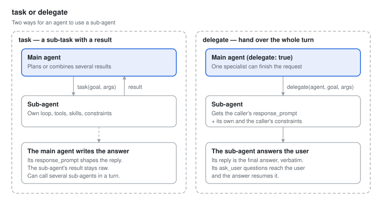
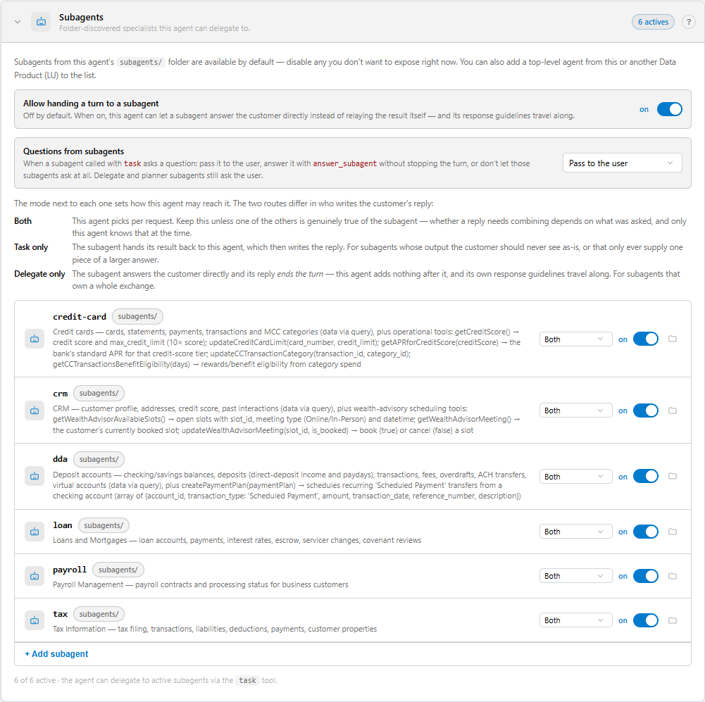
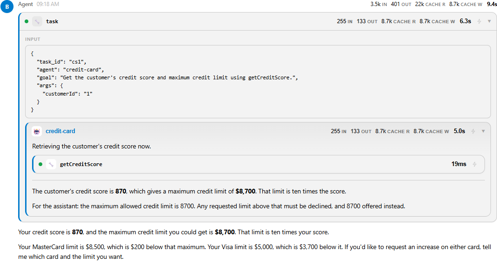
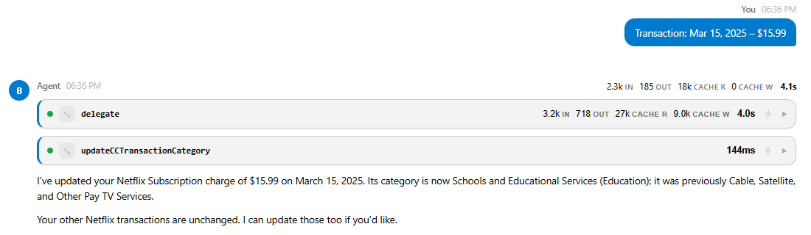

# Sub-Agents and Delegation

A single agent with dozens of tools and schemas becomes slow, expensive and error-prone. AI Fusion 3 lets you split the work: a main agent owns the conversation, and **sub-agents** specialize in a domain — credit cards, loans, payroll — each with only the tools, skills and rules of that domain.

The main agent reaches a sub-agent in one of two ways:

- **`task`** — the sub-agent works on a sub-task and returns its result to the main agent, which continues and writes the answer.
- **`delegate`** — the main agent hands the whole turn to the sub-agent, whose reply goes to the user as the final answer.




## Defining Sub-Agents

### Folder Sub-Agents

Create a YAML file under the agent's `Subagents/` folder (in Studio: **New Sub-Agent...**). It uses the same schema as `agent.yaml`:

```text
AI/Agents/banking/
├── agent.yaml
└── Subagents/
    ├── credit-card.yaml
    ├── dda.yaml
    └── loan.yaml
```

```yaml
# Subagents/credit-card.yaml
description: "Credit cards — cards, statements, payments, transactions; tools: getCreditScore, updateCreditCardLimit, getAPRforCreditScore"

system_prompt: |
  # Credit Card Specialist
  You handle credit card questions and operations for one customer ...

constraints: |
  Never set a credit limit above the maximum the customer's credit score allows.

hooks:
  step_start: LoadCustomerScope

tools:
  - query
  - getCreditScore
  - updateCreditCardLimit
  - getAPRforCreditScore

skills:
  - credit-card-schema:
      auto_load: true
```

Folder sub-agents are discovered and enabled automatically. They inherit the parent's `settings` key by key (a value in the sub-agent wins). Planning is not available to sub-agents.

### Linked Agents from Other Data Products

A top-level agent of another Data Product can be used as a sub-agent by linking it:

```yaml
sub_agents:
  - name: support
    lu: customer_crm            # a top-level agent in another LU
```

A linked agent runs with its own definition and settings (it does not inherit the caller's settings).

### Adjusting Sub-Agents

Use `sub_agents:` to change the discovered set:

```yaml
sub_agents:
  - name: payroll
    enabled: false              # mute a folder sub-agent
  - name: credit-card
    invoke: delegate            # accept only whole-turn handoffs
  - name: dda
    invoke: task                # accept only sub-tasks
```

`invoke` is `both` (default), `task` or `delegate`. Calling a sub-agent by a route it does not accept fails with a message that names the allowed route. Broken references — a missing file or an unknown Data Product — fail the run, and Studio reports them in the **Problems** panel.




## How the Main Agent Sees Its Sub-Agents

The runtime adds an `## Available Sub-Agents` section to the main agent's prompt, listing each enabled sub-agent with its `description`, its required inputs (taken from its hook flows), and a `[task only]` or `[delegate only]` marker when relevant. Write sub-agent descriptions as routing hints: what the specialist covers and which operations it can perform.


## task: Sub-Tasks

```text
task(task_id, goal, agent?, lu?, args?)
```

- `goal` describes what the sub-agent must achieve; `args` passes values such as `customerId`.
- The sub-agent runs its own reasoning loop, with its own tools, skills and hooks, and returns its answer to the main agent as a tool result.
- Without `agent`, `task` runs a copy of the main agent itself on a focused goal — useful for parallelizable or isolated sub-problems.
- `task` is the right route when the main agent needs the result to continue: comparing data from several domains, or executing the steps of a plan.
- Sub-agents can call their own sub-agents, up to a nesting depth of 3.
- A named sub-agent can ask the user a question (`ask_user`). By default the turn pauses, and the user's answer goes back to that sub-agent — see [When a Sub-Agent Asks the User](#when-a-sub-agent-asks-the-user). The calling agent can instead answer the question itself, or not let its sub-agents ask — see [Choosing Who Answers](#choosing-who-answers-subagent_questions).
- A copy of the main agent (`task` without `agent`) cannot ask the user: it is not offered `ask_user`, because nothing of its run is kept for an answer to resume.




## delegate: Whole-Turn Handoff

```yaml
delegate: true
```

```text
delegate(agent, goal, lu?, args?)
```

- The sub-agent's reply is sent to the user verbatim as the final answer; the main agent does not write anything after it. This avoids a specialist's answer being restated a second time.
- If the sub-agent asks the user a question (`ask_user`), the question is shown to the user, and the next message resumes the same sub-agent — see [When a Sub-Agent Asks the User](#when-a-sub-agent-asks-the-user).
- If the delegation fails, the error is returned to the main agent, which can recover.
- `delegate` is off by default and is offered only when `delegate: true` is set and at least one enabled sub-agent accepts the delegate route.

Use `delegate` for a single, self-contained request that one specialist can complete end-to-end ("raise my card limit to 8,000"). Use `task` when the main agent must combine results or follow a plan.




## When a Sub-Agent Asks the User

From AI Fusion 3.0.9, any named sub-agent — on the `task` or the `delegate` route, at any nesting depth — and the planner can ask the user a question. This section describes the default behavior; for `task` sub-agents you can change it with `subagent_questions` (below). The answer goes back to the sub-agent that asked, which continues with its own history instead of starting again.

<table>
<tbody>
<tr>
<td width="60pxl"><strong>Step</strong></td>
<td><strong>What happens</strong></td>
</tr>
<tr>
<td>1</td>
<td>The main agent calls a sub-agent with <code>task</code> or <code>delegate</code>. The sub-agent (or a sub-agent it called) calls <code>ask_user</code>.</td>
</tr>
<tr>
<td>2</td>
<td>The whole turn pauses on that question. The client receives the <code>ask_user</code> event, followed by the normal end of the turn, and the session waits for user input.</td>
</tr>
<tr>
<td>3</td>
<td>The user's next message is the answer. Each agent in the chain, from the main agent down, runs its <code>step_start</code> hook again, so per-request setup such as loading the customer's instance runs on the answer turn too. On this turn the hook's <code>query</code> is the user's answer, and anything the hook returns is ignored. A failing hook fails the turn.</td>
</tr>
<tr>
<td>4</td>
<td>Each calling agent runs again the <code>task</code> or <code>delegate</code> call it paused on. That call's <code>pre_tool_call</code> hooks run again, and the client sees the call start again in the new stream.</td>
</tr>
<tr>
<td>5</td>
<td>The sub-agent that asked receives the answer as the result of its <code>ask_user</code> call and continues from where it stopped, with the same execution ID and its own history.</td>
</tr>
<tr>
<td>6</td>
<td>On the <code>task</code> route, the sub-agent's result returns to its caller, which continues. On the <code>delegate</code> route, the sub-agent's reply is the turn's answer.</td>
</tr>
</tbody>
</table>

Requirements and fallbacks:

- `observability` must be on (the default) for every agent in the chain, because the sub-agent's history is read back from the session.
- If the sub-agent's history cannot be read back, the answer goes to the main agent's pending call instead, marked as not coming from the sub-agent. On the `task` route, the related to-do is marked failed.
- If the repeated call cannot reach the sub-agent — a hook blocks it, or the sub-agent was renamed or disabled — the calling agent receives the answer together with the call's result.

### Choosing Who Answers: subagent_questions

From AI Fusion 3.0.10, the top-level `subagent_questions` key of an agent decides what happens when a sub-agent it calls with `task` asks a question:

```yaml
subagent_questions: answer      # propagate (default) | answer | none
```

<table>
<tbody>
<tr>
<td width="140pxl"><strong>Value</strong></td>
<td width="180pxl"><strong>In the Agent Editor</strong></td>
<td><strong>What happens</strong></td>
</tr>
<tr>
<td><code>propagate</code> (default)</td>
<td>Pass to the user</td>
<td>The question goes up to the user and pauses the turn, as described above.</td>
</tr>
<tr>
<td><code>answer</code></td>
<td>Answer them myself</td>
<td>The question comes back to the calling agent as the <code>task</code> result, with the sub-agent's ID. The agent answers with the <code>answer_subagent</code> tool, and the same sub-agent continues with its own history — all within the same turn. The tool returns the sub-agent's result, or its next question.</td>
</tr>
<tr>
<td><code>none</code></td>
<td>Don't let them ask</td>
<td>The agent's <code>task</code> sub-agents are not offered <code>ask_user</code>, and neither are their own <code>task</code> sub-agents, unless an agent in between is set to <code>answer</code>. A sub-agent that is missing information says so in its result.</td>
</tr>
</tbody>
</table>

Use `answer` or `none` for an agent that has nobody to ask, such as an agent called through the REST API or from a flow. With the default, such a caller gets a question instead of a result.

Rules and limits:

- A sub-agent can be answered at most 3 times in a turn. A sub-agent that is still asking after that is stopped.
- A sub-agent that is still waiting when the calling agent finishes its turn — including when the calling agent asks its own user with `ask_user` — is stopped, and its to-do is marked failed. On the next turn the agent has to call a new sub-agent.
- The setting applies only to the `task` route. Sub-agents reached with `delegate`, and the planner, always ask the user. A copy of the agent run by `task` without a named agent never asks.
- Each agent decides only for its direct sub-agents. In a chain, a question goes up to the first agent set to `answer`.
- The agent's own `ask_user` is independent: turning it off does not stop its sub-agents from asking.
- `subagent_questions` is a top-level key, so it is not inherited by folder sub-agents. A sub-agent that calls sub-agents of its own sets it in its own file.


## Response Guidelines and Constraints Across Agents

Two keys control what reaches the user, and they travel differently between agents:

<table>
<tbody>
<tr>
<td width="180pxl"><strong>Key</strong></td>
<td width="240pxl"><strong>Purpose</strong></td>
<td><strong>Behavior across agents</strong></td>
</tr>
<tr>
<td><code>response_prompt</code></td>
<td>House style of the reply (tone, length, format).</td>
<td>Belongs to the turn. On <code>delegate</code>, the turn owner's response guidelines replace the sub-agent's own; along a chain of delegations, the original owner's guidelines are forwarded. A <code>task</code> sub-agent does not receive them, because its result is an intermediate value that the main agent restates.</td>
</tr>
<tr>
<td><code>constraints</code></td>
<td>Non-negotiable rules (what must never be said or done).</td>
<td>Additive. On <code>delegate</code>, the caller's constraints are added to the sub-agent's own, so a handoff can narrow what may be said but never widen it. A <code>task</code> sub-agent applies only its own constraints, because the main agent restates its result. The built-in planner and widget sub-agents inherit the chain.</td>
</tr>
</tbody>
</table>

Put style in `response_prompt` and hard rules in `constraints`. A rule written in the style section is dropped as soon as the turn is delegated.


## Passing Inputs to Sub-Agents

Sub-agents usually need the same entity as the main agent. Their required inputs come from their hook flows (for example `LoadCustomerScope` declares `customerId`). The runtime fills them from:

1. The `args` passed in the `task` or `delegate` call.
2. The main agent's inputs (`initParams`), which are forwarded automatically.

Values passed by the LLM in `args` can override forwarded inputs. When a flow must rely on a value the LLM cannot change, read it with the `AgentInitParams` actor — see [Hooks and Agent Inputs](/articles/AI_fusion/02_agents/07_hooks_and_inputs.md).


## Design Tips

- **Split by business domain**, matching your schema skills — one specialist per domain.
- **Keep the main agent as the conversation owner.** It answers simple read-only questions itself and routes operations.
- **Tell specialists who reads their output.** A `task` result is read by the main agent; ask specialists to return facts and the IDs needed for the next step. Although a `task` sub-agent can ask the user, it is usually better for it to report a missing input (for example as a result that starts with `MISSING:`) and let the main agent, which owns the conversation, ask.
- **Mute what you don't need** with `enabled: false` rather than deleting files while experimenting.
- **Trace it.** The Studio Trace shows each sub-agent execution nested under the tool call that started it.


**Next article:** [Hooks and Agent Inputs](/articles/AI_fusion/02_agents/07_hooks_and_inputs.md)
