# Preview and Trace

The **Preview** tab of the [Agent Editor](/articles/AI_fusion/03_studio/02_agent_editor.md) is a chat panel for trying an agent while you build it. Messages run against the **deployed** agent through the Fabric agent API, and replies stream in over SSE, so what you see is exactly what a client application would get. Next to the chat, the **Trace** drawer shows every LLM call, tool call and sub-agent run behind each answer.

Use Preview to:

- Check how the agent answers real questions for a real entity.
- Understand *why* it answered that way, from the trace.
- Mark good and bad answers, and hand bad ones to Studio AI for analysis.
- Turn a good conversation into an evaluation test case.

Preview is available for top-level agents only. Opening an agent's `agent.yaml` lands on the **Preview** tab; sub-agents are tested through their parent.

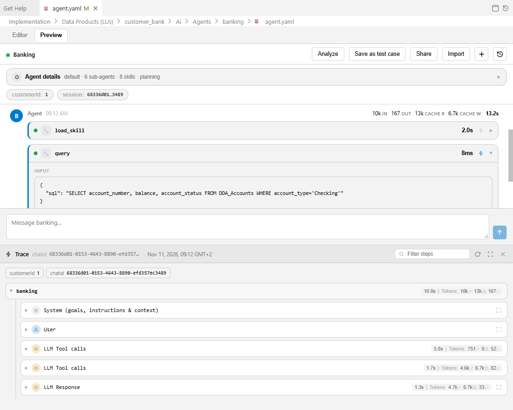

## Before You Start

- **Deploy the LU.** Preview talks to the deployed agent. After editing `agent.yaml`, a skill or a flow, soft-deploy the agent's LU, then start a new chat. If the agent cannot be found on the server, the header shows a **Data Product name** field where you can enter the LU, and the empty chat area shows an error with a **Retry** button if the Fabric API cannot be reached.
- **Keep observability on.** The trace is read from the data that the agent persists when `settings.observability` is `true` (the default). With observability off, the drawer has nothing to show.

## The Preview Toolbar

<table>
<tbody>
<tr>
<td><strong>Control</strong></td>
<td><strong>What it does</strong></td>
</tr>
<tr>
<td><strong>Analyze</strong></td>
<td>Asks Studio AI to analyze the whole conversation and suggest fixes. Shown only when Studio AI's Ask AI service is available. See <a href="/articles/AI_fusion/03_studio/04_ai_assisted_development.md">AI-Assisted Agent Development</a>.</td>
</tr>
<tr>
<td><strong>Save as test case</strong></td>
<td>Saves the current conversation as an evaluation test case. See <a href="#saving-a-conversation-as-a-test-case">Saving a Conversation as a Test Case</a>.</td>
</tr>
<tr>
<td><strong>Share</strong></td>
<td>Downloads the conversation as a zip file that another developer can import.</td>
</tr>
<tr>
<td><strong>Import</strong></td>
<td>Loads a shared conversation zip as a new chat.</td>
</tr>
<tr>
<td><strong>+</strong> (<strong>New chat</strong>)</td>
<td>Opens the <strong>New chat</strong> dialog.</td>
</tr>
<tr>
<td><strong>Show chat history</strong> / <strong>Hide chat history</strong> (icon)</td>
<td>Lists this agent's persisted sessions on the server, each with its chat name (<em>Untitled chat</em> when it has none), its time and <em>Persisted session (click to restore)</em>. Search with <strong>Search chats…</strong> and click a session to restore it. A very long session whose early steps were summarized may restore only partially.</td>
</tr>
</tbody>
</table>

**Analyze**, **Save as test case** and **Share** are disabled while the chat is empty. Studio has no command to rename or delete a chat.

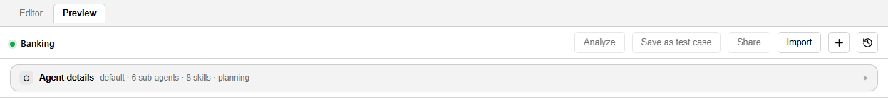

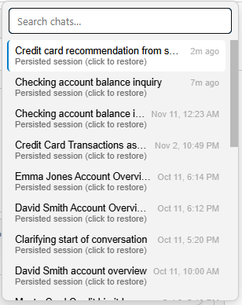

Below the toolbar, the **Agent details** panel summarizes the deployed agent (model, tools, sub-agents, skills, planning, memory). Expand it to see the **Description**, **Model**, **Tools**, **MCP**, **Sub-agents**, **Skills**, **Planning**, **Memory**, **Thinking** and **Inputs** (required inputs are marked with `*`). Chips next to it show the chat's input values (for example **customerId**) and its **session** ID; click a chip to copy its value (the chip shows *Copied*).

## Starting a Chat

Click the **New chat** icon. The **New chat** dialog shows the agent's description and asks for:

- **Agent inputs** — the inputs the agent declares, such as `customerId`. Inputs come from the external parameters of the agent's hook flows; required ones are marked `*` and must be filled. For an `array` input, enter comma-separated values. See [Hooks and Inputs](/articles/AI_fusion/02_agents/07_hooks_and_inputs.md).
- **Extra parameters (optional)** — additional name/value pairs to pass to the session. They are merged into the session's `initParams`.

Click **Start chat** (or **Cancel**). The cursor moves to the message box (*Message &lt;agent&gt;…*); type a message and press **Enter** (**Shift+Enter** adds a new line). While the agent is answering, the send button becomes **Stop answering**; the part of the reply already generated is kept and the turn is marked *Stopped*.

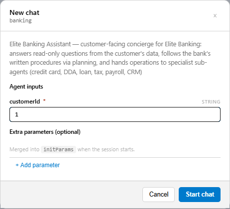

Only one chat streams at a time. Starting a new chat, or sending in another chat, stops the reply that is still streaming. You can type your next message while a reply streams; sending is enabled once it finishes.

The editor keeps your chats for each agent file, so you can switch between **Editor** and **Preview** without losing the conversation. Reopening the agent starts on an empty Preview; use **Show chat history** to return to an earlier session.

## Reading an Answer

Your messages are labeled **You** and the agent's answers **Agent**, with their time. The header of an answer shows its duration and token chips — **IN**, **OUT**, **CACHE R** (cache read) and **CACHE W** (cache write). An answer is built from blocks that appear as they stream in:

<table>
<tbody>
<tr>
<td><strong>Block</strong></td>
<td><strong>Description</strong></td>
</tr>
<tr>
<td><strong>Reasoning</strong></td>
<td>The model's extended thinking, when <code>settings.thinking</code> is not <code>off</code>. It is expanded while streaming and collapses when done.</td>
</tr>
<tr>
<td>Tool card</td>
<td>One card per tool call: a status dot, the tool name, its own duration and token counts, and a lightning icon (<strong>Show in Trace</strong>). Expand it to see the <strong>Input</strong> arguments and any nested output. A card with nested content, such as a <code>task</code> or <code>delegate</code> call, opens automatically.</td>
</tr>
<tr>
<td>Sub-agent card</td>
<td>A sub-agent run, with the sub-agent's own blocks nested inside. It opens expanded and can be collapsed.</td>
</tr>
<tr>
<td>Widgets</td>
<td>Charts, tables and links the agent builds when widgets are enabled.</td>
</tr>
<tr>
<td><strong>To-dos</strong></td>
<td>The agent's plan or task list, titled <em>To-dos (x/y done)</em>. While a turn is running, the current list is also docked above the message box so it stays in view; collapsed, it shows the current item, the counter and a progress bar, and a click expands it.</td>
</tr>
<tr>
<td>Questions</td>
<td>When the agent — or one of its sub-agents — calls <code>ask_user</code>, the chat shows each question with its header and options (plus <strong>Other</strong> — <em>Type your own answer</em>). Choose and click <strong>Submit</strong> to continue the turn; one <strong>Submit</strong> answers all the questions. If the wording of a sub-agent's question cannot be recovered (for example after a reload), the chat shows <em>Please provide input:</em> with a free-text box.</td>
</tr>
</tbody>
</table>

The answer text itself is rendered as Markdown. A stopped answer ends with *Stopped.*

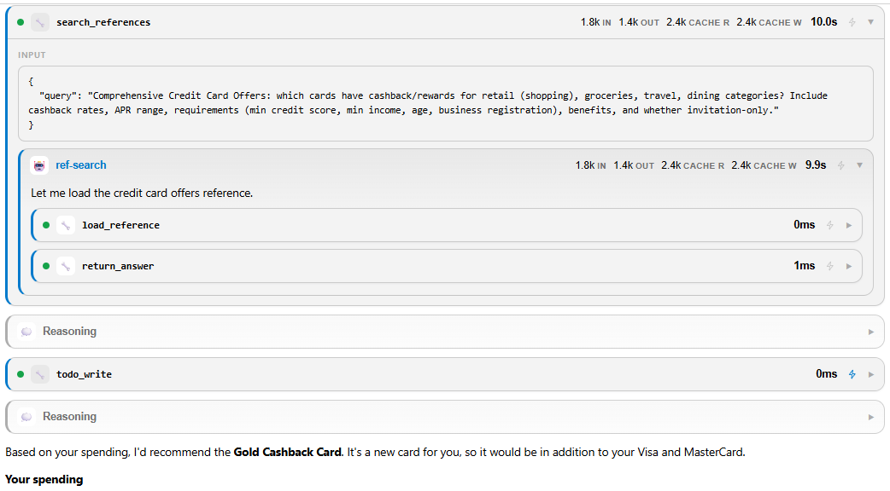

### Message Actions

Hover over a message to see its actions:

- **Copy** — copies the message text.
- **Edit** (your messages) — puts the prompt back into the message box so you can change it and send it as a new message. The earlier turns are not rewound.
- **Regenerate** (the latest agent answer, including a stopped one) — sends the question that produced the answer again, as a new turn.
- **Good response** / **Bad response** (thumbs up / thumbs down) — records feedback for that answer.
- **Note** — opens a note popup (*Add a note…*). Type what is wrong or right with the answer and click **Save**, **Cancel**, or **Remove** an existing note. When Studio AI is available, the popup also has **Analyze**, which hands this answer and your note (saved or not) to Studio AI for diagnosis. The Note icon's tooltip shows the saved note.

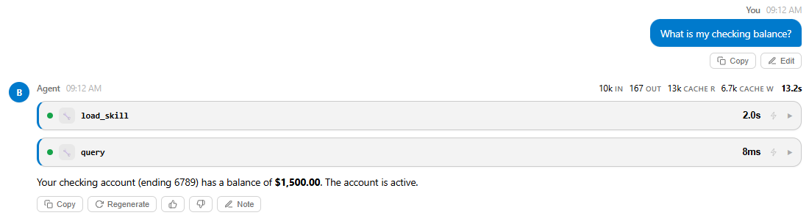

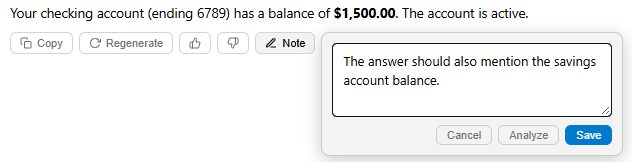

Feedback and notes are stored with the session through the same feedback service your own front end can use, so they show up in conversation review. See [Feedback](/articles/AI_fusion/05_observation/06_feedback.md) and [Conversation Review](/articles/AI_fusion/05_observation/02_conversation_review.md).

## The Trace Drawer

The **Trace** drawer sits at the bottom of the Preview. Collapsed, it is a single bar showing the number of spans, the total duration, the total tokens and the run status of the current chat. Click the bar to open it at half height.

<table>
<tbody>
<tr>
<td><strong>Control</strong></td>
<td><strong>What it does</strong></td>
</tr>
<tr>
<td><strong>Filter steps</strong></td>
<td>Shows only the spans that match the text you type.</td>
</tr>
<tr>
<td><strong>Refresh</strong></td>
<td>Reloads the trace from the server.</td>
</tr>
<tr>
<td><strong>Expand to full view</strong> / <strong>Collapse to half view</strong></td>
<td>Toggles the drawer height.</td>
</tr>
<tr>
<td><strong>Close</strong></td>
<td>Collapses the drawer back to its bar.</td>
</tr>
</tbody>
</table>

The header reads **Trace**, followed by the chat ID (`chatid`) and the date; chips below it repeat the chat's input values. While the trace loads, the drawer shows *Loading trace…*.

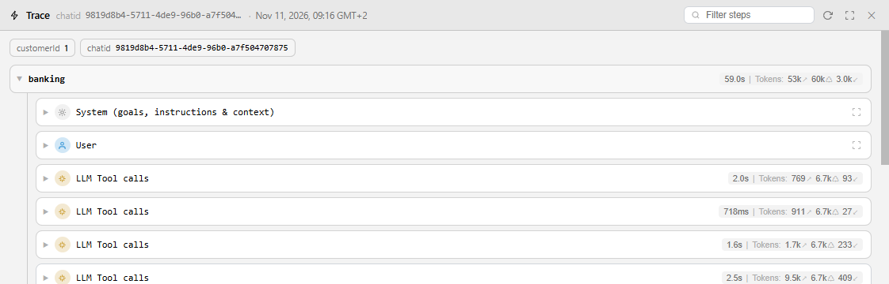

### The Trace Tree

The trace is a tree, with a **Step N** separator above each conversation turn. Under each step:

- **Execution** nodes are agent runs — the agent itself and each sub-agent it called.
- **System (goals, instructions & context)** is the prompt sent to the model.
- **User** is the user message.
- **Tool Response** is a tool result sent back to the model.
- **LLM Response** is a model answer; an answer that requested tools is shown as **LLM Tool calls**, with one **Tool — &lt;name&gt;** node per call nested under it. Each tool node has an **Input** (the arguments) and an **Output** (the result).

Each node shows its duration and token usage after **Tokens:** — the input (↗), cached (↺) and output token counts. Click **Open full content** on a node to read the full message in a dialog. When a `step_start` hook returns additional context, it appears in the **System (goals, instructions & context)** node of that turn, under *Additional Context*.

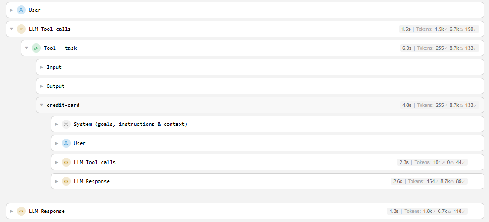

### Jumping from the Chat to the Trace

Tool cards and sub-agent cards in the chat have a **Show in Trace** button (the lightning icon). Click it to open the drawer, expand the path to that call, scroll to it and highlight it. This is the fastest way to answer "what did this tool actually return?"

If the drawer says *No trace recorded for this chat yet*, check that the agent has `observability: true` and that the turn has finished; then click **Refresh**.

For trace data outside Studio, see [Invoking Agents](/articles/AI_fusion/02_agents/09_invoking_agents.md) and [Observation](/articles/AI_fusion/05_observation/README.md).

## Saving a Conversation as a Test Case

When a conversation shows the behavior you want to protect, click **Save as test case**. The dialog asks for:

<table>
<tbody>
<tr>
<td><strong>Field</strong></td>
<td><strong>Description</strong></td>
</tr>
<tr>
<td><strong>Test case name</strong> (required)</td>
<td>The case ID. It must be unique within the suite.</td>
</tr>
<tr>
<td><strong>Suite</strong> (required)</td>
<td>Select one of the agent's eval suites or type a new name (<em>Select or type a suite name</em>); for a new name the dialog notes <em>No matching suite — a new one will be created.</em> and the suite file is created under the agent's <code>Evals/</code> folder. The name cannot contain <code>/</code>, <code>\</code> or <code>..</code>.</td>
</tr>
<tr>
<td><strong>Description</strong></td>
<td>Optional free text.</td>
</tr>
<tr>
<td><strong>Save with Snap</strong></td>
<td>Also saves a snapshot of the entity's data, so the case replays against a fixed data baseline.</td>
</tr>
</tbody>
</table>

Click **Save** (or **Dismiss**). The case is written with the conversation transcript (the agent's final replies only, without intermediate narration), the chat's input values, and the dimensions and thresholds from the agent's evaluation defaults (**Evaluation defaults** setting). The case is set to be evaluated at the **conversation level** and has no criteria yet — open it and add the conversation criteria (or let **Ask AI** propose them) before you run it. A notification confirms the save; click **Go to test case** to select the case in the AI Explorer and open it in the Eval Editor.

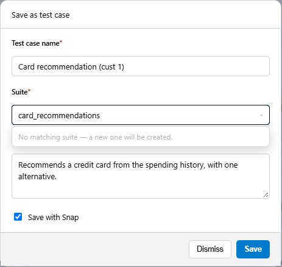

For what happens next — adding conversation criteria, editing the expected answers, choosing quality dimensions and running the evaluation — see [Evaluation](/articles/AI_fusion/04_evaluation/README.md), [Authoring Test Cases](/articles/AI_fusion/04_evaluation/01_authoring_test_cases.md) and [Snapshots and Production Import](/articles/AI_fusion/04_evaluation/04_snapshots_and_production_import.md).

## Sharing and Importing Conversations

**Share** opens the **Share conversation** dialog. Select **Save with Snap** to include the entity's data snapshot, then click **Share** (or **Dismiss**); the conversation downloads as a zip file. A colleague can load it with **Import**: the conversation opens as a new chat named *Imported chat*, under a new session ID, so they can continue it or save it as a test case.

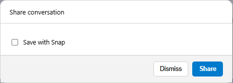

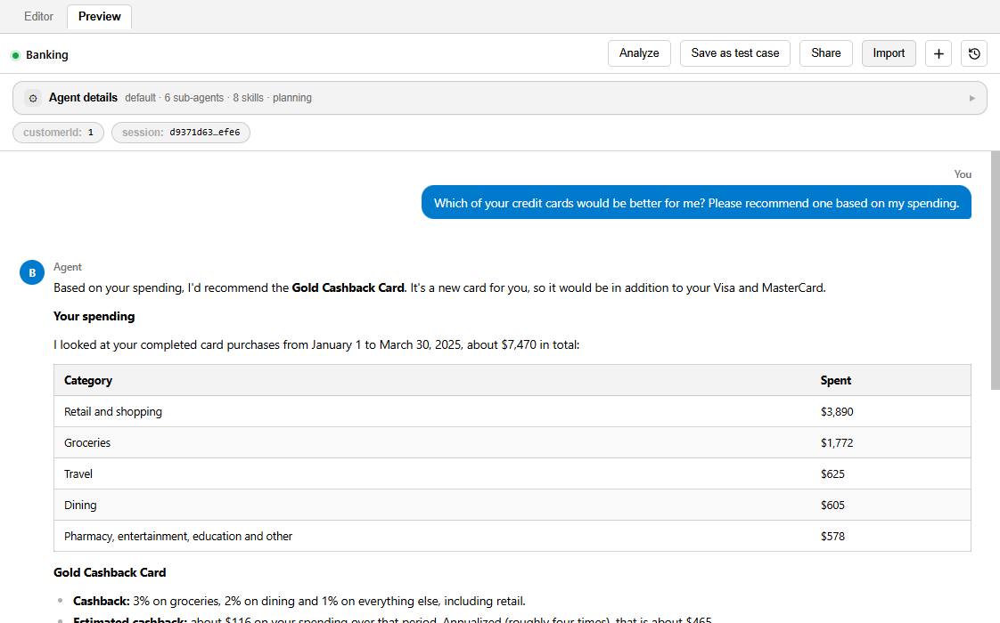

**Next article:** [AI-Assisted Agent Development](/articles/AI_fusion/03_studio/04_ai_assisted_development.md)
