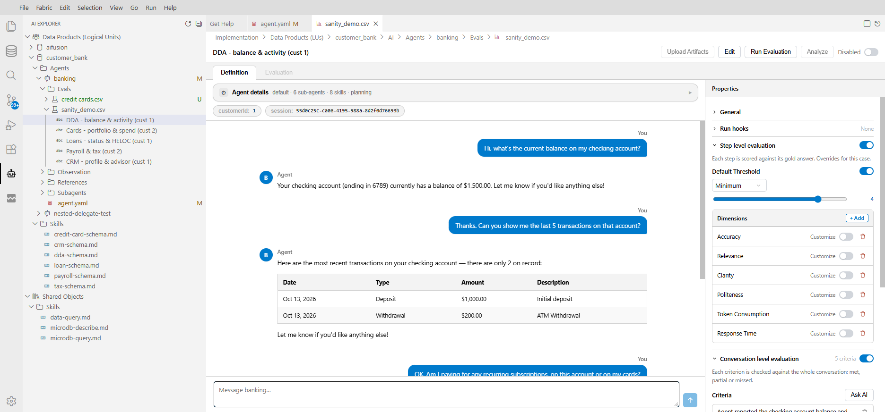

# Introduction to Evaluation

AI Fusion Evaluation lets you test an agent the way a customer uses it: you replay realistic conversations against the agent, and an LLM judge checks the result — answer by answer against the answers you expect, over the whole conversation against criteria you write, or both. The results are checked against pass/fail rules, and optional Broadway flows can run before and after each test to prepare data, verify what the agent did and clean up. Run the same tests after every prompt, model, tool or data change and you know immediately whether quality went up or down.

> **Note:** The examples and screenshots in this section use the banking demo (`customer_bank` › `banking`). See [About the Examples](/articles/AI_fusion/01_overview.md#about-the-examples-in-this-documentation).

In AI Fusion 3, evaluation is part of AI Fusion Studio — there is no separate evaluation application. Everything happens in Studio, next to the agent you are building:

- **Define** — create suites and test cases in the AI Explorer (**New Eval Suite...**, **New Test...**), from a Preview chat (**Save as test case**), or with Studio AI.
- **Edit** — set the conversation, expected answers, criteria, dimensions, thresholds and run hooks in the Eval Editor.
- **Run** — click **Run Evaluation** on a case, a suite or in the Eval Editor.
- **See the results** — status bullets in the AI Explorer, and scores, verdicts and hook results in the Eval Editor's **Evaluation** tab, with **Analyze** to diagnose a failure.

The suites are files in the agent's folder inside the Data Product (LU), so they are versioned and deployed with the agent.

## Why Agents Need a Different Kind of Testing

Traditional tests assume that the same input always produces the same output. Agents do not work that way:

- **Answers are generated, not retrieved.** The same question can be answered in different words on every run.
- **Models and prompts change.** A new model version or a small prompt edit can change behavior across many questions.
- **Agents take several steps.** A single answer can involve planning, several tool calls, SQL queries and sub-agents.
- **Answers depend on data.** The same question about the same customer can have a different correct answer next month.

Two common approaches fail here:

- **Manual review does not scale.** Reviewers see only a few conversations, their judgments vary, and findings are hard to track over time.
- **Exact-match assertions are too brittle.** "Your balance is $1,234.56" and "You currently have $1,234.56 in your checking account" are both correct, but a string comparison treats them as different.

AI Fusion Evaluation addresses this by judging **meaning and quality**, not wording, by judging whole conversations against **goals** as well as single answers, and by pinning the **data** each test runs on.

## How Evaluation Works

1. **Author test cases.** A test case is a conversation with the agent: the user's questions, the agent inputs (for example, the customer ID) and what makes the conversation correct — the answers you expect for each turn (the ground truth, used at step level), the criteria the whole conversation must meet (used at conversation level), or both. A case can also list Broadway flows to run before and after it. You create cases by chatting with the agent in Studio, by saving a Preview conversation, by importing a production conversation, or by asking Studio AI to generate them.
2. **Capture the data.** When a case is saved, AI Fusion records the agent session as a baseline and, optionally, a snapshot of the business data the agent read. Every later run replays the conversation on that same data.
3. **Run.** The case's before hooks run first (if any). Then the run replays each user turn of the case through the current version of the agent.
4. **Judge.** At **step level**, an LLM judge compares each new answer with the expected answer and scores it on every quality dimension (for example, Accuracy and Clarity), with a one-sentence explanation per score; token consumption and response time are compared with the baseline session. At **conversation level**, an LLM judge reads the whole conversation and marks each criterion **met**, **partial** or **missed**, citing the turns it relied on.
5. **Decide pass/fail.** The case's after hooks run (always), and the verdict is computed. A case passes only when every enabled level passes — every step threshold is met and every conversation criterion is met — and no hook failed. If a before hook fails, the conversation is not run and the case is **not evaluated**.
6. **Review and improve.** You read the per-answer scores and explanations, fix the agent (or the test), and run again.

## Key Concepts

<table>
<tbody>
<tr>
<td><strong>Concept</strong></td>
<td><strong>Definition</strong></td>
</tr>
<tr>
<td><strong>Test case</strong></td>
<td>One conversation scenario: one or more user turns, the agent inputs, the expected answer for each turn and/or the conversation criteria, the step-level dimensions and thresholds, and optional run hooks.</td>
</tr>
<tr>
<td><strong>Eval suite</strong></td>
<td>A named collection of test cases for one agent, stored as a CSV file in the agent's <code>Evals</code> folder. You can run a single case, a whole suite, or all of an agent's suites.</td>
</tr>
<tr>
<td><strong>Expected answer (ground truth)</strong></td>
<td>The answer the agent should give for a turn. At step level, the judge rates the new answer against it, together with the question. It is not used at conversation level.</td>
</tr>
<tr>
<td><strong>Evaluation level</strong></td>
<td>How a case is judged: <strong>step level</strong> (each answer against its expected answer), <strong>conversation level</strong> (the whole conversation against criteria), or both. Each level has its own toggle in the Eval Editor.</td>
</tr>
<tr>
<td><strong>Conversation criterion</strong></td>
<td>A plain sentence that a successful conversation must satisfy, for example "The agent gave the balance of every account the customer holds". The judge marks it met, partial or missed.</td>
</tr>
<tr>
<td><strong>Run hook</strong></td>
<td>A Broadway flow that runs before the conversation is replayed (a before hook) or after the evaluation (an after hook), for example to prepare data, check what the agent actually did, or clean up.</td>
</tr>
<tr>
<td><strong>Verdict</strong></td>
<td>The final result of a run: <code>passed</code>, <code>failed</code>, or <code>not evaluated</code> (a before hook failed, so the conversation was not run).</td>
</tr>
<tr>
<td><strong>Initialization parameters</strong></td>
<td>The agent inputs the conversation starts with, such as <code>customerId</code>. They are replayed on every run.</td>
</tr>
<tr>
<td><strong>Dimension</strong></td>
<td>A step-level criterion a case is measured on. Quality dimensions (Accuracy, Relevance, Clarity, Politeness or your own) are scored by the judge for every answer; performance dimensions (Token Consumption, Response Time) are measured against the baseline.</td>
</tr>
<tr>
<td><strong>Threshold</strong></td>
<td>The limit a dimension must meet, for example Accuracy minimum 4, or Token Consumption no more than 20% above the baseline.</td>
</tr>
<tr>
<td><strong>Judge (evaluator)</strong></td>
<td>The LLM that scores each answer and explains the score (step level), or marks each conversation criterion and explains the verdict (conversation level).</td>
</tr>
<tr>
<td><strong>Baseline session</strong></td>
<td>The agent session the case was saved from. It is the reference for the performance dimensions.</td>
</tr>
<tr>
<td><strong>Snapshot (Save with Snap)</strong></td>
<td>A captured copy of the business data (LU instances) the agent read when the case was recorded, so every replay runs on the same data.</td>
</tr>
</tbody>
</table>

## Where Evaluation Lives

<table>
<tbody>
<tr>
<td><strong>Component</strong></td>
<td><strong>Role</strong></td>
</tr>
<tr>
<td>Eval suite files</td>
<td><code>&lt;LU&gt;/AI/Agents/&lt;agent&gt;/Evals/&lt;suite&gt;.csv</code> — one row per test case, deployed with the LU.</td>
</tr>
<tr>
<td>AI Fusion Studio</td>
<td>The <strong>AI Explorer</strong> tree lists suites and cases with their last run status; the <strong>Eval Editor</strong> is where you author cases, run them and read results. See <a href="/articles/AI_fusion/03_studio/01_studio_overview.md">AI Fusion Studio Overview</a>.</td>
</tr>
<tr>
<td>Pipeline extension</td>
<td>The engine behind <strong>Run Evaluation</strong> (the <code>aifusion.AgentEvaluator</code> pipeline). You do not open it; it only needs to be installed and deployed. See <a href="/articles/AI_fusion/04_installation_and_setup.md">Installation and Setup</a>.</td>
</tr>
<tr>
<td>Evaluation web services</td>
<td>Optional: start runs and read results from CI/CD or any job, without opening Studio.</td>
</tr>
<tr>
<td>Insights DB</td>
<td>Stores the evaluation conversations, the per-answer ratings, the conversation-level verdicts and the hook results.</td>
</tr>
<tr>
<td>Evaluation storage</td>
<td>Stores the data snapshots that test cases replay on.</td>
</tr>
</tbody>
</table>

## If You Used Evaluation in AI Fusion 2.x

Evaluation was redesigned in AI Fusion 3. The main differences:

- **Per-agent suites.** Suites are CSV files in each agent's `Evals` folder, not MTables. A case stores the agent's initialization parameters instead of a customer ID and application.
- **Studio instead of the web workspace.** Cases are authored, run and reviewed in AI Fusion Studio. There is no separate evaluation web application in AI Fusion 3.
- **New pipeline.** Runs are executed by the `aifusion.AgentEvaluator` pipeline and started from Studio or the evaluation web service. The 2.x `aifusion.evaluatorPipeline` is not used.
- **AI-assisted generation through Studio AI.** Test generation is done by the Agent Builder in Studio AI, which captures real agent answers. The 2.x Copilot/Autopilot modes and the synthetic-data (SDG) integration are not part of AI Fusion 3.
- **Performance dimensions.** Token consumption and response time are now checked against the case's baseline session.

The 2.x articles remain available in the [legacy documentation](/articles/AI_fusion/legacy_v1_v2/03_evaluation/README.md).

**Next article:** [Authoring Test Cases](/articles/AI_fusion/04_evaluation/01_authoring_test_cases.md)
