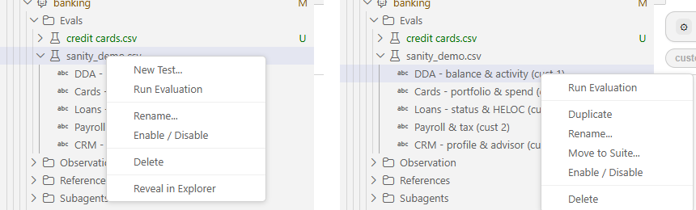
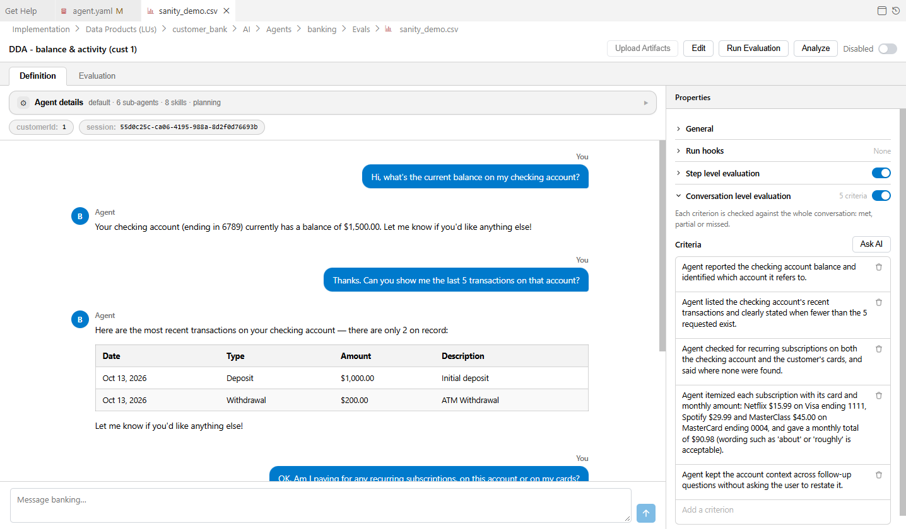
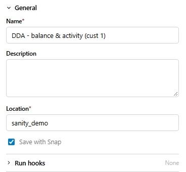
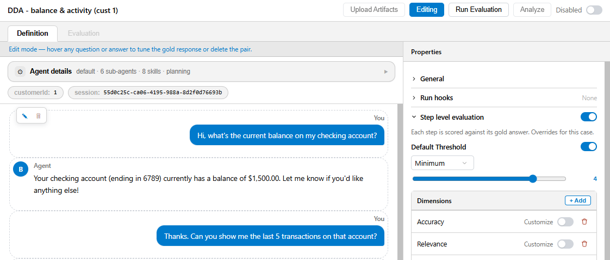
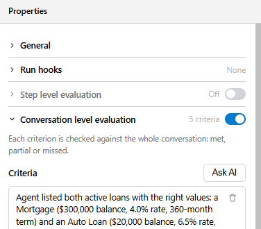
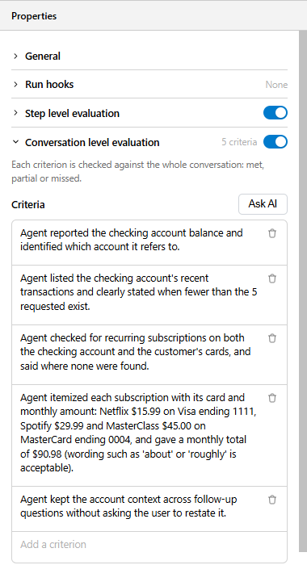
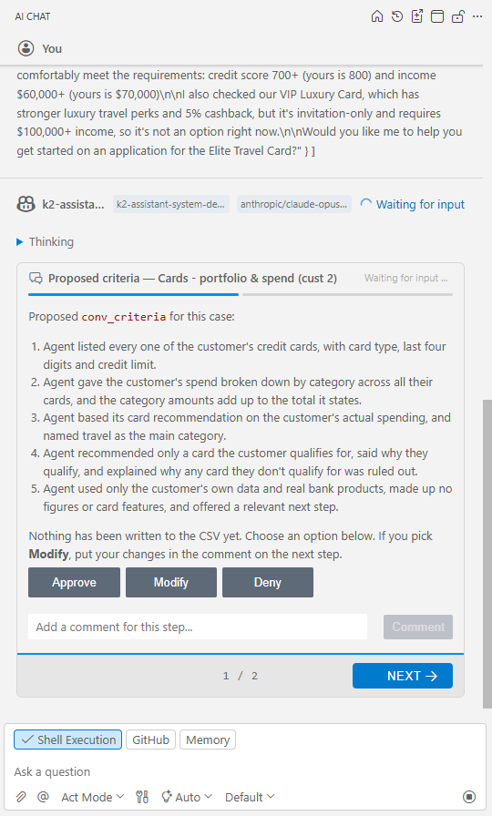
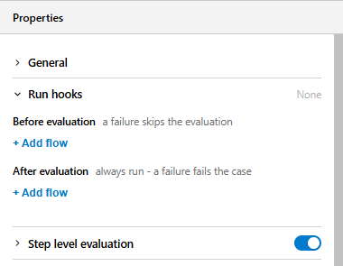

# Authoring Test Cases

A test case is a recorded conversation with your agent that you want to keep answering correctly. Every AI Fusion test case starts from a **real run of the agent**: you hold the conversation (or let Studio AI hold it), check the answers, adjust any answer that is not what you expect, and save it. This article describes where test cases are stored, the four ways to create them in AI Fusion Studio, how to choose the evaluation levels of a case, and how to attach run hooks to it.


## Suites and Test Cases

Test cases are grouped into **eval suites**. Each suite belongs to one agent and is a CSV file in the agent's `Evals` folder:

```text
<LU>/AI/Agents/<agent>/Evals/<suite>.csv
```

Each row of the file is one test case. You normally never edit these files by hand — the Eval Editor and the AI Explorer commands maintain them for you — but knowing the columns helps when you review changes in source control.

<table>
<tbody>
<tr>
<td><strong>Column</strong></td>
<td><strong>Content</strong></td>
</tr>
<tr>
<td><code>id</code></td>
<td>A stable internal row ID.</td>
</tr>
<tr>
<td><code>sessionid</code></td>
<td>The baseline session the case was saved from. Its snapshots and its token/time figures are what the case replays on and is compared with.</td>
</tr>
<tr>
<td><code>caseId</code></td>
<td>The test case name, unique within the suite.</td>
</tr>
<tr>
<td><code>initParams</code></td>
<td>JSON object of the agent inputs the conversation starts with, for example <code>{"customerId":"1"}</code>. From AI Fusion 3.0.9, keys may contain any character except quotes (<code>'</code>, <code>"</code>, <code>`</code>), backslash, <code>?</code> and control characters; earlier versions accepted only letters, digits and underscores.</td>
</tr>
<tr>
<td><code>description</code></td>
<td>Free-text description of what the case checks.</td>
</tr>
<tr>
<td><code>disabled</code></td>
<td><code>1</code> when the case is excluded from runs.</td>
</tr>
<tr>
<td><code>threshold</code></td>
<td>JSON array of thresholds, for example <code>[{"defaultThreshold":{"MIN":"4.0"}},{"Tokens":{"MAX":"20"}}]</code>. See <a href="/articles/AI_fusion/04_evaluation/02_quality_criteria.md">Quality Criteria and Thresholds</a>.</td>
</tr>
<tr>
<td><code>dimension</code></td>
<td>JSON map of dimension name to the description the judge receives.</td>
</tr>
<tr>
<td><code>transcript</code></td>
<td>JSON array of <code>{"role","content"}</code> messages. <code>user</code> messages are the questions that are replayed; <code>assistant</code> messages are the expected answers.</td>
</tr>
<tr>
<td><code>transcript_edited</code></td>
<td><code>1</code> while the transcript has changes that were not yet uploaded with <strong>Upload Artifacts</strong>.</td>
</tr>
<tr>
<td><code>saved_with_snap</code></td>
<td><code>1</code> when a snapshot of the business data was captured with the case. Set once, when the case is first saved.</td>
</tr>
<tr>
<td><code>eval_mode</code></td>
<td>The evaluation levels of the case: <code>step</code>, <code>conversation</code> or <code>both</code>. An empty cell (suites written before AI Fusion 3.0.9) means <code>step</code>. Studio always writes the value explicitly, so older files gain <code>step</code> cells the next time Studio saves them.</td>
</tr>
<tr>
<td><code>conv_criteria</code></td>
<td>JSON array of the conversation-level criteria, one plain sentence each, for example <code>["The agent gave the checking balance","The agent offered further help"]</code>. Empty when the case has no criteria.</td>
</tr>
<tr>
<td><code>before_hooks</code></td>
<td>JSON array of the Broadway flows to run before the conversation is replayed, in run order, for example <code>["PrepareCustomer"]</code>. Empty when there are none.</td>
</tr>
<tr>
<td><code>after_hooks</code></td>
<td>JSON array of the Broadway flows to run after the evaluation, in run order. Empty when there are none.</td>
</tr>
</tbody>
</table>

The last four columns require AI Fusion 3.0.9 and AI Fusion Studio 1.0.2. Older suite files, without these columns, still open and run as step-level cases without hooks.

A case can be **single-turn** (one question, one answer) or **multi-turn**. In a multi-turn case, every `user` message is replayed in order within the same conversation, so the case also tests whether the agent keeps context across turns.

> **Suites are read from the deployed LU.** The evaluation runtime reads the copy of the suites that was deployed with the LU, not the files in your workspace. Studio takes care of this: it soft-deploys the agent's LU after every change it makes to a suite and before every run. If you change a CSV outside Studio (for example, by pulling from Git), deploy the LU before running.


## Managing Suites and Cases in the AI Explorer



In the **AI Explorer**, expand an agent and its **Evals** folder. Each suite is shown as a node, and its test cases are listed under it.

To create a suite, right-click the agent (or its **Evals** folder) and select **New Eval Suite...**. Enter a name; Studio creates the CSV with one test case named "New test" and opens it in the Eval Editor. Like every case created in Studio, it starts at conversation level with no criteria — see [Choosing the Evaluation Levels](#choosing-the-evaluation-levels).

Right-click a **suite** to:

<table>
<tbody>
<tr>
<td><strong>Action</strong></td>
<td><strong>What it does</strong></td>
</tr>
<tr>
<td><strong>New Test...</strong></td>
<td>Adds a test case, seeded with the agent's default dimensions and thresholds and set to conversation level (with no criteria yet), and opens it in the Eval Editor.</td>
</tr>
<tr>
<td><strong>Run Evaluation</strong></td>
<td>Runs every enabled case in the suite.</td>
</tr>
<tr>
<td><strong>Rename...</strong></td>
<td>Renames the suite file. Run history is kept per suite name, so the history of the old name is discarded.</td>
</tr>
<tr>
<td><strong>Enable / Disable</strong></td>
<td>If any case in the suite is disabled, enables all cases; otherwise disables all cases.</td>
</tr>
<tr>
<td><strong>Delete</strong></td>
<td>Deletes the suite file with all its cases, and clears their run history.</td>
</tr>
</tbody>
</table>

Right-click a **test case** to:

<table>
<tbody>
<tr>
<td><strong>Action</strong></td>
<td><strong>What it does</strong></td>
</tr>
<tr>
<td><strong>Run Evaluation</strong></td>
<td>Runs this case in the background. The status bullet in the tree shows progress and the result.</td>
</tr>
<tr>
<td><strong>Duplicate</strong></td>
<td>Copies the case (named "&lt;name&gt; (copy)") and captures a separate session and snapshot for the copy, so the two cases are independent.</td>
</tr>
<tr>
<td><strong>Rename...</strong></td>
<td>Renames the case. The run history of the old name is discarded.</td>
</tr>
<tr>
<td><strong>Move to Suite...</strong></td>
<td>Moves the case to another suite of the same agent. If the target suite already has a case with that name, the moved case is renamed. History does not move with the case.</td>
</tr>
<tr>
<td><strong>Enable / Disable</strong></td>
<td>Excludes the case from runs, or includes it again. Disabled cases are shown with a grayed-out icon.</td>
</tr>
<tr>
<td><strong>Delete</strong></td>
<td>Deletes the case and clears its run history.</td>
</tr>
</tbody>
</table>


## Method 1: Record a Case in the Eval Editor

Use this method when you want to design a specific scenario from scratch.



1. In the AI Explorer, right-click a suite and select **New Test...**. Enter a name.
2. The Eval Editor opens on the new case and shows the **New chat** dialog. Fill in the **Agent inputs** (for example, the customer ID) and, if needed, **Extra parameters (optional)**, then click **Start chat**. These values are saved as the case's initialization parameters.
3. Chat with the agent in the composer at the bottom of the conversation. The agent runs for real, on live data, exactly as in Preview. Ask the questions a real user would ask, including follow-ups.
   Above the conversation, the **Agent details** bar summarizes the agent the case runs on (for example "default · 6 sub-agents · 8 skills · planning"); click it to expand. Below it, chips show the case's initialization parameters and its baseline **session**.
4. In the **Properties** panel on the right, expand the **General** section (it starts collapsed). Review the **Name**, add a **Description**, and check the **Location** (the suite the case belongs to).



5. In the same section, select **Save with Snap** if the agent reads business data and you want every run to replay on the data as it is now. This choice is only available before the first upload. See [Data Snapshots and Production Import](/articles/AI_fusion/04_evaluation/04_snapshots_and_production_import.md).
6. Choose the evaluation levels and configure them: add criteria under **Conversation level evaluation** and, if you also want each answer scored against its expected answer, turn on **Step level evaluation** and adjust its dimensions and thresholds or keep the defaults. See [Choosing the Evaluation Levels](#choosing-the-evaluation-levels) and [Quality Criteria and Thresholds](/articles/AI_fusion/04_evaluation/02_quality_criteria.md).
7. Optionally, add flows under **Run hooks**. See [Run Hooks](#run-hooks).
8. Click **Upload Artifacts**. This stores the conversation's session as the case's baseline and, with **Save with Snap**, captures the data snapshot. **Edit** and **Run Evaluation** become available only after the first upload.

The suite file is edited like any other document in Studio: save it with **Ctrl+S**. Studio asks you to save or discard unsaved changes when you switch to another case.


## Method 2: Save a Preview Conversation as a Test Case

Use this method when you find an interesting conversation while testing the agent in Preview — a good answer you want to protect, or a bad one you want to fix and keep fixed.

1. In the agent's Preview chat, hold the conversation. See [Preview and Trace](/articles/AI_fusion/03_studio/03_preview_and_trace.md).
2. Click **Save as test case**.
3. In the dialog, enter a **Test case name**, choose an existing **Suite** or type a new suite name (a new suite file is created), and optionally add a **Description**.
4. Select **Save with Snap** to capture the business data the conversation used.
5. Click **Save**. The case is added with the default dimensions and thresholds of the agent, and the agent's answers are stored as the expected answers.

The new case starts at **conversation level only, with no criteria**. Until you add criteria, its conversation level fails with the note "No conversation criteria defined for this case. Add at least one criterion." Open the case from the AI Explorer, add criteria (or click **Ask AI**), and turn on **Step level evaluation** if you also want the stored answers used as expected answers. See [Choosing the Evaluation Levels](#choosing-the-evaluation-levels).


## Method 3: Import a Production Conversation

Conversations that real users had — especially those with negative feedback or unexpected behavior — make the most valuable test cases. You export them from Observation and import them into Studio Preview, then save them as test cases. See [Data Snapshots and Production Import](/articles/AI_fusion/04_evaluation/04_snapshots_and_production_import.md).


## Method 4: Generate Test Cases with Studio AI

The Agent Builder in Studio AI can build a suite for you from a list of business questions. Unlike the AI-assisted generation of AI Fusion 2.x, it does not invent answers: it runs **every question through the agent** and saves the agent's real answer as the expected answer.

- It asks you for the business questions (or proposes them from the agent's domains) and for the customer IDs (or other instance IDs) to use. It never invents IDs.
- It groups cases into one suite per business domain and gives each case a unique name.
- It can build **multi-turn** cases. Studio AI plays the customer, decides each follow-up from the agent's actual answer, and stops when the goal is met or a turn limit is reached (10 user/agent pairs by default). You can ask for a specific persona (for example, an impatient customer) to set the tone of the questions.
- Every generated case is saved with a snapshot and with the agent's default dimensions and thresholds, at **step level**: the captured answers are the expected answers. You can add conversation criteria to a generated case afterwards. If the agent asks a clarifying question, Studio AI answers it and continues the conversation rather than saving the question as an answer.

For an entity-scoped agent, the agent needs a working `step_start` hook that loads the entity with the `GetWithSnap` actor; otherwise the agent has no customer data and the snapshots are empty. The Agent Builder checks this and offers to fix the hook first.

See [AI-Assisted Development](/articles/AI_fusion/03_studio/04_ai_assisted_development.md) for how to start the Agent Builder.

Review generated cases like any other: an answer captured from the agent is a baseline, not automatically a correct answer.


## Editing Expected Answers

At step level, the assistant answers in a case's transcript are what the judge compares new answers with. They are not used at conversation level. When a recorded answer is wrong or incomplete, correct it so the case describes what the agent *should* say.



1. Open the case in the Eval Editor (the case must already be uploaded).
2. Click **Edit**. The button changes to **Editing** and an edit banner appears.
3. Hover any question or answer:
   - Click the pencil icon to change its text, then **Save**.
   - Click the trash icon to delete the question/answer pair.
4. Click **Upload Artifacts** to store the edited case. Studio gives the edited case a new session ID with its own copy of the snapshots.
5. Save the suite.

Editing the user questions changes what is replayed; editing the assistant answers changes what is expected. Write expected answers that describe the required content, not exact wording — see [Evaluation Best Practices](/articles/AI_fusion/04_evaluation/05_best_practices.md).


## Choosing the Evaluation Levels

A case can be judged on two levels. Each level has its own section in the **Properties** panel, with an on/off toggle in the section header:

<table>
<tbody>
<tr>
<td><strong>Section</strong></td>
<td><strong>What it judges</strong></td>
<td><strong>What you configure</strong></td>
</tr>
<tr>
<td><strong>Step level evaluation</strong></td>
<td>Each answer, against the expected answer of its turn ("Each step is scored against its gold answer").</td>
<td><strong>Default Threshold</strong>, <strong>Dimensions</strong> and their thresholds, including Token Consumption and Response Time. See <a href="/articles/AI_fusion/04_evaluation/02_quality_criteria.md">Quality Criteria and Thresholds</a>.</td>
</tr>
<tr>
<td><strong>Conversation level evaluation</strong></td>
<td>The whole conversation, against criteria ("Each criterion is checked against the whole conversation: met, partial or missed").</td>
<td>The <strong>Criteria</strong> list. See <a href="/articles/AI_fusion/04_evaluation/02_quality_criteria.md#conversation-criteria">Conversation Criteria</a>.</td>
</tr>
</tbody>
</table>

Turn on one level or both. At least one level must stay on: if you try to switch off the only level that is on, Studio shows "At least one evaluation level must stay on. Turn the other level on first to switch this one off." A section that is off is faded and shows **Off** as its summary. When the conversation level is on, its summary shows the number of criteria, for example **3 criteria**.



Which level a case starts with depends on how it was created:

<table>
<tbody>
<tr>
<td><strong>Created with</strong></td>
<td><strong>Starts at</strong></td>
</tr>
<tr>
<td><strong>New Eval Suite...</strong>, <strong>New Test...</strong>, or <strong>Save as test case</strong> in Preview (including imported conversations)</td>
<td>Conversation level only, with no criteria.</td>
</tr>
<tr>
<td>Studio AI test generation</td>
<td>Step level only.</td>
</tr>
<tr>
<td>A suite written before AI Fusion 3.0.9 (empty <code>eval_mode</code>)</td>
<td>Step level only.</td>
</tr>
</tbody>
</table>

There are no default criteria. While the conversation level is on and the case has no criteria, the criteria list shows the error "Add at least one criterion to evaluate at conversation level." The case can still be saved and run, but its conversation level fails.

Use both levels when you can. The conversation level checks that the conversation reached its goal, whatever path the agent took; the step level checks each answer in detail, and it is the only level that checks token consumption and response time.

### Adding Criteria



1. Expand **Conversation level evaluation** and make sure its toggle is on.
2. Type a criterion in the **Add a criterion** row and press **Enter** (or click outside the row). Each criterion is one plain sentence; long text wraps.
3. To change a criterion, edit its text in place. To remove one, click its trash icon.
4. Save the suite.

To get suggestions, click **Ask AI** (shown when Studio AI is available). Studio AI reads the case's transcript and proposes three to five criteria. It does not change the case until you answer: approve the list to add it to the case's criteria (existing criteria are kept), ask for changes, or decline.



For how the criteria are judged and how to write good ones, see [Conversation Criteria](/articles/AI_fusion/04_evaluation/02_quality_criteria.md#conversation-criteria).


## Run Hooks

Run hooks are Broadway flows that run around a test case: **before** the conversation is replayed and **after** it is evaluated. Use them to:

- **Prepare data** — for example, reset an order to a known state before the agent is asked about it.
- **Verify actions** — for example, after a conversation in which the agent should have opened a ticket, check that the ticket exists. An answer can sound right while the action never happened; an after hook catches that.
- **Clean up** — undo what the conversation or a before hook changed, so the next run starts clean.

Run hooks require AI Fusion 3.0.9 and AI Fusion Studio 1.0.2. After upgrading AI Fusion, redeploy the `aifusion` Data Product so that hook results can be stored.

### Adding Hooks



1. In the **Properties** panel, expand **Run hooks**. Its summary shows **None**, or the number of hooks, for example **2 before · 1 after**.
2. Under **Before evaluation** or **After evaluation**, click **+ Add flow**.
3. Click the flow picker of the new row (it shows **None**) and choose a flow. Type in **Search Broadway flows…** to filter. The list contains the flows of the agent's Data Product and the shared flows; table population flows are not listed.
4. Add more flows as needed. Hooks run in the order shown; drag a row by its grip to reorder. Click the open-flow icon to open the flow in the Broadway editor, or the trash icon to remove the row. Rows left at **None** are dropped when the suite is saved.
5. Save the suite.

### How Hooks Run

<table>
<tbody>
<tr>
<td><strong>Phase</strong></td>
<td><strong>When it runs</strong></td>
<td><strong>If a hook fails</strong></td>
</tr>
<tr>
<td><strong>Before evaluation</strong></td>
<td>Before the first user turn is replayed.</td>
<td>The remaining before hooks are skipped, the conversation is not replayed or judged, and the case's verdict is <code>not evaluated</code>.</td>
</tr>
<tr>
<td><strong>After evaluation</strong></td>
<td>After the evaluation — <strong>always</strong>, including when a before hook failed or the evaluation itself ended in an error.</td>
<td>The other after hooks still run, so cleanup always happens. The case fails, even if every score and criterion passed.</td>
</tr>
</tbody>
</table>

A hook **fails** when its flow throws an error — for example, an assert actor whose check does not hold, or a flow that cannot be found. The error text becomes the hook's message. A hook **passes** when its flow completes. A hook does not have to return anything: if the flow has outputs, they are recorded as the hook's output and shown in the results, but they do not affect the verdict. Each hook is reported as **passed**, **failed** or **skipped**.

Every hook flow receives these inputs (flow externals):

<table>
<tbody>
<tr>
<td><strong>Input</strong></td>
<td><strong>Content</strong></td>
</tr>
<tr>
<td><code>sessionid</code></td>
<td>The session ID of this evaluation run — the session shown on the Evaluation tab, not the case's baseline session.</td>
</tr>
<tr>
<td><code>caseId</code></td>
<td>The test case name.</td>
</tr>
<tr>
<td><code>agentName</code></td>
<td>The agent under test.</td>
</tr>
<tr>
<td><code>luName</code></td>
<td>The agent's Data Product (LU).</td>
</tr>
<tr>
<td><code>initParams</code></td>
<td>The case's initialization parameters, as an object.</td>
</tr>
<tr>
<td>Each initialization parameter</td>
<td>Every key of <code>initParams</code> is also passed as an input of its own, for example <code>customerId</code>. The <code>AgentInitParams</code> actor works inside a hook flow, as it does in an agent hook.</td>
</tr>
</tbody>
</table>

A hook flow name is resolved the same way as an agent hook: first in the agent's Data Product, then in the `aifusion` Data Product. To pin a flow to a specific Data Product, write it as `LU__<lu>__<flow>` in the `before_hooks` / `after_hooks` cell of the suite CSV; the flow picker lists plain names only.

See [Run Hooks in the Results](/articles/AI_fusion/04_evaluation/03_running_and_results.md#run-hooks-in-the-results) for how hook outcomes are shown.


## Disabling a Case

Toggle **Disabled** in the Eval Editor top bar (or use **Enable / Disable** in the AI Explorer) to keep a case in the suite without running it, for example while a known issue is being fixed. Disabled cases are skipped by suite runs, and **Run Evaluation** is not available for them.


## Advanced: Pinning the Current Date

Agents that answer relative-date questions ("my bill from last month") get today's date from the `current_datetime` tool. When a case replays a snapshot captured months ago, today's date no longer matches the data. To pin the date for a case, add a `now` key to the case's `initParams`, for example `{"customerId":"1","now":"2025-06-01T00:00:00Z"}` (a date-only value means midnight UTC).

`now` is honored only in evaluation runs. The interactive agent endpoints reject it, so you cannot enter it in the **New chat** dialog; add it to the `initParams` cell of the suite CSV and deploy the LU.

**Next article:** [Quality Criteria and Thresholds](/articles/AI_fusion/04_evaluation/02_quality_criteria.md)
