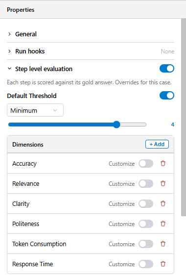
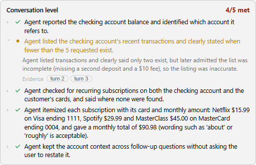

# Quality Criteria and Thresholds

A test case is judged on one or both evaluation levels (see [Choosing the Evaluation Levels](/articles/AI_fusion/04_evaluation/01_authoring_test_cases.md#choosing-the-evaluation-levels)):

- At **step level**, the case is measured on a set of **dimensions**, and every dimension has one or more **thresholds**. The step level passes only when all of its thresholds are met.
- At **conversation level**, the case is measured against a list of **criteria**. The conversation level passes only when every criterion is met.

A case passes when every level it uses passes and none of its run hooks failed. This article explains the two kinds of dimensions, how thresholds are evaluated, where the defaults come from, how the LLM judge scores answers, and how conversation criteria are judged.

## Two Kinds of Dimensions

<table>
<tbody>
<tr>
<td><strong>Kind</strong></td>
<td><strong>Measured by</strong></td>
<td><strong>Value</strong></td>
<td><strong>Threshold directions</strong></td>
</tr>
<tr>
<td>Quality</td>
<td>The LLM judge, per answer</td>
<td>A score out of 5</td>
<td><strong>Minimum</strong> (MIN) or <strong>Average</strong> (AVERAGE) — the score must be at least the threshold</td>
</tr>
<tr>
<td>Performance</td>
<td>Comparison with the case's baseline session</td>
<td>Percent deviation from the baseline</td>
<td><strong>Maximum</strong> (MAX) or <strong>Average</strong> (AVERAGE) — the deviation must not exceed the threshold</td>
</tr>
</tbody>
</table>

## Quality Dimensions

AI Fusion provides four built-in quality dimensions. You can use any of them, remove them, or add your own.

* **Accuracy** — is the information correct and complete compared with the expected answer? Inaccurate answers damage trust and can lead to wrong payments, missed deadlines or wrong decisions.

  Example: "What's my checking account balance?"

<table>
<tbody>
<tr>
<td></td>
<td><strong>Response</strong></td>
<td><strong>Score</strong></td>
</tr>
<tr>
<td><strong>High</strong></td>
<td>"Your checking account (ending in 1234) has a balance of $1,234.56 as of today."</td>
<td>5</td>
</tr>
<tr>
<td><strong>Low</strong></td>
<td>"Your checking account has about $1,200." (wrong amount, no details)</td>
<td>2</td>
</tr>
</tbody>
</table>

* **Relevance** — does the response address the user's question and intent?

<table>
<tbody>
<tr>
<td></td>
<td><strong>Response</strong></td>
<td><strong>Score</strong></td>
</tr>
<tr>
<td><strong>High</strong></td>
<td>"Your checking account (ending in 1234) has a balance of $1,234.56 as of today."</td>
<td>5</td>
</tr>
<tr>
<td><strong>Low</strong></td>
<td>"We offer many types of accounts including checking, savings, and CDs..."</td>
<td>1</td>
</tr>
</tbody>
</table>

* **Clarity** — is the response easy to understand and well organized? A list of balances with one account per line scores higher than the same numbers run together in one long sentence.

* **Politeness** — is the tone respectful, courteous and professional? This usually matters more for customer-facing agents than for agents used by internal staff.

<table>
<tbody>
<tr>
<td></td>
<td><strong>Response</strong></td>
<td><strong>Score</strong></td>
</tr>
<tr>
<td><strong>High</strong></td>
<td>"I'd be happy to help! Your checking account currently has $1,234.56. Is there anything else I can assist you with?"</td>
<td>5</td>
</tr>
<tr>
<td><strong>Low</strong></td>
<td>"Your balance is $1234.56. Next question."</td>
<td>1</td>
</tr>
</tbody>
</table>

### Custom Quality Dimensions

Add your own dimensions for what matters in your business, for example:

- **Compliance** — does the answer include the required regulatory disclosures?
- **Data protection** — does the agent avoid exposing full account numbers or other sensitive data?
- **Problem resolution** — does the agent actually solve the customer's issue?
- **Empathy** — does the agent acknowledge the customer's frustration?

A custom dimension is defined by its name and a **description for the evaluator** — the text the judge reads to understand what to rate. Write the description as a precise rating instruction; the judge is only as consistent as the description is clear.

## Performance Dimensions

Performance dimensions catch regressions in cost and speed, which quality scores do not show. Both compare the new run with the **baseline session** the case was saved from. They belong to the step level: a case that is evaluated at conversation level only has no token or response-time checks.

<table>
<tbody>
<tr>
<td><strong>Dimension</strong></td>
<td><strong>Name in the suite file</strong></td>
<td><strong>What is compared</strong></td>
</tr>
<tr>
<td><strong>Token Consumption</strong></td>
<td><code>Tokens</code></td>
<td>Tokens used by the agent's LLM calls.</td>
</tr>
<tr>
<td><strong>Response Time</strong></td>
<td><code>ConversationTime</code></td>
<td>Time the agent took to answer.</td>
</tr>
</tbody>
</table>

Each is reported as a percent deviation from the baseline (positive means more tokens or slower than the baseline):

- **MAX** — the worst single answer: the highest per-turn deviation in the conversation. Use it to catch one turn that suddenly became expensive or slow.
- **AVERAGE** — the whole conversation: total of the run compared with total of the baseline.

A threshold of 20 means "fail if the deviation is more than +20%", for both MAX and AVERAGE. When there is no baseline data to compare with, the deviation is reported as 0 and the check passes.

> **Note:** Before AI Fusion 3.0.9, an AVERAGE threshold on a performance dimension was checked in the wrong direction (as a minimum). If you use AVERAGE for Token Consumption or Response Time, upgrade to 3.0.9 or later.

## Thresholds

### MIN and AVERAGE for Quality Dimensions

- **Minimum** — the lowest score of any answer in the conversation must be at least the threshold. Use it for non-negotiable criteria such as accuracy, compliance or data protection.

  > Accuracy, Minimum 4 — every answer must score at least 4.

- **Average** — the mean score across all answers must be at least the threshold. Use it for stylistic criteria where some variation is acceptable, such as clarity or politeness.

  > Clarity, Average 4 — one answer can score 3 if another scores 5.

A dimension can have both a Minimum and an Average threshold.

### Default Threshold

The **Default Threshold** applies to every quality dimension that does not have its own threshold. With the default set to Minimum 4, every judged dimension must score at least 4 in every answer unless you customize it.

### Configuring a Case

In the Eval Editor, open the **Definition** tab and expand the **Step level evaluation** section of the **Properties** panel (its toggle must be on). It shows:

- **Default Threshold** — toggle it on or off and set its direction and value.
- **Dimensions** — the dimensions the judge rates for this case. Click **+ Add** to add **Accuracy**, **Relevance**, **Clarity**, **Politeness** or a **Custom dimension…**. Click the trash icon to remove one.
- **Customize** — turn it on for a dimension to give it its own threshold. For a quality dimension you can also edit its **Name** and **Description for evaluator**. Use **Add Threshold** to add a second threshold (for example, both Minimum and Average).

Threshold directions are shown as **Minimum**, **Average** and **Maximum**. Quality thresholds are set on a 0–5 slider; performance thresholds on a 0–100% slider. A quality dimension whose **Customize** toggle is off is still rated, and is checked against the Default Threshold. Performance dimensions are always checked against their own thresholds: with **Customize** off they use the default thresholds, and turning **Customize** off again restores those defaults. From AI Fusion Studio 1.0.2, a customized performance dimension keeps its **Customize** toggle on after the suite is saved and reopened.

## Default Dimensions and Thresholds

New test cases are seeded from a named set of defaults, stored in the `evaluationDefaults` MTable of the AI Fusion project. Each row has a `name`, a `threshold` JSON array, a `dimension` JSON map of quality dimensions, and a `performanceDimension` JSON map of performance dimensions. The default row, `evalDefaults`, contains:

<table>
<tbody>
<tr>
<td><strong>Setting</strong></td>
<td><strong>Default</strong></td>
</tr>
<tr>
<td>Default Threshold</td>
<td>Minimum 4.0</td>
</tr>
<tr>
<td>Quality dimensions</td>
<td>Accuracy, Relevance, Clarity, Politeness</td>
</tr>
<tr>
<td>Token Consumption (<code>Tokens</code>)</td>
<td>MAX 20%</td>
</tr>
<tr>
<td>Response Time (<code>ConversationTime</code>)</td>
<td>MAX 15%</td>
</tr>
</tbody>
</table>

To use different defaults for an agent, add a row to `evaluationDefaults` and set the agent's `settings.eval_defaults_name` in `agent.yaml` to the row's name (see [agent.yaml Reference](/articles/AI_fusion/02_agents/02_agent_yaml_reference.md)). The defaults are applied when a case is created; changing them later does not change existing cases. The defaults contain no conversation criteria: every case starts with an empty criteria list. Studio reads the defaults from the `defaults` evaluation web service (`GET /api/defaults`).

## How the Step-Level Judge Scores Answers

For each answer, the judge receives the user's question, the expected answer, the agent's new answer, and the name and description of every quality dimension. It returns a score out of 5 and a short explanation for each dimension. Answers are rated in batches of three turns per judge call.

The judge follows these rules:

1. **Rate against both the question and the expected answer**, so that an answer is judged on whether it addresses the user's intent, not only on its similarity to the expected text.
2. **Keep the criteria separate.** An issue that affects accuracy (for example, missing data) should not also lower relevance or clarity.
3. **Penalize an issue once**, on the criterion it affects most directly.
4. **Explain each score in one sentence**, with a suggestion for improvement where needed.
5. **The expected action is authoritative.** If the expected answer refuses to share certain data, an answer that shares it is rated inaccurate, even if the data is correct.

The judge uses the project's default LLM interface. See [LLM Connectors](/articles/AI_fusion/02_agents/10_llm_connectors.md).

## Conversation Criteria

At conversation level, a case is judged on **criteria** instead of expected answers. A criterion is one plain sentence that describes something a successful conversation must achieve, for example:

- "The agent gave the balance of every account the customer holds."
- "The agent asked which card the customer meant before blocking it."
- "The agent did not reveal more than the last four digits of any card number."

You add criteria in the **Conversation level evaluation** section of the Eval Editor, or let **Ask AI** propose them. See [Adding Criteria](/articles/AI_fusion/04_evaluation/01_authoring_test_cases.md#adding-criteria).

### How the Conversation Judge Works

After the conversation is replayed, the judge receives the whole replayed conversation — every turn, numbered from 1, with the user message and the agent's answer — and the numbered list of criteria. It judges the conversation as a whole and gives each criterion one verdict:

<table>
<tbody>
<tr>
<td><strong>Verdict</strong></td>
<td><strong>Meaning</strong></td>
</tr>
<tr>
<td><strong>met</strong></td>
<td>Clearly achieved.</td>
</tr>
<tr>
<td><strong>partial</strong></td>
<td>Only partly achieved, or achieved with an error.</td>
</tr>
<tr>
<td><strong>missed</strong></td>
<td>Not achieved, or contradicted.</td>
</tr>
</tbody>
</table>

For each criterion the judge also writes a one-sentence note and cites the turns its verdict is based on (the evidence). The judge follows these rules:

1. **The criteria are the only reference.** There is no expected answer at this level, so differences in wording, order or style that do not affect a criterion are not penalized.
2. **Only what the agent actually said counts.**
3. **A met verdict needs evidence.** A criterion marked met without any cited turn is downgraded to partial, and "(no evidence step cited)" is added to its note.
4. **Nothing is skipped.** A criterion the judge did not return is counted as missed, with the note "Not judged by the evaluator".

**Pass rule:** the conversation level passes only when the case has at least one criterion and **every** criterion is met. A single partial or missed criterion fails it.

If the case has no criteria, the judge is not called and the conversation level fails with the note "No conversation criteria defined for this case. Add at least one criterion." If the judge's reply cannot be read, the conversation level fails with the note "judge reply is missing or not valid JSON".

The conversation judge uses the same LLM interface as the step-level judge, and is called once per run.

### Writing Good Criteria

- **Make each criterion observable.** "States the checking balance ($1,234.56)" can be checked in the transcript; "Gives a good answer" cannot.
- **One requirement per criterion.** A criterion that combines several facts is marked partial when one of them is missing, and the note has to explain which. Split it.
- **Keep criteria independent**, so one problem fails one criterion, not several.
- **Describe the outcome, not the path.** "The customer learns why the bill went up" leaves the agent free to ask a clarifying question first; this is the strength of the conversation level.
- **Include guardrails as criteria**, for example "The agent does not reveal the full account number".
- **Three to five criteria** are usually enough for one user journey.

**Next article:** [Running Evaluations and Reading Results](/articles/AI_fusion/04_evaluation/03_running_and_results.md)
