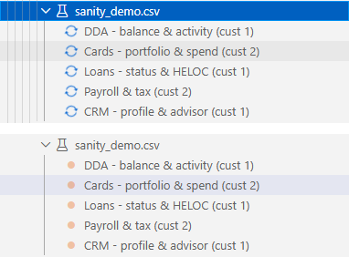
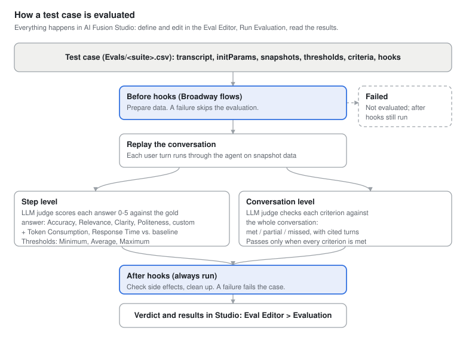
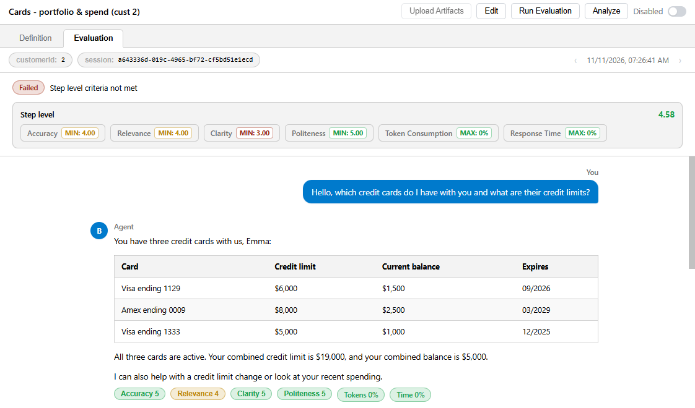
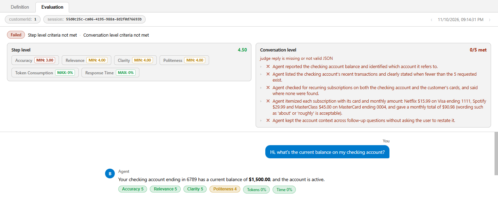
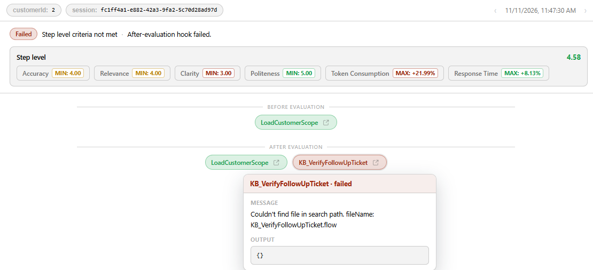
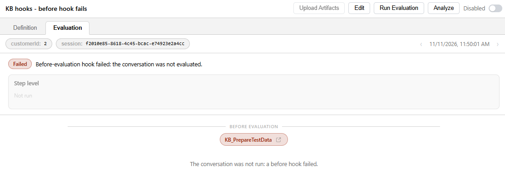

# Running Evaluations and Reading Results

An evaluation run replays test cases through the current version of the agent, has the judge score the new answers and check the conversation against its criteria, runs the case's hooks, and decides the verdict. You run cases and suites from AI Fusion Studio and read the results in the Eval Editor. Optionally, the same runs can be started from automation through the evaluation web service.


## Prerequisites

- The **Pipeline extension** is installed and deployed. It runs the evaluation in the background (the `aifusion.AgentEvaluator` pipeline); you work only in Studio. See [Installation and Setup](/articles/AI_fusion/04_installation_and_setup.md).
- The agent's LU, including its `Evals` folder, is deployed. Studio deploys it automatically before each run; in other environments, deploy the LU as part of your release.
- Each case to run has been uploaded (it has a baseline session) and is enabled.
- For conversation-level evaluation and run hooks: AI Fusion 3.0.9 or later and AI Fusion Studio 1.0.2 or later, and the `aifusion` Data Product redeployed after the upgrade (the redeploy adds the columns that store conversation-level results and hook results).


## Running from Studio

<table>
<tbody>
<tr>
<td><strong>To run</strong></td>
<td><strong>Do this</strong></td>
</tr>
<tr>
<td>One case, and watch the results</td>
<td>Open the case in the Eval Editor and click <strong>Run Evaluation</strong>.</td>
</tr>
<tr>
<td>One case, in the background</td>
<td>In the AI Explorer, right-click the case and select <strong>Run Evaluation</strong>.</td>
</tr>
<tr>
<td>A whole suite</td>
<td>In the AI Explorer, right-click the suite and select <strong>Run Evaluation</strong>. Every enabled case in the suite runs.</td>
</tr>
</tbody>
</table>

While a run is in progress, the case's bullet in the AI Explorer spins and the editor button shows **Running…**. When the run ends, the bullet shows the result:

<table>
<tbody>
<tr>
<td><strong>Bullet</strong></td>
<td><strong>Meaning</strong></td>
</tr>
<tr>
<td>Blue, spinning</td>
<td>Running.</td>
</tr>
<tr>
<td>Green</td>
<td>Passed — every enabled level passed and no hook failed.</td>
</tr>
<tr>
<td>Orange</td>
<td>Completed, but did not pass: a dimension missed its threshold, a conversation criterion was not met, a hook failed, the case was not evaluated (a before hook failed), or the evaluation ended in an error. Open the case to see which.</td>
</tr>
<tr>
<td>Red</td>
<td>The run failed technically (for example, it was stopped, or Studio got no result in time) and has no verdict.</td>
</tr>
<tr>
<td>Gray, crossed</td>
<td>The case is disabled.</td>
</tr>
<tr>
<td><code>abc</code> icon</td>
<td>The case has not been evaluated yet.</td>
</tr>
</tbody>
</table>



Studio stops waiting for a case after about five minutes without a result and marks it failed. The time the case's hooks take counts toward this limit.


## What Happens During a Run



1. **Prepare.** The case is read from the deployed suite. AI Fusion creates a new evaluation session and an isolated copy of the case's snapshots, so the run cannot change the baseline.
2. **Before hooks.** The case's before hooks run in order. If one fails, the rest are skipped, steps 3–6 are skipped, and the case is **not evaluated**. See [Run Hooks](/articles/AI_fusion/04_evaluation/01_authoring_test_cases.md#run-hooks).
3. **Replay.** Each `user` turn of the transcript is sent to the agent, in order and in the same conversation, with the case's initialization parameters. If the case was saved with a snapshot, the agent reads the snapshot data instead of live data. If the case pins the date with `now`, the agent's `current_datetime` tool returns that date.
4. **Step-level judge** (when the step level is on). The judge compares each new answer with the expected answer and scores every quality dimension, with an explanation. AI Fusion then computes the minimum and average score of each quality dimension and the token and time deviations from the baseline session, and checks them against the case's thresholds. The step level passes only if no threshold is breached. See [Quality Criteria and Thresholds](/articles/AI_fusion/04_evaluation/02_quality_criteria.md).
5. **Conversation-level judge** (when the conversation level is on). The judge reads the whole replayed conversation and marks each criterion met, partial or missed. The conversation level passes only if every criterion is met. See [Conversation Criteria](/articles/AI_fusion/04_evaluation/02_quality_criteria.md#conversation-criteria).
6. **Evaluation errors.** If the agent or a judge fails with an error during steps 3–5, the run still continues to the after hooks, and the case fails with that error.
7. **After hooks.** The case's after hooks run in order — always, whatever happened before.
8. **Verdict.** The results of the levels and the hooks are combined into the case's verdict (see the table below).
9. **Store.** The run's conversation, ratings, conversation-level verdicts and hook results are stored in the insights DB (`evaluation_chat`, `evaluation_details`), and the run status and verdict are recorded by the pipeline (`case_execution`).

### How the Verdict Is Decided

<table>
<tbody>
<tr>
<td><strong>A before hook failed</strong></td>
<td><strong>An after hook failed</strong></td>
<td><strong>Step level</strong></td>
<td><strong>Conversation level</strong></td>
<td><strong>Verdict</strong></td>
</tr>
<tr>
<td>Yes</td>
<td>Any</td>
<td>Not run</td>
<td>Not run</td>
<td><code>not evaluated</code></td>
</tr>
<tr>
<td>No</td>
<td>Yes</td>
<td>Any</td>
<td>Any</td>
<td><code>failed</code></td>
</tr>
<tr>
<td>No</td>
<td>No</td>
<td>Passed</td>
<td>Passed</td>
<td><code>passed</code></td>
</tr>
<tr>
<td>No</td>
<td>No</td>
<td>Passed</td>
<td>Off</td>
<td><code>passed</code></td>
</tr>
<tr>
<td>No</td>
<td>No</td>
<td>Off</td>
<td>Passed</td>
<td><code>passed</code></td>
</tr>
<tr>
<td>No</td>
<td>No</td>
<td>Failed</td>
<td>Any</td>
<td><code>failed</code></td>
</tr>
<tr>
<td>No</td>
<td>No</td>
<td>Any</td>
<td>Failed</td>
<td><code>failed</code></td>
</tr>
<tr>
<td>No</td>
<td>No</td>
<td colspan="2">No result (the evaluation ended in an error)</td>
<td><code>failed</code></td>
</tr>
</tbody>
</table>

When the verdict is not `passed`, the run's failure message lists what failed: the failed hooks, the evaluation error, the step-level dimensions that missed their threshold, and the conversation criteria that were not met.


## Reading the Results

When a run completes, the Eval Editor switches to the **Evaluation** tab. The tab is available once the case has at least one run.



At the top:

- **Chips** — the case's initialization parameters and the run's own session ID (different from the case's baseline session).
- **Run stepper** — the run date and time, with **Previous run** and **Next run** arrows to browse the case's earlier and later runs.
- **Verdict line** — shown only when the run did not pass: a red **Failed** pill followed by what failed, for example "Step level criteria not met · Conversation level criteria not met". The possible notes are "Before-evaluation hook failed: the conversation was not evaluated.", "Evaluation error: …" (hover it for the full error), "Step level criteria not met", "Conversation level criteria not met" and "After-evaluation hook failed."

Below them, one box per evaluation level the run used (side by side when both were used):

- **Step level** box:
  - **Overall score** — the average of all quality scores in the run. It is green when it is at least the case's Default Threshold (4 when no Default Threshold is set), and amber otherwise.
  - **Threshold chips** — one per dimension, with the aggregate value for each configured direction, for example **Accuracy MIN: 4.00 AVERAGE: 4.50** or **Token Consumption MAX: +12%**. Green means better than the threshold, amber exactly at the threshold, red a breach.
- **Conversation level** box:
  - **Met count** — for example **2/3 met**, green when the conversation level passed and red when it failed. A judge error, such as a case with no criteria, is shown under the box title.
  - **Criteria** — one row per criterion, with a green check (met), an amber dot (partial) or a red cross (missed). Click a row to expand it and see the judge's note and the **Evidence** turns; click a turn chip (for example **turn 2**) to scroll to that turn in the conversation and highlight it.



Then the **conversation** — the replayed conversation with the agent's *new* answers. When the step level was used, each answer shows:

- A **score chip** per quality dimension. Click a chip to see the **Expected answer** and the judge's **Verdict** (the explanation for the score).
- **Performance badges** — the token and time deviation of that answer from the baseline. Hover a badge to see the actual and baseline values and the limit.

A run evaluated at conversation level only shows no score chips or performance badges.

### Run Hooks in the Results

When the case has run hooks, the before hooks are shown as chips above the conversation (**Before evaluation**) and the after hooks below it (**After evaluation**), in run order. Each chip shows the flow name and is colored by status: passed, failed or skipped. Click a chip to see its status, its **Message** (failed hooks only) and its **Output** (the flow's outputs, or "No output"). Click the open-flow icon on a chip to open the flow.



If a before hook failed, the conversation was not run: the level boxes are grayed out and show **Not run**, the note "The conversation was not run: a before hook failed." appears above the conversation, and the verdict line reads "Before-evaluation hook failed: the conversation was not evaluated."



### Investigating a Failure

1. Read the verdict line to see what failed: a hook, the step level, the conversation level, or an evaluation error.
2. For a hook failure, click the red hook chip and read its **Message**.
3. For the step level, find the red chip in the **Step level** box to see which dimension and which direction failed, then find the answers with red score chips for that dimension and read the verdict next to the expected answer.
4. For the conversation level, expand the missed and partial criteria in the **Conversation level** box, read the judge's note, and click the evidence turns to see them in the conversation.
5. Decide whether the agent or the test is wrong:

<table>
<tbody>
<tr>
<td><strong>Cause</strong></td>
<td><strong>Fix</strong></td>
</tr>
<tr>
<td>The agent lacks data, or queried the wrong data</td>
<td>Fix the hook, tool, skill or schema description. Reproduce the question in Preview and check its trace.</td>
</tr>
<tr>
<td>The agent misunderstood the question</td>
<td>Improve the system prompt, skills or examples.</td>
</tr>
<tr>
<td>The expected answer is wrong, outdated or too strict</td>
<td>Edit the expected answer (<strong>Edit</strong>, then <strong>Upload Artifacts</strong>).</td>
</tr>
<tr>
<td>The threshold is unrealistic</td>
<td>Adjust it in the <strong>Step level evaluation</strong> section.</td>
</tr>
<tr>
<td>A criterion is vague, combines several requirements, or cannot be seen in the transcript</td>
<td>Rewrite or split it in the <strong>Conversation level evaluation</strong> section. See <a href="/articles/AI_fusion/04_evaluation/02_quality_criteria.md#writing-good-criteria">Writing Good Criteria</a>.</td>
</tr>
<tr>
<td>A run hook failed</td>
<td>Read the hook's message. Fix the hook flow, or the agent if the hook correctly found that an expected action did not happen.</td>
</tr>
<tr>
<td>Token or time deviation after an intended change (new model, richer answers)</td>
<td>Relax the performance threshold, or record the case again so it gets a new baseline session.</td>
</tr>
</tbody>
</table>

6. Run the case again, then run the rest of the suite to make sure the fix did not break anything else.

Click **Analyze** to ask Studio AI to analyze the failed run and suggest a fix. Studio AI receives the dimensions that failed and the conversation criteria that were not met (partial ones are marked as partial). See [AI-Assisted Development](/articles/AI_fusion/03_studio/04_ai_assisted_development.md).


## Optional: Running from CI/CD or Another Job

You do not need this to evaluate in Studio. Evaluation runs are started and monitored through the evaluation web services, so you can trigger them from a CI/CD pipeline, a Fabric job, or any scheduler after a deployment. AI Fusion does not schedule evaluation runs by itself.

### Start a Run

```text
POST /api/agent/{luName}/{agentName}/evaluate
```

<table>
<tbody>
<tr>
<td><strong>Parameter</strong></td>
<td><strong>Description</strong></td>
</tr>
<tr>
<td><code>luName</code></td>
<td>The LU that contains the agent and its suites.</td>
</tr>
<tr>
<td><code>agentName</code></td>
<td>The agent to evaluate.</td>
</tr>
<tr>
<td><code>suiteName</code> (optional)</td>
<td>Run only this suite. Omit it to run all of the agent's suites.</td>
</tr>
<tr>
<td><code>caseId</code> (optional)</td>
<td>Run only this case. Requires <code>suiteName</code>.</td>
</tr>
</tbody>
</table>

The response contains a `runId` that identifies this run:

```json
{
  "message": "Pipeline started successfully: aifusion.AgentEvaluator",
  "runId": "3f0c2a8e-..."
}
```

Each call gets its own `runId`, so several runs can be in progress at the same time.

<table>
<tbody>
<tr>
<td><strong>HTTP status</strong></td>
<td><strong>Meaning</strong></td>
</tr>
<tr>
<td>400</td>
<td><code>caseId</code> was passed without <code>suiteName</code>.</td>
</tr>
<tr>
<td>409</td>
<td>The pipeline was not started: <code>aifusion.AgentEvaluator</code> was not found, is disabled, or is paused.</td>
</tr>
<tr>
<td>503</td>
<td>"Pipeline extension is not installed or not deployed".</td>
</tr>
</tbody>
</table>

### Poll the Status

```text
GET /api/agent/case/evaluation-status?luName=<LU>&agentName=<agent>&suiteName=<suite>&runId=<runId>
```

Add `id=<caseId>` for a single case; omit it to get a row for every case of the run. Each row carries `process_status` (`completed` when the case is done; `fail`, `stopped` or `unknown` for a technical failure), `evaluation_result` (once completed: `passed`, `failed`, or `not evaluated` when a before hook failed) and the run's `sessionid`.

### Get the Details

```text
GET /api/case/conversation?sessionid=<sessionid>
```

Returns the replayed conversation with the per-answer ratings, expected answers, explanations and performance figures, plus the aggregate ratings and the overall score — the same data the Evaluation tab shows. From AI Fusion 3.0.9 the response also contains:

<table>
<tbody>
<tr>
<td><strong>Field</strong></td>
<td><strong>Content</strong></td>
</tr>
<tr>
<td><code>result</code></td>
<td>The step-level result (<code>passed</code> or <code>failed</code>), or <code>not evaluated</code> when a before hook failed.</td>
</tr>
<tr>
<td><code>convResult</code></td>
<td>The conversation-level result: <code>passed</code>, <code>failed</code>, or null when the case has no conversation level.</td>
</tr>
<tr>
<td><code>conversationLevel</code></td>
<td>Null when the run has no conversation level. Otherwise <code>{"result", "counts": {"met", "partial", "missed"}, "criteria": [{"id", "text", "verdict", "note", "evidence_steps"}], "error"}</code>. <code>verdict</code> is <code>met</code>, <code>partial</code> or <code>missed</code>; <code>evidence_steps</code> lists the cited turn numbers (from 1); <code>error</code> is the judge's failure note, empty when the judge ran normally.</td>
</tr>
<tr>
<td><code>hooks</code></td>
<td><code>{"before": [...], "after": [...]}</code>, one entry per hook in run order: <code>{"flow", "status", "message", "output"}</code>. <code>status</code> is <code>passed</code>, <code>failed</code> or <code>skipped</code>; <code>message</code> is the error text of a failed hook; <code>output</code> holds the hook flow's outputs (empty for failed and skipped hooks).</td>
</tr>
<tr>
<td><code>error</code></td>
<td>The error message when the evaluation itself ended in an error; absent otherwise.</td>
</tr>
</tbody>
</table>

**Next article:** [Data Snapshots and Production Import](/articles/AI_fusion/04_evaluation/04_snapshots_and_production_import.md)
