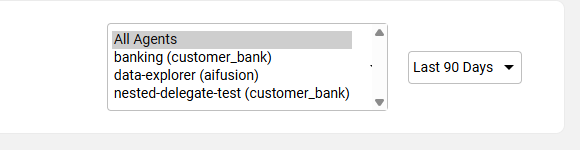
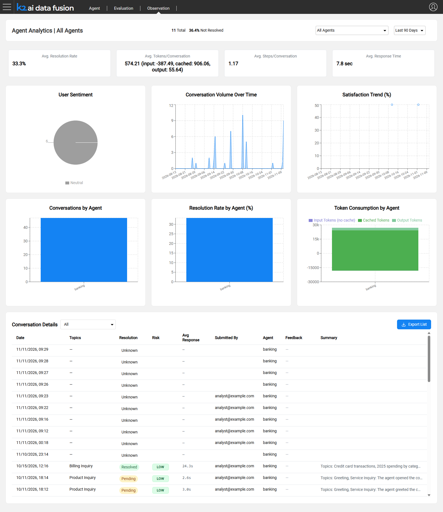
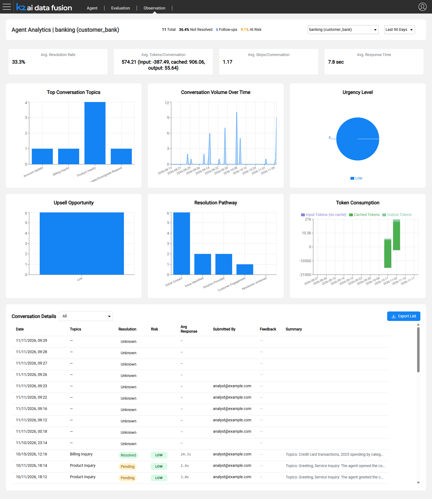
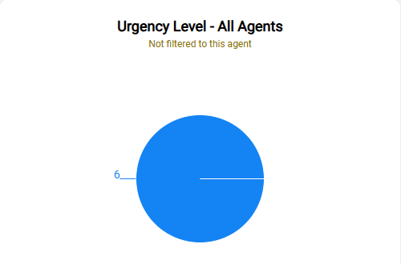
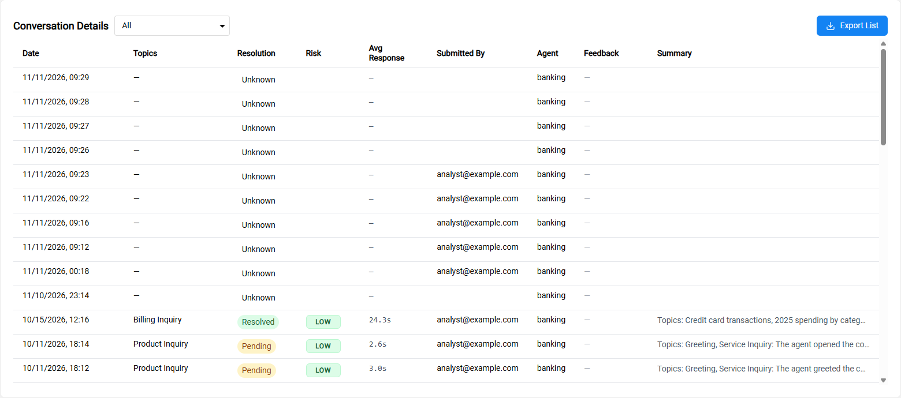
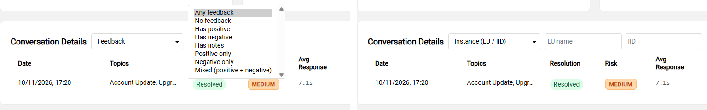

# Observation Dashboard

The Observation dashboard is where you monitor your agents in production. It shows conversation quality, volume and cost for a time window you choose, either across all agents or for one agent, and ends with a filterable conversation table that opens each session in [Conversation Review](/articles/AI_fusion/05_observation/02_conversation_review.md).

## Opening the Dashboard

Open the **Observation** tab of the AI Data Fusion web application. The dashboard opens with the scope and time range you used last (the first time: **All Agents** and **Last 7 Days**). Your last scope, time range and table filter are remembered in the browser.

The selected agent is also kept in the page URL as `?agent=<LU>/<agent>`, so you can bookmark or share a link to one agent's dashboard, for example `https://<server>[/<space>]/app/aifusion/observation?agent=customer_bank/banking`. See [Opening Observation](/articles/AI_fusion/05_observation/00_intro_to_observation.md#opening-observation) for the URL format and deep links.

## Dashboard Layout

From top to bottom:

1. **Header bar** — the title, the summary items for the period, the agent selector and the time range
2. **Number cards** — single-value widgets (type `box`)
3. **Chart widgets** — bar, stacked bar, pie, line and area charts
4. **Conversation Details** — the conversation table, always last

Which cards and charts appear depends on the scope: the overall widgets for **All Agents**, or the selected agent's own widgets.

## Header Bar

The header title shows the current scope: **Agent Analytics | All Agents**, or **Agent Analytics | <agent> (<LU>)** when an agent is selected.

### Summary items

Next to the title, the header shows a row of summary items for the selected period. They come from the scope's `summary` widget — one item per row its query returns. For **All Agents** the shipped items are:

- **Total** — the number of analyzed conversations in the period
- **Not Resolved** — the percentage of analyzed conversations whose Resolution Status is Pending or Escalated

An agent's `widgets.yaml` can add its own headline items. For example, the banking sample agent adds **Follow-ups** (conversations tagged with the Follow-up signal) and **At Risk** (the percentage with a Medium or High Customer Lifetime Value Risk). A scope without a `summary` widget shows no summary items.

### Agent selector

The agent selector lists **All Agents** followed by every deployed agent, shown as **<agent> (<LU>)** and sorted by agent name. Selecting an agent:

- Replaces the widgets with that agent's own widgets (see [Agent Scope](#agent-scope) below)
- Limits the conversation table to the agent's conversations, and hides the table's **Agent** column and **Agent** filter
- Updates the `?agent=` parameter in the URL

If a remembered agent is no longer deployed, the dashboard falls back to **All Agents**.

### Time range

The time range applies to all widgets and to the conversation table:

<table>
<tbody>
<tr>
<td><strong>Option</strong></td>
<td><strong>Typical use</strong></td>
</tr>
<tr>
<td><strong>Last 24 Hours</strong></td>
<td>Checking activity since the last deployment, or investigating a recent spike</td>
</tr>
<tr>
<td><strong>Last 7 Days</strong></td>
<td>Weekly review; emerging patterns (default)</td>
</tr>
<tr>
<td><strong>Last 30 Days</strong></td>
<td>Monthly performance and trend tracking</td>
</tr>
<tr>
<td><strong>Last 90 Days</strong></td>
<td>Quarterly analysis and long-term quality trends</td>
</tr>
</tbody>
</table>

Time-series charts use 4-hour buckets for **Last 24 Hours** and daily buckets for the longer ranges.

## All Agents Widgets

With **All Agents** selected, the dashboard shows the overall widgets defined in the `widgets` MTable of the `aifusion` LU (`widgets.csv`). The shipped set is:

<table>
<tbody>
<tr>
<td><strong>Widget</strong></td>
<td><strong>Type</strong></td>
<td><strong>What it shows</strong></td>
</tr>
<tr>
<td><strong>Conversation Tag Summary</strong></td>
<td>summary</td>
<td>The header bar items: Total and Not Resolved</td>
</tr>
<tr>
<td><strong>Avg. Resolution Rate</strong></td>
<td>box</td>
<td>Percentage of analyzed conversations with Resolution Status = Resolved</td>
</tr>
<tr>
<td><strong>Avg. Tokens/Conversation</strong></td>
<td>box</td>
<td>Mean tokens per session, with a breakdown into input, cached and output tokens</td>
</tr>
<tr>
<td><strong>Avg. Steps/Conversation</strong></td>
<td>box</td>
<td>Mean number of user–assistant turns per session</td>
</tr>
<tr>
<td><strong>Avg. Response Time</strong></td>
<td>box</td>
<td>Mean response time per turn, in seconds</td>
</tr>
<tr>
<td><strong>User Sentiment</strong></td>
<td>pie</td>
<td>Sentiment tags grouped into Positive, Neutral and Negative</td>
</tr>
<tr>
<td><strong>Conversation Volume Over Time</strong></td>
<td>area</td>
<td>Number of conversations per time bucket</td>
</tr>
<tr>
<td><strong>Satisfaction Trend (%)</strong></td>
<td>line</td>
<td>A satisfaction score derived from the Sentiment tags, over time</td>
</tr>
<tr>
<td><strong>Conversations by Agent</strong></td>
<td>bar</td>
<td>Number of conversations per agent</td>
</tr>
<tr>
<td><strong>Resolution Rate by Agent (%)</strong></td>
<td>bar</td>
<td>Resolution rate per agent</td>
</tr>
<tr>
<td><strong>Token Consumption by Agent</strong></td>
<td>stacked bar</td>
<td>Input (without cache), cached and output tokens per agent</td>
</tr>
</tbody>
</table>

There is no topics chart in the All Agents view: each agent has its own Topic values, so topics are shown per agent.

Token and step figures are filled in by the analysis process, so sessions that have not been analyzed yet do not contribute to them.

## Agent Scope

When you select an agent, the dashboard shows **only** the widgets defined in that agent's `Observation/widgets.yaml` — its header summary, number cards and charts. The overall widgets are not shown. An agent without a `widgets.yaml` shows no widgets, just the conversation table.

Agent widgets read the agent's sessions only. A widget whose query reads neither the agent's sessions placeholder nor the `ACTVSESSION` table (for example, a query over `INSIGHTS` alone) cannot be limited to the agent: its card is marked **Not filtered to this agent** and shows data for all agents. See [Configuring Observation](/articles/AI_fusion/05_observation/03_configuring_observation.md#agent-dashboard-widgets-widgetsyaml) for how to write agent widgets.

A new agent created in AI Fusion Studio comes with a starter `widgets.yaml` that includes the header summary, four number cards (**Avg. Resolution Rate**, **Avg. Tokens/Conversation**, **Avg. Steps/Conversation**, **Avg. Response Time**), **Top Conversation Topics**, **Token Consumption** and an **Escalation Rate** card. The banking sample agent (`customer_bank/AI/Agents/banking`) shows the header summary (adding **Follow-ups** and **At Risk**), the four number cards, **Top Conversation Topics**, **Conversation Volume Over Time**, **Urgency Level**, **Upsell Opportunity**, **Resolution Pathway** and **Token Consumption**.

## Conversation Details Table

The **Conversation Details** table lists the sessions created in the selected period, newest first, for the current scope and filter. It includes sessions that have not been analyzed yet (and sessions whose turn is still running); only sessions whose batch analysis failed are excluded. Click a row to open it in [Conversation Review](/articles/AI_fusion/05_observation/02_conversation_review.md).

> **Why the table and the widgets can show different counts:** the table selects sessions by when they were **created**, while the widgets select sessions by their **last activity** and, for tag-based figures such as **Total**, count only analyzed sessions. A conversation started before the period but continued during it is counted by the widgets but not listed in the table, and a new, not yet analyzed conversation is listed in the table but not counted in **Total**.

### Columns

<table>
<tbody>
<tr>
<td><strong>Column</strong></td>
<td><strong>Description</strong></td>
</tr>
<tr>
<td><strong>Date</strong></td>
<td>When the session started, shown as date and time</td>
</tr>
<tr>
<td><strong>Topics</strong></td>
<td>The session's Topic tags; up to two are shown, hover for the full list</td>
</tr>
<tr>
<td><strong>Resolution</strong></td>
<td>The Resolution Status tag (Resolved, Pending or Escalated) as a colored badge; <strong>Unknown</strong> when the session has not been analyzed</td>
</tr>
<tr>
<td><strong>Risk</strong></td>
<td>The Customer Lifetime Value Risk tag (Low, Medium or High) as a colored badge. Empty for agents that do not define this signal</td>
</tr>
<tr>
<td><strong>Avg Response</strong></td>
<td>Mean response time per turn in this session, in seconds</td>
</tr>
<tr>
<td><strong>Submitted By</strong></td>
<td>The user who ran the session</td>
</tr>
<tr>
<td><strong>Agent</strong></td>
<td>The agent that handled the session (hidden when an agent is selected)</td>
</tr>
<tr>
<td><strong>Feedback</strong></td>
<td>Counters for thumbs up, thumbs down and notes, each shown only when non-zero; a dash when there is no feedback</td>
</tr>
<tr>
<td><strong>Summary</strong></td>
<td>The LLM-generated conversation summary; hover for the full text</td>
</tr>
</tbody>
</table>

Topics, Resolution, Risk, Avg Response, Feedback and Summary are filled in by the analysis process. Feedback counters reflect the feedback that existed when the session was last analyzed.

### Filters

Select a filter from the drop-down list next to the table title:

<table>
<tbody>
<tr>
<td><strong>Filter</strong></td>
<td><strong>What it shows</strong></td>
</tr>
<tr>
<td><strong>All</strong></td>
<td>Every conversation in the period (default)</td>
</tr>
<tr>
<td><strong>High Risk Conversations</strong></td>
<td>Conversations whose Customer Lifetime Value Risk is High</td>
</tr>
<tr>
<td><strong>Unresolved Conversations</strong></td>
<td>Conversations whose Resolution Status is Pending or Escalated</td>
</tr>
<tr>
<td><strong>Instance (LU / IID)</strong></td>
<td>Conversations that ran against a specific LU instance. Enter the <strong>LU name</strong> and the <strong>IID</strong> (both are required, because an IID is unique only within its LU), then click <strong>Filter</strong></td>
</tr>
<tr>
<td><strong>Submitted By</strong></td>
<td>Conversations run by a specific user. Enter the user name and click <strong>Filter</strong></td>
</tr>
<tr>
<td><strong>Agent</strong></td>
<td>Conversations of a specific agent. Enter the agent name and click <strong>Filter</strong>. The filter matches the agent name only, so agents with the same name in different LUs are listed together; to see one of them, select it in the header instead. Not available when an agent is selected in the header</td>
</tr>
<tr>
<td><strong>Feedback</strong></td>
<td>Conversations by the feedback they received. A second list offers <strong>Any feedback</strong>, <strong>No feedback</strong>, <strong>Has positive</strong>, <strong>Has negative</strong>, <strong>Has notes</strong>, <strong>Positive only</strong>, <strong>Negative only</strong> and <strong>Mixed (positive + negative)</strong></td>
</tr>
</tbody>
</table>

The **High Risk Conversations** filter relies on the Customer Lifetime Value Risk signal; it returns nothing for agents that do not define it.

The feedback filters read the feedback counters stored by the last analysis. Feedback given after a session was analyzed does not re-open the session, so it is not reflected in the counters or the filters until the session is analyzed again (which happens when the user continues the conversation).

### Exporting the list

Click **Export List** to download the current list — the selected scope, time range and filter — as a CSV file. The file contains all the fields returned for each session, including fields that are not shown as columns. Use it for reporting or to load into an external analytics tool.

**Next article:** [Conversation Review](/articles/AI_fusion/05_observation/02_conversation_review.md)
