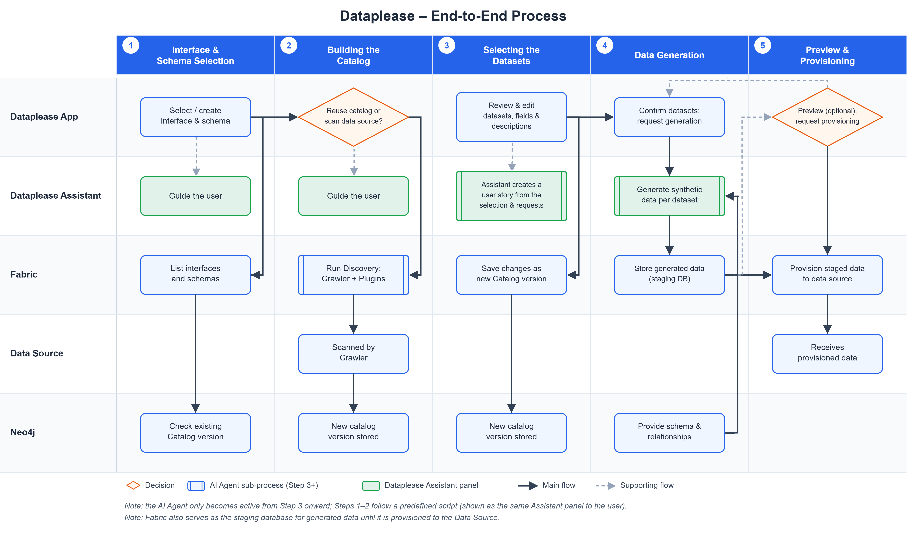

# Dataplease Process

### Overview

This article describes the end-to-end Dataplease flow and the K2view components that support it. For the purpose of Dataplease and the data that it sends to the LLM, refer to [Dataplease Overview](01_dataplease_overview.md).

### End-to-End Flow

The Dataplease app walks the user through the following steps:

1. **Interface and schema selection** – The user picks an existing Fabric interface or creates a new one, then selects the schema to work with.
2. **Scanning** – If a Catalog version already exists for that interface and schema, the user can reuse it. Otherwise, Dataplease starts a discovery process that scans the interface and builds a new Catalog version. The user follows the scan progress until it completes.
3. **Selecting datasets** – The user reviews and refines the discovered datasets, including the fields and their properties (such as classification and description). The user can edit descriptions and other properties to get better generation results. Dataplease saves the changes as a new Catalog version.
4. **Data generation** – When the user clicks **Continue**, Dataplease locks the dataset selection and the Dataplease AI Agent becomes available in the chat. The user describes the necessary data to the agent. Then the data generation begins: Dataplease generates the synthetic data for the selected datasets and reports status, row counts, duration, and an overall execution summary.
5. **Data preview** – The user can preview and evaluate the data to validate its quality.
6. **Provisioning** – The generated data is provisioned to the target system using Fabric's platform capabilities. Dataplease monitors the provisioning and reports the progress and errors, if they occur.

Throughout this flow, the Dataplease Assistant panel stays present alongside the main screen. Before the dataset selection is locked, the panel explains each step and reacts to the user's selections. After the dataset selection is locked, the panel becomes a chat with the Dataplease AI Agent.

### Solution Components

Dataplease is built on the following K2view tools:

* **Dataplease App** is a K2view Web Application, accessible from the [K2view Web Framework](/articles/30_web_framework/01_web_framework_overview.md) by selecting **Dataplease** from the menu.
* **Fabric** is the underlying data platform. It provides:
  * The **interfaces** that connect to the target systems.
  * The **LLM interfaces** that run all LLM-based activities (chat, story building and data generation).
  * A Data Product (Logical Unit) that stages the generated rows before they are loaded into the target.
  * The data provisioning capabilities that deliver the generated data to the target system.

  The minimum Fabric version that supports Dataplease is V8.5.2.
* **Fabric Catalog App** – Dataplease relies on the Catalog App's **discovery** pipeline and APIs to scan the interface's metadata (schema, tables and the relationships between them) and build the Catalog. See the [Fabric Catalog articles](/articles/39_fabric_catalog/README.md) for more on cataloging and discovery.
* **Dataplease AI Agent** is a dedicated AI agent, composed of multiple skills and sub-agents. It interprets natural-language requests into a data story and drives the synthetic data generation process based on the request and the Catalog metadata. The agent:
  * Creates a coherent **data story** from the user request and the Catalog metadata.
  * Enforces logical consistency across multiple related datasets (tables).
  * Answers questions about the Catalog metadata.
* **AI Fusion** is the K2view agentic platform on which the Dataplease AI Agent runs.

Further articles walk through each step of the [Dataplease App](dataplease_app/README.md) in more detail.
