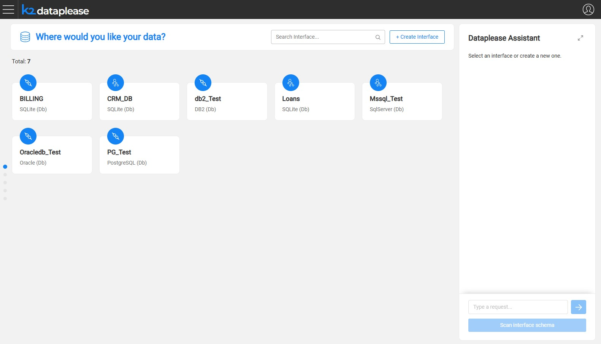
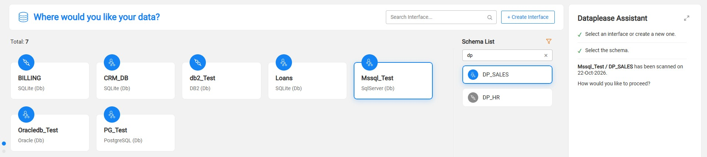

# Interface and Schema Selection

### Overview

The Dataplease flow starts with the data source. The user selects a Fabric interface, and then a schema under that interface.

The **Where would you like your data?** screen shows the available interfaces as cards. Each card shows the interface name and the interface type, for example `SQLite (Db)`, `SqlServer (Db)` or `PostgreSQL (Db)`. The **Total** counter shows the number of interfaces.

In the MVP, Dataplease supports only relational databases that have a JDBC driver, for example Oracle, PostgreSQL, IBM Db2 and Microsoft SQL Server.

On this screen, the user can:

* Type in the **Search Interface** box to filter the list.
* Click **+ Create Interface** to define a new interface without leaving the flow.

The **Dataplease Assistant** panel on the right side of the screen guides the user through the flow. It shows the instruction for the current step, for example *Select an interface or create a new one*. When a step is complete, the Assistant shows a check mark next to it. The indicator on the left side of the screen shows the current step of the flow.

### Selecting the Schema

When the user selects an interface, the **Schema List** shows the schemas of that interface:

The icon of each schema shows its Catalog status:

* **Blue icon** - The schema was scanned before, and a Catalog version exists for it.
* **Grey icon** - The schema was not scanned.

If the schema list is long, click the filter icon above the list. Then type a part of the schema name. The list shows only the schemas that contain this text.

When the user selects a schema that has a Catalog version, the Assistant shows the date of the last scan, for example *Mssql_Test / DP_SALES has been scanned on 22-Oct-2026*. Then the Assistant asks how to continue:

* **Use existing metadata** - Use the existing Catalog version and skip the scan.
* **Re-scan schema** - Start a new Discovery run on the source to create an up-to-date Catalog version.

When the user selects a schema that has no Catalog version, the user clicks **Scan interface schema** to start the Discovery process.

The selected option sets the next step of the flow. Refer to [Scanning](03_scanning.md).
