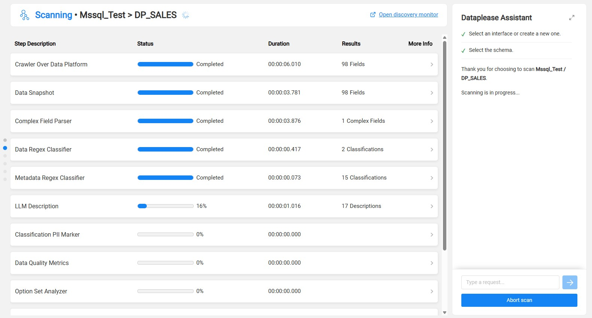
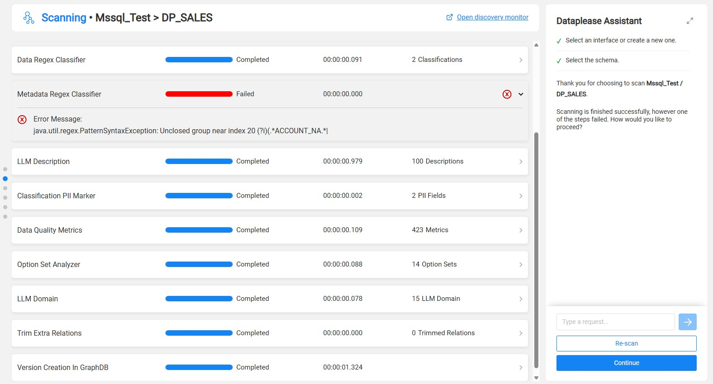
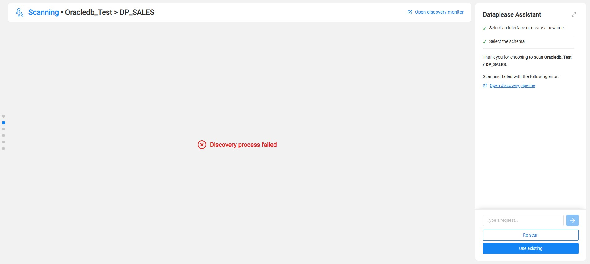

# Scanning

### Overview

To generate data, Dataplease needs the full metadata of the selected interface and schema. The metadata describes the datasets, fields and relationships of the schema. The option that the user selected in the previous step sets what occurs in this step:

* **Use existing metadata** - Dataplease skips this step. It loads the datasets from the existing Catalog version.
* **Scan interface schema** or **Re-scan schema** - Dataplease starts a Fabric Discovery process on the selected interface and schema.

Dataplease applies an ad-hoc Discovery pipeline rule to the selected interface and schema. This rule excludes the other schemas of the interface. Thus, Discovery scans only the selected schema. Dataplease does not save this rule in the `pluginsOverride.discovery` file.

For more information about the Discovery process and the Catalog, refer to the [Fabric Catalog articles](/articles/39_fabric_catalog/README.md).

### Monitoring the Scan

During the scan, the **Scanning** screen shows the progress of the Discovery job. The header shows the interface and the schema, for example *Mssql_Test > DP_SALES*.

The table shows one row for each step of the Discovery job. The Discovery Pipeline rule sets these steps. For more information, refer to [Discovery Pipeline Settings](/articles/39_fabric_catalog/catalog_app/13_discovery_pipeline_settings.md).

While the scan runs, the Assistant shows *Scanning is in progress...*. To stop the scan, click **Abort scan**.

Click **Open discovery monitor** to open the full Catalog Discovery Monitor.

When the scan completes with no failures, the flow continues to the next step automatically.

### Handling Warnings and Failures

One or more steps can fail while the Discovery job completes. For example, a classifier step can fail because of an incorrect regular expression. In this case, the step shows a red **Failed** status. Expand the step to see the error message.

The Assistant shows that the scan is finished, but one of the steps failed. The user selects one of these options:

* **Continue** - Continue with the new Catalog version. This version includes the results of the steps that completed.
* **Re-scan** - Start the Discovery process again.

The full Discovery job can also fail, for example when Fabric cannot connect to the source. In this case, the main area shows *Discovery process failed*. The Assistant shows the error message and an **Open discovery pipeline** link.

If an earlier Catalog version exists, click **Use existing** to continue with it. **Continue** is not available, because the scan did not create a new Catalog version.

When a Catalog version is available, the flow continues to [Selecting the Datasets](04_selecting_the_datasets.md).
