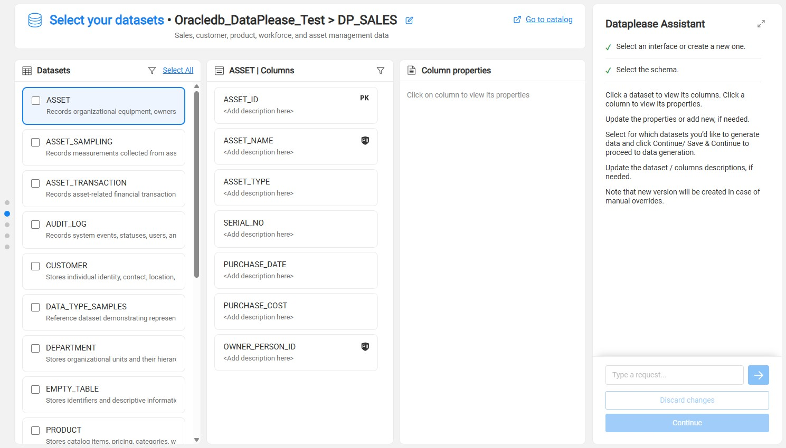
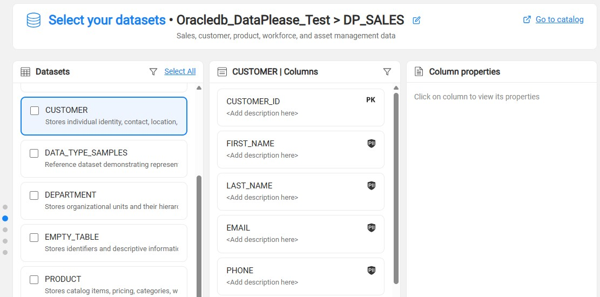
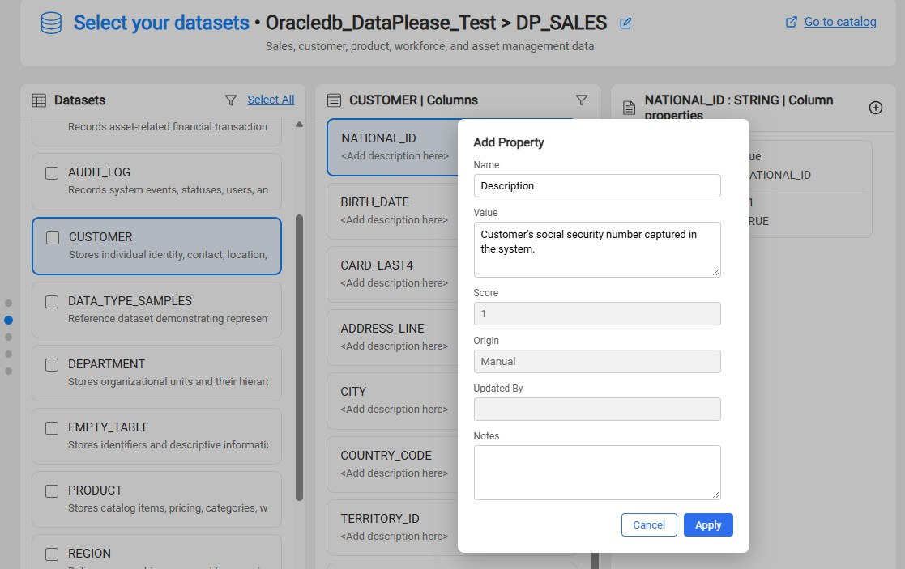
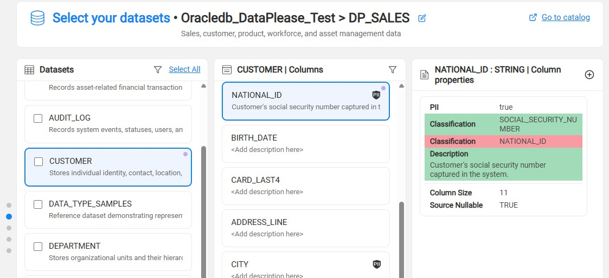
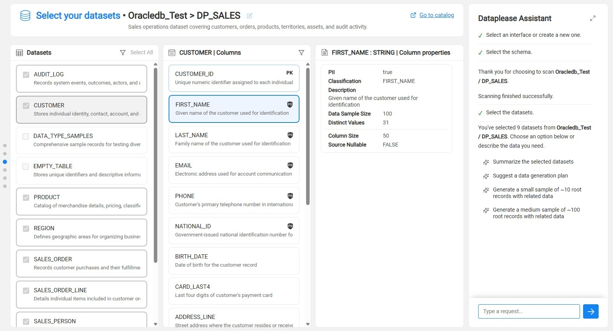

# Selecting the Datasets

### Overview

In this step, the user examines the datasets of the selected schema. Then the user selects all or part of the datasets for data generation, in order to continue to data generation step.

After the user selects the datasets and clicks **Continue**, the user can also ask the Dataplease AI Agent questions about the Catalog metadata of the selected datasets, for example about fields, data types, PII, classifications and relationships.

The header of the **Select your datasets** screen shows the interface, the schema and the schema description from the Catalog. Click the edit icon next to the schema name to edit the schema description. Click **Go to catalog** to open the schema in the Catalog app.

The screen has three panels:

* **Datasets** - The datasets (tables) of the schema. Each dataset shows its description from the Catalog. Select the check box of each dataset that you want to generate data for, or click **Select All**. Click the filter icon to filter the list.
* **Columns** - The columns of the selected dataset. Each column shows its description (if exists). Click the filter icon to filter the list when searching for a specific column.
* **Column properties** - The properties of the selected column. The panel header shows the column name and its data type, for example *FIRST_NAME : STRING*. The properties are different for each column.

### Reviewing and Updating

The user can edit the descriptions of the schema, the datasets and the columns, and the properties of the columns. Better descriptions and properties give better generation results. 

* To update the dataset or column description, click the description text (or the description placeholder):

* To add a property to a column, click the **+** icon in the **Column properties** panel:

* To update the existing property, click the property and update the value in the Property Details popup:

The **Column properties** panel highlights the updates: green shows the added values and red shows the removed values. A small purple dot shows on each dataset and column that has updates.

### Requesting the Generation

When the review is complete, select the datasets for data generation. To select the datasets, click **Select All** or select each dataset. Select at least one dataset to continue.

When the selection is complete, click **Continue** to move to the data generation step.

If the user makes changes (for example, adds a new description or updates a classification), the **Continue** button label changes to **Save & Continue**. This label shows that Dataplease saves these changes as a new Catalog version. In addition, the **Discard changes** button becomes available to cancel all the changes.

At this point, Dataplease locks the dataset selection, and the Dataplease Assistant panel becomes a chat with the [Dataplease AI Agent](../dataplease_assistant/01_dataplease_assistant_overview.md). After the lock, the user cannot change the dataset selection or update the properties. To change the selection, click **Start over**.

The agent shows the number of selected datasets. Then it asks the user to select an option or to describe the necessary data. The options are:

* Summarize the selected datasets
* Suggest a data generation plan
* Generate a small sample of ~10 root records with related data
* Generate a medium sample of ~100 root records with related data

These options are only examples of possible requests. Type the request in the **Type a request** box. Use your own words and describe the necessary data. For example: 

*This database represents ABC company which is a regional electric company in California. Generate 50 customers with an address in San Diego and several cities near it, with 1 or 2 outage-report activities. Customer IDs should start from 1000.*

The Dataplease AI Agent converts the request into a **data story**. The data story drives the generation. It keeps the data logically consistent across all the selected tables.

The generation starts when the user selects one of the predefined **Generate** options, or asks the agent to generate the data. The flow then continues to [Data Generation](05_data_generation.md).
