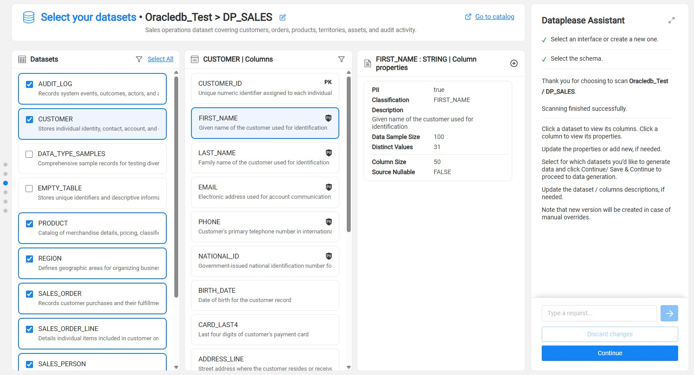

# Selecting the Datasets

### Overview

In this step, the user examines the datasets of the selected schema. Then the user selects the datasets for data generation.

The header of the **Select your datasets** screen shows the interface, the schema and the schema description from the Catalog. Click the edit icon next to the schema name to edit the schema description. Click **Go to catalog** to open the schema in the Catalog app.

The screen has three panels:

* **Datasets** - The datasets (tables) of the schema. Each dataset shows its description from the Catalog. Select the check box of each dataset that you want to generate data for, or click **Select All**. Click the filter icon to filter the list.
* **Columns** - The columns of the selected dataset. Each column shows its description. The **PK** label identifies a primary key column. The PII icon identifies a PII column. Click the filter icon to filter the list.
* **Column properties** - The properties of the selected column. The panel header shows the column name and its data type, for example *FIRST_NAME : STRING*. The properties are different for each column.

### Reviewing and Updating

The user can edit descriptions and properties at the schema, dataset and column level. Better descriptions and properties give better generation results. To add a property to a column, click the **+** icon in the **Column properties** panel.

* If there are no changes, the flow continues with the same Catalog version.
* If there are changes, Dataplease creates a new Catalog version when the user saves them. This is the same mechanism as the [manual overrides](/articles/39_fabric_catalog/catalog_app/07_manual_overrides.md) in the Catalog app.

When there are changes that are not saved:

* The **Continue** button changes to **Save & Continue**.
* The **Discard changes** button becomes available. Click it to cancel the changes.

### Requesting the Generation

When the user clicks **Continue** or **Save & Continue**, Dataplease locks the dataset selection. The check boxes, **Select All** and the edit icon become unavailable. The Dataplease Assistant starts its conversation mode, which the [Dataplease AI Agent](../dataplease_assistant/01_dataplease_assistant_overview.md) operates.

The Assistant shows the number of selected datasets. Then it asks the user to select an option or to describe the necessary data. The options are:

* Summarize the selected datasets
* Suggest a data generation plan
* Generate a small sample (~10 rows per dataset)
* Generate a medium sample (~100 rows per dataset)

These options are only examples of possible requests. We recommend that the user types the request in the **Type a request** box, in his own words, and describes the necessary data. For example: *Generate 20 customers with 1-2 addresses in Argentina, Chile, Peru or Colombia, 1-2 activities and multiple cases each. All texts should be generated in Spanish. All IDs should start from 1000.*

The Dataplease AI Agent converts the request into a **data story**. The data story drives the generation. It keeps the data logically consistent across all the selected tables.

The generation starts when the user selects one of pre-defined **Generate** option, or asks the Agent to generate the data. The flow then continues to [Data Generation](05_data_generation.md).
