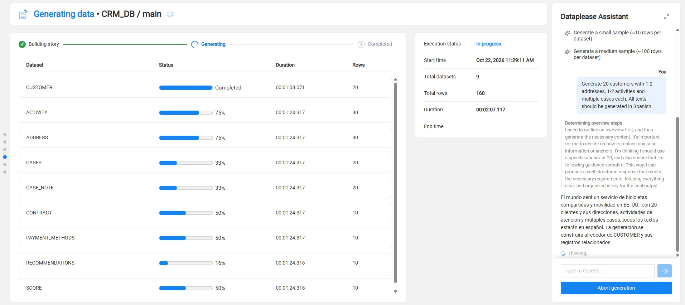
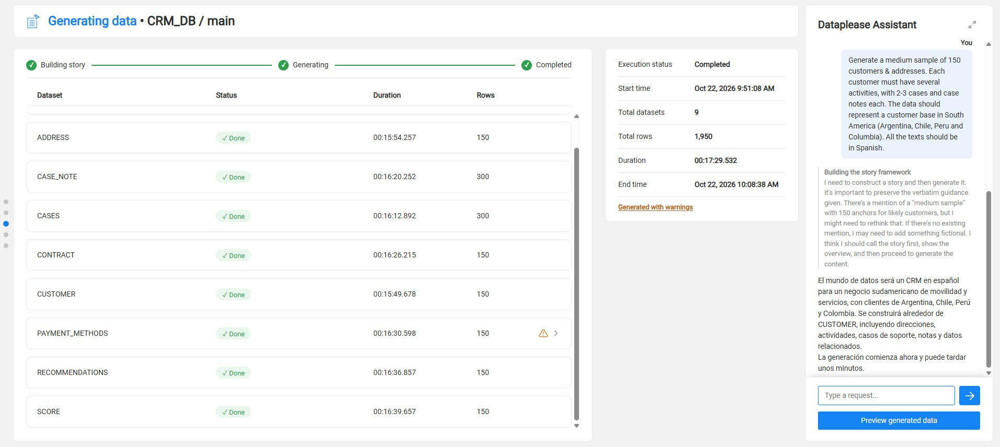

# Data Generation

### Overview

In this step, the [Dataplease AI Agent](../dataplease_assistant/01_dataplease_assistant_overview.md) generates the data and saves it in the staging DB. The **Generating data** screen shows the progress. The header shows the interface and the schema, for example *CRM_DB / main*.

The progress bar at the top of the screen shows three stages:

1. **Building story** - The Agent creates the data story from the user request. Refer to [Selecting the Datasets](04_selecting_the_datasets.md).
2. **Generating** - The Agent generates the data for each dataset.
3. **Completed** - The generation is complete.

The table shows one row for each dataset, with these columns:

* **Status** - A progress bar with the percentage of completion, or the final status.
* **Duration** - The run time of the dataset generation.
* **Rows** - The number of rows for the dataset.

The summary panel shows the **Execution status**, **Start time**, **Total datasets**, **Total rows**, **Duration** and **End time**.

The Assistant panel shows the user request and the response of the Agent. The response includes the reasoning steps of the Agent and a summary of the data story.

To stop the generation, click **Abort generation**.

### Reviewing the Results

When the generation is complete, all three stages show a check mark, and each dataset shows the **Done** status.

If the generation of a dataset has warnings, a warning icon shows in the row of that dataset. Click the arrow to see the details. The summary panel then shows the **Generated with warnings** link.

To examine the generated data, click **Preview generated data**. Refer to [Data Preview](06_data_preview.md).
