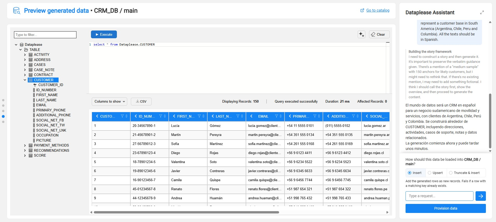

# Data Preview

### Overview

In this step, the user examines the generated data before Dataplease loads it into the target. The user also selects how to load the data.

The header of the **Preview generated data** screen shows the interface and the schema. Click **Go to catalog** to open the schema in the Catalog app.

The screen has these areas:

* **Interface explorer** - The left panel shows the datasets for which the user requested to generate data. Type in the filter box to filter the list.
* **Query Builder** - Write the query to examine the data, for example `select * from Dataplease.CUSTOMER`. To create the query, do one of these steps:
  * Type the query manually.
  * Click the **>** button next to a dataset name.
  * Click the AI Assistant button.
* **Results grid** - Shows the query results. Click **CSV** to export the results to a CSV file.

If the data does not meet the requirements of the user, the user can give more instructions to the Assistant. The user can ask the Assistant to replace the data or to add more data.

### Selecting the Load Mode

The Assistant asks how to load the data into the target interface and schema, for example *How should this data be loaded into CRM_DB / main?* The user selects one of these load modes:

* **Insert** - Adds the generated rows as new records. The load fails if a row with a matching key already exists.
* **Upsert** - Adds the generated rows as new records, and updates the existing records that have a matching key.
* **Truncate & Insert** - Deletes all the records in the target tables, and then adds the generated rows.

The Assistant shows a description of the selected load mode.

To load the data, click **Provision data**. Refer to [Provisioning](07_provisioning.md).
