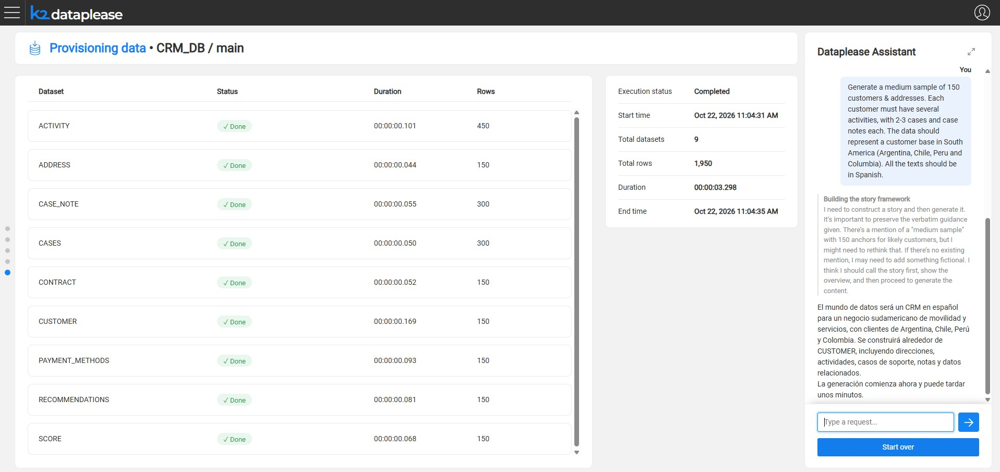
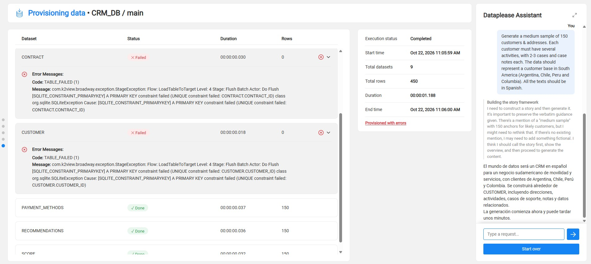

# Provisioning

### Overview

In this step, Dataplease loads the generated data into the target. Dataplease uses the Fabric data management and provisioning capabilities, and the load mode that the user selected in [Data Preview](06_data_preview.md).

The **Provisioning data** screen shows the progress in the same way as the data generation. The header shows the target interface and schema, for example *CRM_DB / main*.

The table shows one row for each dataset, with its **Status**, **Duration** and **Rows**. The summary panel shows the **Execution status**, **Start time**, **Total datasets**, **Total rows**, **Duration** and **End time**.

When the provisioning of a dataset is successful, the dataset shows the **Done** status and the number of loaded rows.

### Handling Failures

If the provisioning of a dataset fails, the dataset shows the **Failed** status and 0 rows. Expand the row to see the **Error Messages**, with the error **Code** and **Message**. The summary panel then shows the **Provisioned with errors** link.

For example, the **Insert** load mode fails with a primary key constraint error when the target table already has a row with the same key. To prevent this error, use the **Upsert** or **Truncate & Insert** load mode.

To start a new Dataplease flow from the first step, click **Start over**.

This step completes the end-to-end Dataplease flow: select a data source, create and update the Catalog, generate synthetic data, examine the data and load it into the target.
