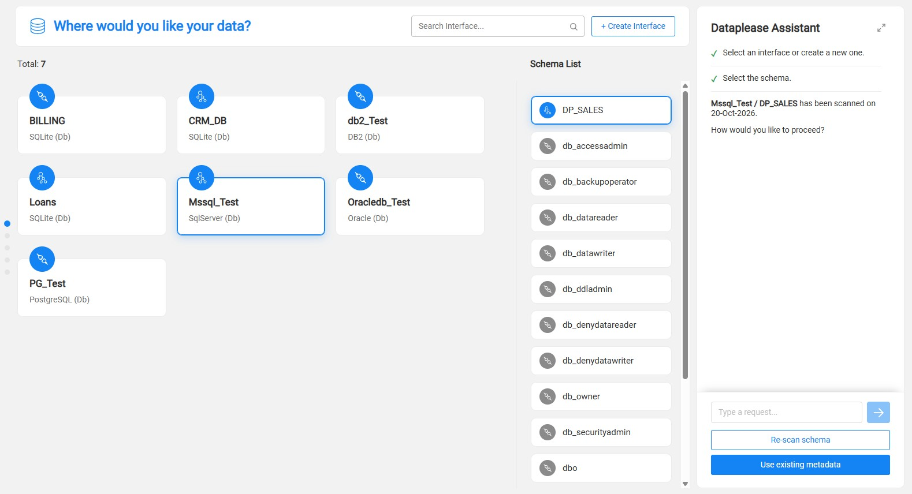
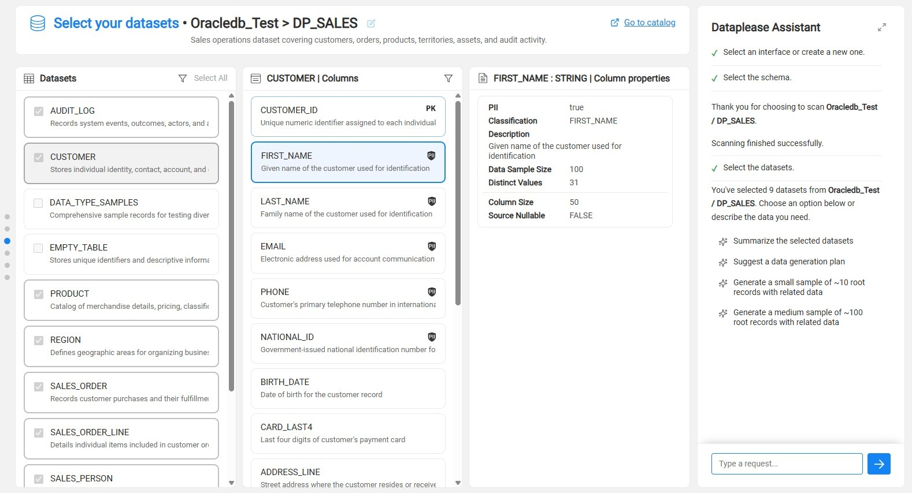

# Dataplease Assistant Overview

### Overview

The **Dataplease Assistant** is the panel on the right side of the main screen. The panel is present during the full Dataplease flow and guides the user through each step.

After the user selects the datasets, the Dataplease Assistant connects the user to the **Dataplease AI Agent**. The Dataplease AI Agent runs on AI Fusion, the K2view agentic platform. It uses the Fabric LLM interfaces for all LLM-based activities.

The Dataplease AI Agent changes natural-language requests into a **data story**. The data story controls the synthetic data generation. The agent:

* Creates a coherent data story from the user request and the Catalog metadata. Refer to [Communicating with the Dataplease AI Agent](/articles/Dataplease/dataplease_assistant/02_communicating_with_the_agent.md#the-data-story).
* Keeps the data logically consistent across **multiple related datasets (tables)**.

Dataplease sends metadata to the LLM. It does not send the source table rows. Refer to [Data Privacy: What Is Sent to the LLM](/articles/Dataplease/01_dataplease_overview.md#data-privacy-what-is-sent-to-the-llm).

### Guiding Script vs. AI Agent

The Dataplease Assistant panel is present during the full flow, described in the [Dataplease App](/articles/Dataplease/dataplease_app/README.md) articles. But the Dataplease AI Agent does not operate in each step:

* In the first steps of the flow (interface and schema selection, scanning, and selecting the datasets), the panel is only a **guiding script**. It shows the current step, confirms the completed actions and explains the next action. In these steps, the panel does not accept free-text conversation.

  

* When the user selects the datasets and clicks **Continue** (or **Save & Continue**) in [Selecting the Datasets](/articles/Dataplease/dataplease_app/04_selecting_the_datasets.md), Dataplease starts the Dataplease AI Agent. The panel then becomes an interactive chat, and the user can communicate freely with the agent.

  

### Agent Structure

The Dataplease AI Agent has these components:

* **Dataplease AI Agent** – The main agent. It reads each user request and decides on the next action. It sends Catalog questions to the Catalog sub-agent. For data generation requests, it creates the data story and then uses the SDG tool to generate the data.
* **Catalog sub-agent** – Answers questions about the Catalog metadata of the selected datasets.
* **Synthetic Data Generation (SDG) tool** – Generates the synthetic data for the selected datasets. The generation is based on the data story and the Catalog metadata. Dataplease saves the generated data in the staging DB.

For more information about the requests and the data story, refer to [Communicating with the Dataplease AI Agent](/articles/Dataplease/dataplease_assistant/02_communicating_with_the_agent.md).
