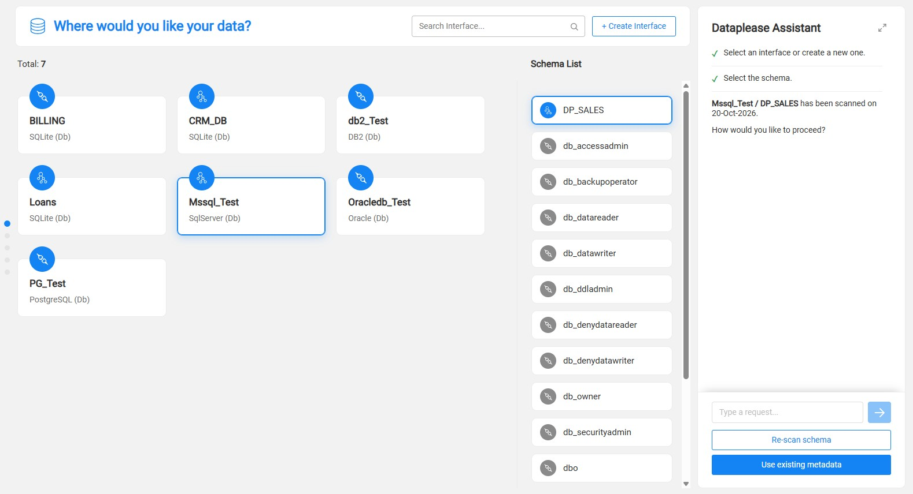
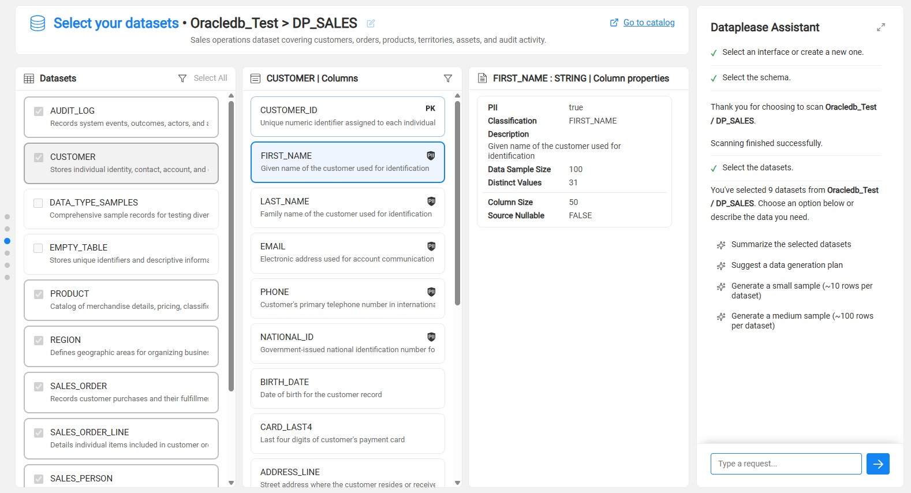

# Dataplease Assistant Overview

### Overview

The **Dataplease Assistant** is the panel at the side of the main screen. The panel is present during the full Dataplease flow and guides the user through each step.

After the user selects the datasets, the Dataplease Assistant connects the user to the **Dataplease AI Agent**. The Dataplease AI Agent runs on AI Fusion, the K2view agentic platform. It uses the Fabric LLM interfaces for all LLM-based activities.

The Dataplease AI Agent changes natural-language requests into a **data story**. The data story controls the synthetic data generation. The agent:

* Creates a coherent data story, with or without user guidance. Refer to [The Data Story](#the-data-story).
* Keeps the data logically consistent across **multiple related datasets (tables)**.

Dataplease sends metadata to the LLM. It does not send the source table rows. Refer to the *Data Privacy: What Is Sent to the LLM* section in [Dataplease Overview](/articles/Dataplease/01_dataplease_overview.md).

### Guiding Script vs. AI Agent

The Dataplease Assistant panel is present during the full flow, described in the [Dataplease App](/articles/Dataplease/dataplease_app/README.md) articles. But the Dataplease AI Agent does not operate in each step:

* For most of the flow (interface and schema selection, scanning, and selecting the datasets), the panel is only a **guiding script**. It shows the current step, confirms the completed actions and explains the next action. The user always knows the current position in the flow. In these steps, the panel does not accept free-text conversation.

  

* When the user selects the datasets and clicks **Continue** (or **Save & Continue**) in [Selecting the Datasets](/articles/Dataplease/dataplease_app/04_selecting_the_datasets.md), Dataplease starts the Dataplease AI Agent. The panel then becomes an interactive chat, and the user can communicate freely with the agent.

  

### Agent Structure

The Dataplease AI Agent is an orchestrator that operates two sub-agents:

* **Dataplease AI Agent (orchestrator)** – Reads each user request and decides on the next action. It sends Catalog questions to the Catalog sub-agent. It sends data generation requests to the Synthetic Data Generation sub-agent.
* **Catalog sub-agent** – Answers questions about the Catalog metadata of the selected datasets. It also creates the business summary of the schema, and updates this summary automatically when it is out of date. The data story uses this summary.
* **Synthetic Data Generation sub-agent** – Generates the synthetic data for the selected datasets. The generation is based on the data story and the Catalog metadata. Dataplease saves the generated data in the staging DB.

### Communicating with the Agent

After the agent starts, the user can write requests in natural language. The agent handles two types of requests:

* **Catalog questions** – Questions about the Catalog metadata of the selected datasets. The Catalog sub-agent answers these questions.
* **Data generation** – Requests to generate synthetic data for the selected datasets. The Synthetic Data Generation sub-agent generates the data.

The Dataplease Assistant also shows quick-pick options, for example **Summarize the selected datasets** and **Generate a small sample**. For the full list of options, refer to [Selecting the Datasets](/articles/Dataplease/dataplease_app/04_selecting_the_datasets.md).

### The Data Story

The data story is based on the user prompt. The agent adds the parts that are missing from the prompt. To do this, it uses the Catalog metadata and the business summary of the schema.

* **With user guidance** – The user describes the necessary data, for example the business scenario, the number of records, the languages or the ID ranges. The agent uses this description as the base of the data story, and adds the missing details.
* **Without user guidance** – The user does not describe the data. The agent creates the full data story and, by default, generates a small data sample.

The agent creates the data story in the **Building story** stage of the generation. Refer to [Data Generation](/articles/Dataplease/dataplease_app/05_data_generation.md).
