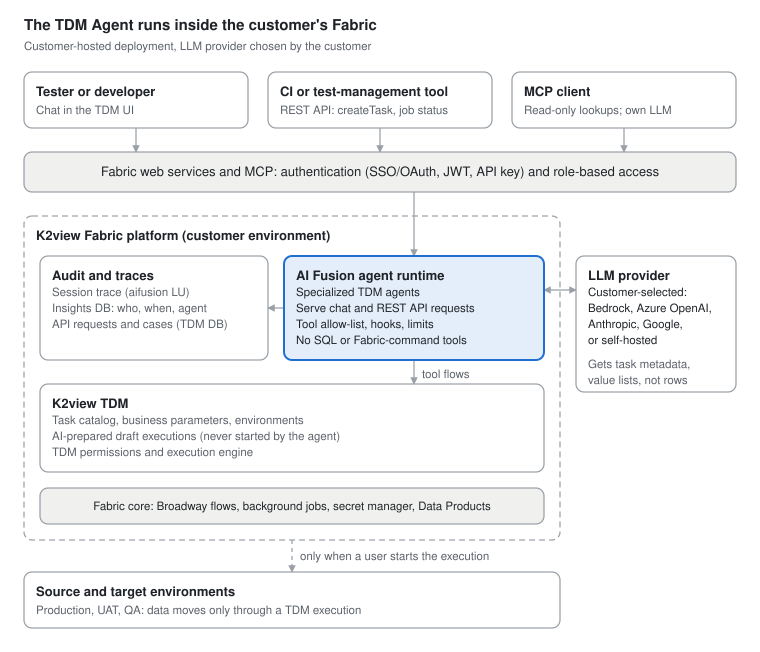
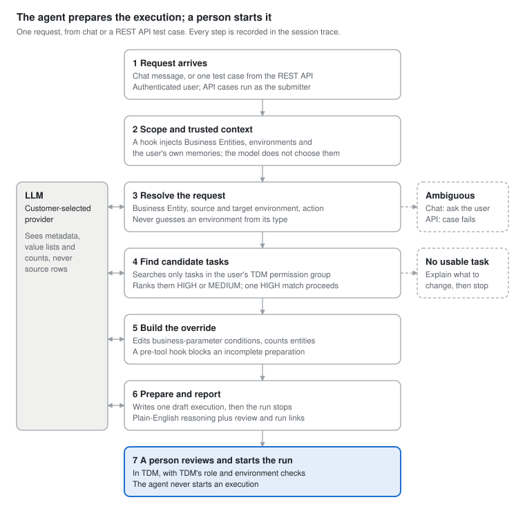

# TDM Agent Architecture

The TDM Agent runs entirely inside the customer's K2view Fabric deployment, beside TDM, on the AI Fusion agent runtime. It only prepares TDM task executions — a person always reviews and runs them. This article describes how the agent is built on top of Fabric and AI Fusion, and how a request flows through it.

For the data sent to the LLM and the security controls, see [TDM Agent Security and Privacy](05_tdm_agent_security_and_privacy.md).

## Core Control Principle: It Prepares, It Never Executes

<table>
<thead>
<tr>
<th>The agent will</th>
<th>The agent will not</th>
</tr>
</thead>
<tbody>
<tr>
<td>Reuse existing, administrator-defined TDM tasks</td>
<td>Create new tasks from scratch</td>
</tr>
<tr>
<td>Prepare a task execution with overrides</td>
<td>Start an execution — a user clicks the link</td>
</tr>
<tr>
<td>Ask when the entity, environment or action is ambiguous</td>
<td>Guess an environment from its type</td>
</tr>
<tr>
<td>Explain each condition it will select by</td>
<td>Show raw override JSON or internal IDs</td>
</tr>
</tbody>
</table>

Every data movement therefore still passes through TDM's existing task permissions, environment permissions and execution controls.

## Components

The TDM Agent is a set of AI Fusion agents and Broadway tool flows deployed on the customer's own K2view Fabric, beside TDM. It adds no new external service. The only outbound call is to the LLM provider the customer configures.

Requests enter only through authenticated Fabric web services and MCP. The agents reach TDM only through allow-listed tool flows. Data moves between environments only when a person starts the prepared TDM execution.

<table>
<thead>
<tr>
<th>Layer</th>
<th>Components</th>
</tr>
</thead>
<tbody>
<tr>
<td><strong>Clients</strong></td>
<td>TDM chat UI; CI or test-management tools through the REST API; MCP clients</td>
</tr>
<tr>
<td><strong>Access</strong></td>
<td>Fabric web services and MCP servers, Fabric authentication and RBAC</td>
</tr>
<tr>
<td><strong>Agents</strong></td>
<td>Specialized AI Fusion agents for request handling, task search and override building, deployed in the TDM Data Product</td>
</tr>
<tr>
<td><strong>Tools</strong></td>
<td>A fixed set of tools to search tasks, read task and parameter definitions, check execution status and prepare a draft execution (allow-listed per agent)</td>
</tr>
<tr>
<td><strong>TDM</strong></td>
<td>Task catalog, environments, draft executions, permissions, execution engine</td>
</tr>
<tr>
<td><strong>Platform</strong></td>
<td>K2view Fabric: flow engine, background jobs, secret manager, LLM interfaces</td>
</tr>
<tr>
<td><strong>Storage</strong></td>
<td>Conversation traces, session records, API requests and draft executions, all in the customer's Fabric and TDM databases</td>
</tr>
</tbody>
</table>

## Agentic Flow

Each chat or REST API request passes through a fixed chain of specialized agents. A trusted hook sets the scope, the LLM works only through allow-listed tools, and the run always ends at a draft that a person must start.

In chat, when several good matches exist, they are shown to the user to choose from. Through the REST API, each test case runs as its own audited session and never asks questions. It ends READY with a review link, or FAILED with the agent's reasoning.

## Related Articles

- [TDM Agent Overview](01_tdm_agent_overview.md)
- [TDM Agent Security and Privacy](05_tdm_agent_security_and_privacy.md)
- [AI Fusion Architecture](/articles/AI_fusion/03_architecture.md)

