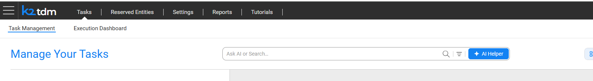
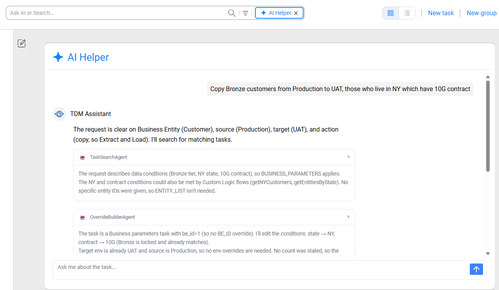
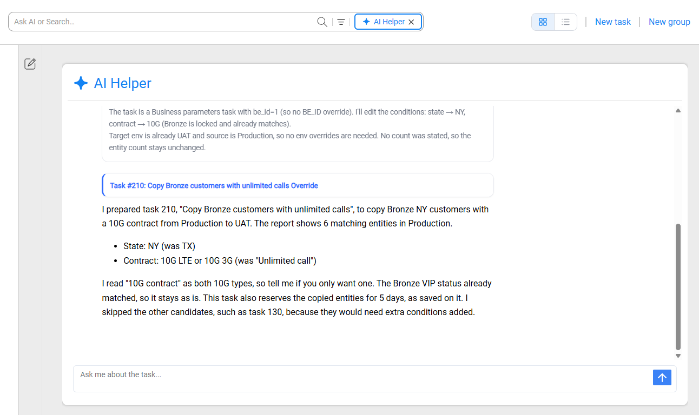
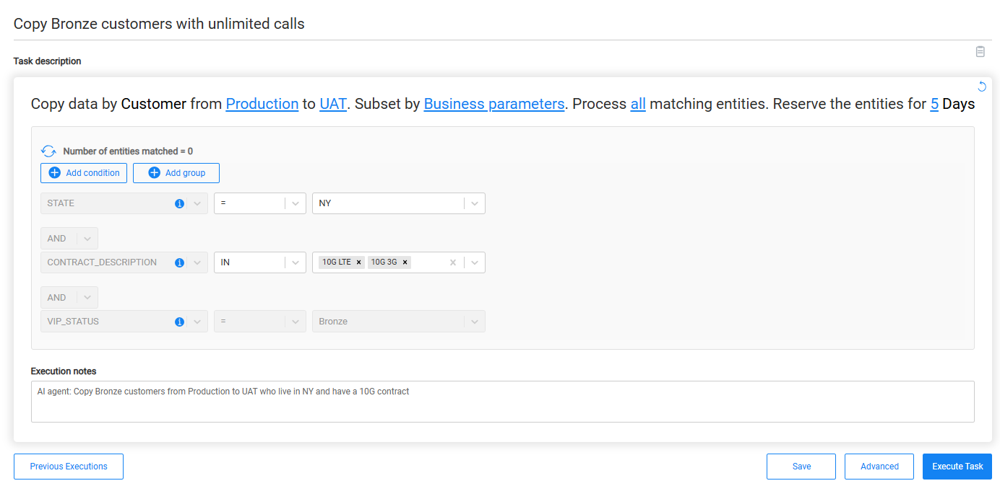

# Using the TDM Agent in the TDM Portal App

This article describes how testers use the TDM Agent chat in the TDM App: opening the **AI Helper**, writing a request, reviewing the proposed task, and saving or executing the prepared execution.

The TDM Agent is available only when it is enabled for the TDM App. See [TDM Agent Overview](01_tdm_agent_overview.md#installation).

## Opening the AI Helper

The TDM Agent is available in the **Tasks > Task Management** window, in the **Card view**.

There are two ways to start a conversation:

- Click **AI Helper** on the right side of the search bar. The AI Helper panel opens. If the search box already contains text, it is sent as the first message.
- Type a question in the search box, whose placeholder reads **Ask AI or Search...**, and press Enter. A question is sent to the AI Helper and starts a new conversation. 

The panel opens with a greeting from the **TDM Assistant**.

To close the panel, click **AI Helper** again (the button shows an X icon while the panel is open). Closing the panel hides it without ending the conversation. Selecting a task group tab also closes the panel.

## Writing a Request

Type the request in the chat input (**Ask me about the task...**) and press Enter to send it. Press Shift+Enter to add a new line.

Describe the data you need, the environments and the action, for example:

- *Extract and load 6 customers from Production to UAT where they are Gold tier with an unlimited-calls offer.*
- *I need 6 VIP customers with an address in New York City in UAT.*
- *Reserve 3 customers in QA that have at least 2 active subscribers.*
- *Copy Bronze customers from Production to UAT, those who live in NY which have 10G contract*

The agent asks a clarifying question when something it needs is missing or ambiguous, such as the target environment or the number of entities. Answer it by typing a reply in the chat.

While the agent works, its answer is streamed into the panel. A collapsible **Reasoning** card and the names of the agent's internal steps can appear above the answer. To stop the agent, click the stop button (the send button changes to a square while the agent is answering).

If the agent cannot complete a request, the panel displays an error message, such as *The assistant hit an error and couldn't complete your request*. 

## Reviewing the Proposed Task

The agent answers in plain language. It explains which task it chose, what the execution will do (action, number of entities, source and target environments), and every condition it will select by, including any condition the task always applies that you did not ask for. It also explains why other candidate tasks were skipped.

While the agent works, collapsible cards show the progress of its internal steps, such as the task search and the preparation of the execution.

- When one task clearly matches, the agent prepares it and returns a link to the prepared execution, titled with the task ID and name, for example **Task #150: Reload customers to target Override**.
- When several tasks could match, or only partly match, the agent lists the candidates, explains what differs between them, and asks you to choose.
- When no task can satisfy the request, the agent explains what is missing and what to change.

Under each answer, hover to use **Copy** (copies the answer) or **Regenerate** (asks the agent to answer again).

## The Prepared Execution Window

Click the link in the agent's answer to open the prepared execution. It opens in a new browser tab, so the conversation stays open in the original tab.

The **Execute Task** window opens with the values prepared by the agent. The task's execution is summarized as a sentence, for example *Copy data by Customer from Production to UAT. Subset by Custom logic using: getNYCustomers. Process up to 3 matching entities.* The editable values in the sentence, such as the environments and the number of entities, are links that you can click to change. The **Execution notes** field contains the agent's summary of your request.

Review the values before executing. You can change any value, including attributes the agent added, or delete them, as in any task execution. To change execution settings and processes, use **Advanced**. To see earlier executions of the task, use **Previous Executions**.

To have the agent change the values instead, return to the AI Helper tab and describe the change, for example *"Same, but 10 entities instead of 6"*. The agent prepares an updated execution and returns a new link.

## Saving the Execution as a Draft/Staged Candidate

Starting from TDM 10.1, an execution prepared by the agent is saved as a draft/staged candidate task. When the execution window is opened from the agent's link, a **Save** button is displayed. Click **Save** to save your changes to the draft without executing the task, and return to it later from the same link.

> Note: The **Save** button is available only for a draft that has not been executed yet.

## Executing the Task

Click **Execute Task** to start the execution. TDM validates the execution as it does for any task execution. If TDM returns a warning, a confirmation dialog asks whether to proceed.

When the execution starts, a confirmation message is displayed and the execution monitor opens.

The agent never executes a task by itself; an execution starts only when you click **Execute Task**.

## Starting a New Conversation

Each conversation starts fresh. To start a new one, click the **New chat** (pencil) icon at the top left of the AI Helper panel. A new conversation also starts when you send a question from the search box, or reload the page.

