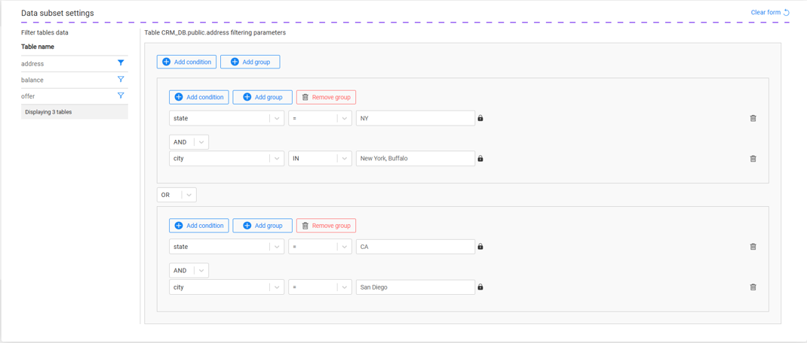

# Task — Table Subset

The table subset enables an optional filtering and sampling of the records extracted for the task's tables. The table subset is available when selecting the [Tables](14c_task_source_component_tables.md#task---source-component---tables) option in the Source component, i.e., creating a task on tables only.

A filter and/or a record sampling can be added to one, several, or all of the task's tables.

Click the filter icon next to a table to open the **Data subset settings** window:

The window is split into two panels:

- **Left panel** — lists all the task's tables. A filled filter icon next to a table indicates that a filter has already been set for it. An **S** icon next to the filter icon indicates that a record sampling has been set for the table. Click a table name to view or edit its filtering parameters in the right panel.
- **Right panel** — displays the filtering parameters for the selected table, identified by its full name (e.g., *CRM_DB.public.address*). The right panel includes the following sections:
  - **Filter conditions** — define the field conditions to filter the table's records.
  - **Record sampling** — limit the number of records extracted from the table. See [Record Sampling](#record-sampling).

To define a filter, select a table field, an operator, and enter a value. Multiple conditions and/or groups can be added using the **Add condition** and **Add group** buttons.

Click **Clear form** to remove all filters across all tables.

Click **Share filter** to copy the filter conditions and/or the record sampling of the selected table to other tables of the task. See [Shared Filters](#shared-filters).

## Field Aliases and Valid Values

Starting from TDM 10.1, the table filter displays business-friendly field names and valid values from the Catalog, making it easier to define the filter conditions:

- **Field aliases** — when a field alias (business name) is defined for a field in the Catalog, it is displayed under the field name in the fields dropdown list, as well as under the selected field in the filter condition. For example, the *offer_ref_id* field is displayed with its alias *Offer Reference ID*.

  

- **Valid values** — when the Catalog holds a list of valid values for the selected field, these values are displayed in a dropdown list in the condition's value field. For example, the *vip_status* field displays the following valid values: Bronze, Silver, Gold, and Platinum. You can select a value from the list or type a custom value manually.

  

**Prerequisites:**

- Field aliases are defined in the Catalog using the **FIELD ALIAS** tag on the table's fields.
- Valid values are available when the Catalog Discovery has been executed with the **Option Set Analyzer** enabled. The Option Set Analyzer identifies non-sensitive fields with a limited number of distinct values within a data sample and saves these values in the Catalog.

## Record Sampling

Starting from TDM 10.1, you can extract a random sample of records from a table, either together with the filter conditions or without them. The sample is used to limit the number of records extracted from the table. 

To set a record sampling on a table:

1. Expand the **Record sampling** section in the right panel.
2. Turn on the **Limit output to a sample of records** toggle. An information message displays the number of partitions of the table, for example: *This table is partitioned (9 partitions)*.
3. Populate the following settings:
   - **Number of partitions** — the number of table partitions to sample. You can sample up to the number of the table's partitions. 
   - **Records per partition** — the number of records to take from each sampled partition.

A summary message displays the expected output. For example: *Output = 50 records from each of 5 partitions (max 250 records), after applying the field conditions above*.

**How the sampling works:**

- Sampling is partition-based, and each partition is processed independently.
- In each sampled partition, the table's SELECT statement retrieves all records that match the filter conditions (or all records, if no filter conditions are defined). The number of records read from the SELECT statement's output is then limited by the configured number of records per partition.
- The number of the table's partitions is displayed based on the partition flow defined for the table in the **TableLevelDefinitions** MTable.
- Tables with a record sampling are indicated in the task execution window.

**Notes:**

- Record sampling is intended for independent tables. Applying sampling separately to related tables (tables with PK/FK relationships) may break the referential integrity of the extracted data. The task creator is responsible for using record sampling only on tables where referential integrity is not compromised.

## Shared Filters

Starting from TDM 10.1, you can share the filter conditions and/or the record sampling of a table with other tables of the task in one step. For example, apply a last update date condition to all the task's tables that contain this field.

Click **Share filter** in the right panel of the source table to open the **Share filter** window. The **Share filter** button is enabled only when a filter or a record sampling has been defined on the selected table.

The **Share filter** window includes the following steps:

1. **What to share** — select the settings to share:
   - **Field conditions** — shares the entire filter expression of the source table, including all its conditions, groups, and logical operators. The number of conditions is displayed next to the option.
   - **Record sampling** — shares the record sampling settings of the source table. This option is disabled if a record sampling is not enabled on the source table.
2. **How to apply it** — select how to apply the shared settings to the target tables:
   - **Replace** — overwrites the target table's own filter.
   - **Add to filter** — keeps the target table's filter and merges the shared settings into it.
3. **Apply to tables** — lists the task's tables that the filter can be shared with. All tables are selected by default. Clear the check box of a table to exclude it, or click **Remove all** to clear all tables. For each table, the window displays:
   - The matching field aliases, for example: *Matches: Subscriber ID*.
   - Whether a filter is already defined on the table, for example: *No filter defined yet*.

Click **Share with [N] tables** to apply the shared settings to the selected tables.

**Notes:**

- Filter conditions are matched to each target table by their **field alias** and not by the field name, since the same field name can represent a different meaning in different tables. For example, an *ID_NUM* field can represent a customer, an address, or a contract.
- Filter conditions can be shared only with tables that contain all the fields referenced by the shared conditions.
- Partial sharing of individual filter conditions is not supported. The entire filter expression is shared.
- The shared settings are copied to the target tables. After sharing, the filter of each table can be edited independently, and future edits on the source table do not affect the target tables.

## Lock Icons

Each condition has a lock icon. The task creator can lock or unlock individual conditions to control whether the task runner can modify them at execution time:

- **Locked** — the condition's operator and value are fixed and cannot be changed by the task runner at execution.
- **Unlocked** — the task runner can modify the condition's operator and/or value when executing the task.

At execution time, all filter conditions are displayed, but the task runner can only edit the unlocked ones.
