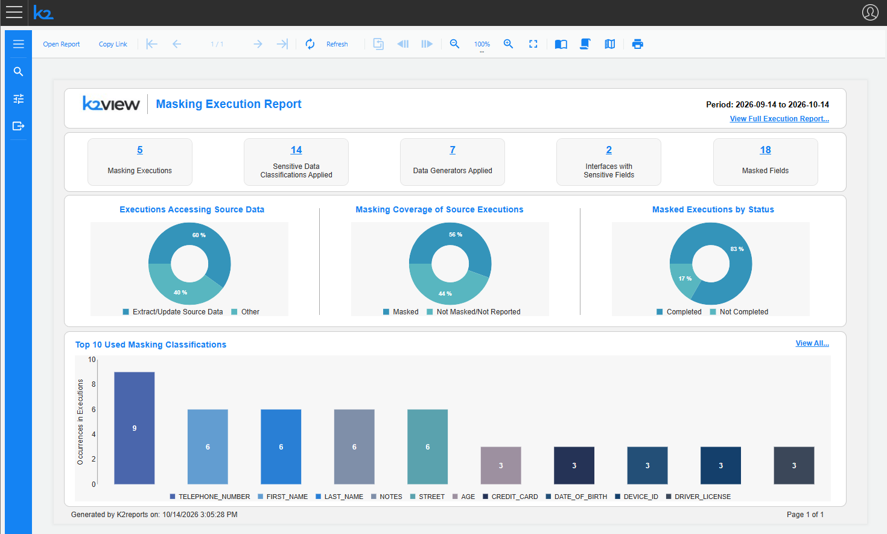
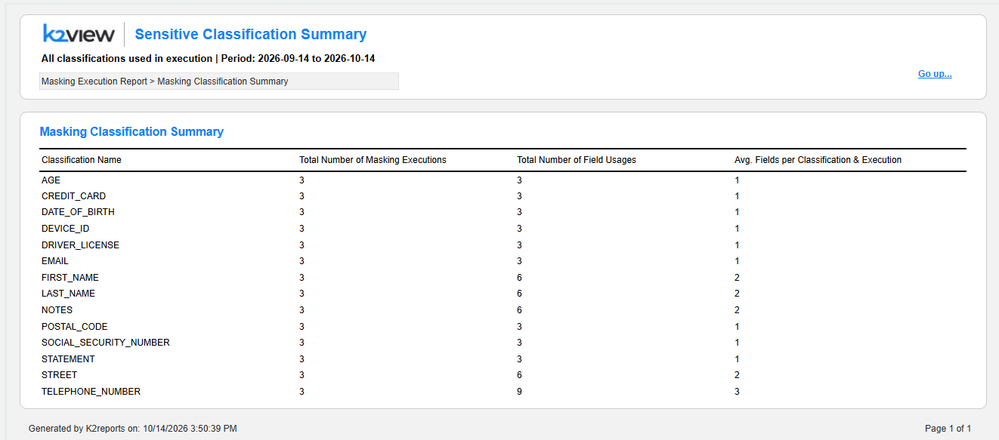
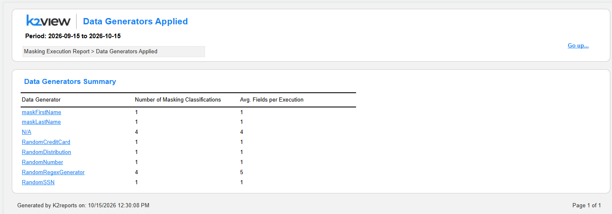
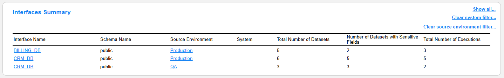
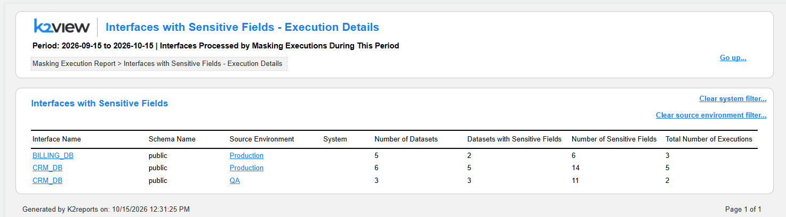
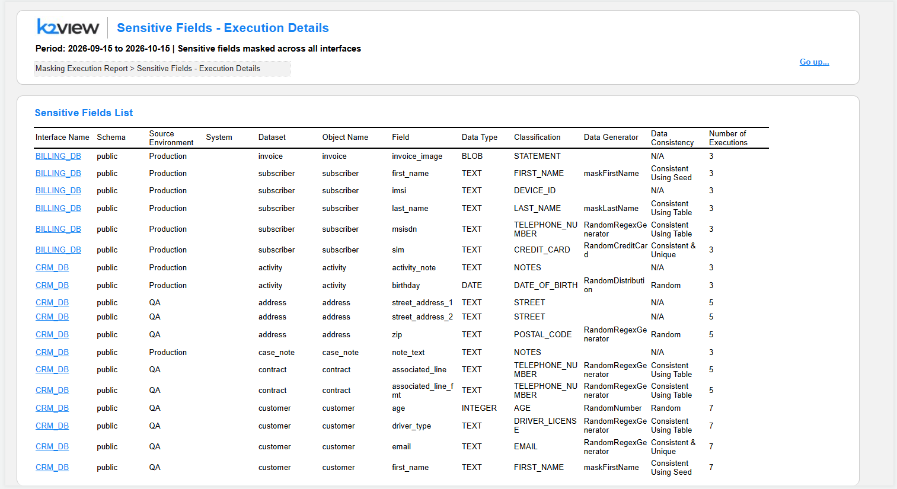

# Masking Execution Report

## Overview

The **Masking Execution Report** is a new report, available starting from TDM V10.1, that provides a record of the masking executions within the selected reporting period, including the masking classifications and data generators applied in each execution. The report enables data owners, security officers and TDM administrators to audit how the masking policy is applied during task executions and to identify potential compliance gaps, such as executions that extracted or updated source data without masking.

While the [Masking Policy Report](TDM_Masking_Policy_Report.md) shows how the masking is **configured**, the Masking Execution Report shows how the masking was **actually applied** by the task executions.

The Masking Execution Report can be opened either from the **TDM** application or from the **Reports** application.

**Prerequisite**: The report availability depends on the TDM configuration. The **MASKING_REPORT_FLAG** must be set to **true** in order to report the masking activities of the task executions. Executions that run when this flag is set to false do not report their masking activities and are therefore displayed as *Not Masked/Not Reported* in the report.

**Data sources**: The report is based on the masking activities reported by the task executions and stored in the **TDM DB**, such as the masked interfaces, datasets and fields, and the masking classifications and data generators applied to each field.

**Time Period**: The report shows the task executions within the selected reporting period. Set the **From date** and **End date** parameters (in YYYY-MM-DD format) in the **Parameters** panel on the left side and click **Preview** to generate the report. The selected period is displayed at the top-right corner of the main report and under the title of each linked report.

**Export:** Each report can be exported into PDF or CSV format by opening the **Export** section using the relevant icon on the left-side menu.

**Navigation between the linked reports**: The navigation from the main report to the linked reports and back can be done by one of the following two options:

* By clicking the links (such as the numbers, the interface and data generator names, or the 'View all...' links) to drill down into the next level of details and 'Go up...' to return to the previous level.
* Using the native pagination icons of the Reports application.

**Execution details**: The task execution IDs displayed in the reports are links. Clicking an execution ID opens the task execution monitor window of the selected execution, where you can view the execution details and download the detailed execution report of the execution if needed.

**Navigation within each report**: Each report can be extended to multiple pages (based on the included data). Page numbers are displayed in the bottom-right corner for multi-page reports. The navigation between the pages of each report can be done by using the native navigation icons of the Reports application.

**Breadcrumb trail**: Located at the top of each report page. For example: Masking Execution Report > Masking Executions. The breadcrumbs are added for orientation only and are not clickable. The breadcrumb reflects the navigation path; for example, the *Interface Summary List* report opened from the *Full Masking Execution Report* displays: Masking Execution Report > Full Masking Execution Report > Interface Summary List.

Click [here](/articles/38_reports/01_reports_overview.md) for more information about the Reports application.

---

## Main Report

The main Masking Execution Report displays the key metrics and visualizations of the masking executions within the selected period, organized into several sections. Each section includes links to deep dive into the details related to the section.

**View Full Execution Report...**: The link at the top-right corner of the report opens the *Full Masking Execution Report*, which combines all the execution masking details in a single, printable report.

### Masking Executions Summary

**Metrics displayed:**

- **Masking Executions**: Number of task executions that reported masking activities during the selected period. Clicking the number opens the *Masking Executions* report.
- **Sensitive Data Classifications Applied**: Number of distinct masking classifications applied by the executions. Clicking the number opens the *Masking Classification Summary* report.
- **Data Generators Applied**: Number of distinct data generators applied by the executions. Clicking the number opens the *Data Generators Used* report.
- **Interfaces with Sensitive Fields**: Number of distinct interfaces with sensitive fields that were processed by the executions. Clicking the number opens the *Interface Summary List* report.
- **Masked Fields**: Number of distinct sensitive fields masked by the executions. Clicking the number opens the *Sensitive Fields - Execution Details* report.

### Execution Percentage Breakdown

The three pie charts narrow down the executions step by step: from all executions, to the executions that access the source data, to the masked executions.

**Executions Accessing Source Data** (Pie Chart):

- Shows the proportion (in %) of executions that extract or update source data vs. all other executions within the selected period.
- **Extract/Update Source Data**: Executions that read data from the source environment, for example, Extract, Load, or Load & Reserve executions that extract the data from the source.
- **Other**: Executions that do not access the source data.

**Masking Coverage of Source Executions** (Pie Chart):

- Shows the proportion (in %) of the masked executions out of the executions that extract or update source data.
- **Masked**: Source data executions that reported masking activities.
- **Not Masked/Not Reported**: Source data executions that did not mask the data or did not report their masking activities, for example, when the MASKING_REPORT_FLAG was set to false. These executions are listed in the *Extract/Update Source Data Executions without Masking* section of the *Full Masking Execution Report* and should be reviewed as potential compliance gaps.

**Masked Executions by Status** (Pie Chart):

- Shows the proportion (in %) of the masked executions by their execution status: **Completed** vs. **Not Completed** (for example, Stopped or Failed executions).

### Top 10 Used Masking Classifications

Displays the 10 masking classifications that were used most frequently by the executions within the selected period. Each bar shows the number of times the classification was applied to fields across all executions. For example, if the TELEPHONE_NUMBER classification is assigned to 3 fields, and these fields were masked by 3 executions, the bar displays 9.

The 'View All...' link opens the *Masking Classification Summary* report with all the classifications used in the executions.

## Linked Reports

### General

The reports are built on up to four levels: Main report > Level 1 details (in each functional area) > Level 2 details > Level 3 details. Level 3 is reached when drilling down from an interface into its schemas or datasets.

<table>
<thead>
<tr>
<th>Level 1 Report</th>
<th>Opened From (Main Report)</th>
<th>Level 2 Reports</th>
<th>Level 3 Reports</th>
</tr>
</thead>
<tbody>
<tr>
<td>Masking Executions</td>
<td>Masking Executions number</td>
<td>-</td>
<td>-</td>
</tr>
<tr>
<td>Masking Classification Summary</td>
<td>Sensitive Data Classifications Applied number; 'View All...' link of the <i>Top 10 Used Masking Classifications</i> chart</td>
<td>-</td>
<td>-</td>
</tr>
<tr>
<td>Data Generators Used</td>
<td>Data Generators Applied number</td>
<td>Data Generator Details</td>
<td>-</td>
</tr>
<tr>
<td>Interface Summary List</td>
<td>Interfaces with Sensitive Fields number</td>
<td>Interface Summary List, filtered by an interface</td>
<td>Interface Summary List, filtered by a schema or a dataset</td>
</tr>
<tr>
<td>Sensitive Fields - Execution Details</td>
<td>Masked Fields number</td>
<td>Interface Summary List, filtered by an interface</td>
<td>Interface Summary List, filtered by a schema or a dataset</td>
</tr>
<tr>
<td>Full Masking Execution Report</td>
<td>'View Full Execution Report...' link</td>
<td>Interface Summary List (all interfaces or filtered by an interface) Data Generator Details</td>
<td>Interface Summary List, filtered by a schema or a dataset</td>
</tr>
</tbody>
</table>

In addition, the execution IDs in the reports open the task execution monitor window of the selected execution.

Below you can find the detailed description of each report.

### Masking Executions

**Access**: By clicking the number of Masking Executions in the main report.

**Purpose**: Lists the task executions within the selected period and summarizes the masking activities of each execution.

**Task Executions - Masking Summary**

Table showing the following columns:

- **Execution ID**: The task execution ID. Each execution ID is a link. Clicking it opens the **task execution monitor** window, where you can view the execution details and download the detailed execution report of the execution.
- **Task Name**: The name of the executed task.
- **Task Type**: The task type, for example, Extract, Load, Load & Reserve, or In-place masking.
- **Processed Data**: Whether the execution processed Entities or Tables.
- **Source Environment**: The source environment of the execution.
- **Status**: The execution status, for example, Completed or Stopped.
- **Date**: The execution date.
- **Number of Sensitive Interfaces**, **Number of Sensitive Datasets**: The number of interfaces and datasets with sensitive fields that were processed by the execution.
- **Number of Classifications**: The number of masking classifications applied by the execution.
- **Number of Masked Fields**: The number of fields masked by the execution.
- **Number of Data Generators**: The number of data generators applied by the execution.

### Masking Classification Summary

**Access**: Either by clicking the number of Sensitive Data Classifications Applied in the main report, or by clicking the 'View All...' link of the *Top 10 Used Masking Classifications* chart.

**Purpose**: Shows how often each masking classification was applied by the executions within the selected period.

**Masking Classification Summary**

- Table showing: Classification Name, Total Number of Masking Executions, Total Number of Field Usages, Avg. Fields per Classification & Execution.
- **Total Number of Field Usages**: The number of times the classification was applied to fields across all executions.
- **Avg. Fields per Classification & Execution**: The average number of fields masked by the classification in each execution. For example, a classification with 6 field usages in 3 executions has an average of 2.

### Data Generators Used

**Access**: By clicking the number of Data Generators Applied in the main report.

**Purpose**: Shows the data generators applied by the executions within the selected period.

**Data Generators Summary**

- Table showing: Data Generator, Number of Masking Classifications, Avg. Fields per Execution.
- **N/A** is displayed for the masked fields whose classification has no data generator. These fields should be reviewed, as no data generator is set for their classification. The [Masking Policy Report](/articles/38_reports/TDM_Masking_Policy_Report.md) lists the classifications without data generators.
- Each data generator name is a link. Clicking it opens the *Data Generator Details* report for the selected data generator.

### Data Generator Details

**Access**: By clicking a data generator name either in the *Data Generators Used* report or in the *Data Generators Summary* section of the *Full Masking Execution Report*.

**Purpose**: Shows the fields masked by the selected data generator (for example: *Data Generator: maskLastName*) and the task executions that applied it.

**Sections include:**

**Fields Masked by This Data Generator**

- Table showing: Interface Name, Schema, System, Dataset, Object Name, Field, Data Type, Classification, Data Consistency, Number of Executions.
- Lists the sensitive fields masked by the selected data generator, and the number of executions that masked each field.

**Task Executions Using This Data Generator**

- Table showing: Execution ID, Date, Number of Interfaces, Number of Datasets, Number of Fields Masked.
- Lists the executions that applied the selected data generator, and the number of interfaces, datasets and fields masked by it in each execution.
- Each execution ID is a link that opens the task execution monitor window of the selected execution.

### Interface Summary List

**Access**: By clicking the number of Interfaces with Sensitive Fields in the main report, or by clicking an interface name either in the *Sensitive Fields - Execution Details* report or in the *Interfaces Summary* section of the *Full Masking Execution Report*.

**Purpose**: Detailed view of the datasets and sensitive fields processed by the executions. The report shows either all interfaces (*Interface: All Interfaces*) or the selected interface (for example: *Interface: BILLING_DB*).

**Sections include:**

**Interface Summary List**

- Table showing: Interface Name, Schema, System, Dataset, Number of Fields, Number of Sensitive Fields, Number of Executions.
- Lists the datasets of the interfaces with the number of fields and sensitive fields per dataset, and the number of executions that processed each dataset.
- The **Interface Name** values are links. Clicking an interface name filters the report by the selected interface (for example: *Interface Summary List: BILLING_DB*).
- The **Schema** and **Dataset** values are links. Clicking a schema or a dataset opens the *Interface Detailed List* section filtered by the selected schema or dataset.
- The 'Show all interfaces...' link removes the filter and displays all interfaces.

**Interface Detailed List (Sensitive Fields Only)**

- Table showing: Interface Name, Schema, System, Dataset, Object Name, Field, Data Type, Classification, Data Generator, Data Consistency, Number of Executions.
- Lists the sensitive fields masked by the executions, with the classification and data generator applied to each field.
- Data Consistency is set to N/A for fields whose classification has no data generator.

When filtered by a schema or a dataset, only the *Interface Detailed List* section is displayed, and the section title displays the active filter, for example: *Interface Detailed List (Sensitive Fields Only): BILLING_DB — Filtered by Schema: public and Dataset: subscriber*. The following links allow to remove the filter:

- **Show all datasets in this interface...**: Displays the sensitive fields of all datasets in the selected interface.
- **Show all datasets in this schema...**: Displays the sensitive fields of all datasets in the selected schema.

### Sensitive Fields - Execution Details

**Access**: By clicking the number of Masked Fields in the main report.

**Purpose**: Lists the sensitive fields masked across all interfaces by the executions within the selected period.

**Sensitive Fields List**

- Table showing: Interface Name, Schema, Source Environment, System, Dataset, Object Name, Field, Data Type, Classification, Data Generator, Data Consistency, Number of Executions.
- **Number of Executions**: The number of executions that masked the field.
- Each interface name is a link that opens the *Interface Summary List* report filtered by the selected interface.

### Full Masking Execution Report

**Access**: By clicking 'View Full Execution Report...' at the top-right corner of the main report.

**Purpose**: Combines all the execution masking details in a single report. This report is useful for exporting or sharing the masking execution records, for example, for an audit or a compliance review.

**Sections include:**

**Task Executions - Masking Summary**

- The list of the task executions, with the same columns as in the *Masking Executions* report.

**Extract/Update Source Data Executions without Masking**

- Table showing: Execution ID, Task Name, Task Type, Processed Data, Source Environment, Status, Date, Reason for Not Masking.
- Lists the executions that extracted or updated source data without reporting masking activities. These executions should be reviewed as potential compliance gaps.
- **Reason for Not Masking**: The reason the execution did not mask the data. *Unknown* is displayed when the reason was not reported.

In both execution sections, each execution ID is a link that opens the task execution monitor window of the selected execution.

**Data Generators Summary**

- Table showing: Data Generator, Number of Sensitive Classifications, Total Number of Executions, Avg. Number of Fields.
- Each data generator name is a link that opens the *Data Generator Details* report for the selected data generator.

**Interfaces Summary**

- Table showing: Interface Name, Schema Name, Source Environment, System, Total Number of Datasets, Number of Datasets with Sensitive Fields, Total Number of Executions.
- Each interface name is a link that opens the *Interface Summary List* report for the selected interface.
- Each source environment is a link that filters the section by the selected source environment.
- The following links are displayed at the top-right corner of the section:
  - **Show all...**: Opens the *Interface Summary List* report with all interfaces.
  - **Clear system filter...**: Removes the system filter.
  - **Clear source environment filter...**: Removes the source environment filter.

**Source Data Executions by Environment**

- Table showing: Env Name, Sensitivity, Total Number of Executions.
- Lists the number of source data executions per source environment, with the environment's sensitivity: Sensitive or Non-sensitive.
