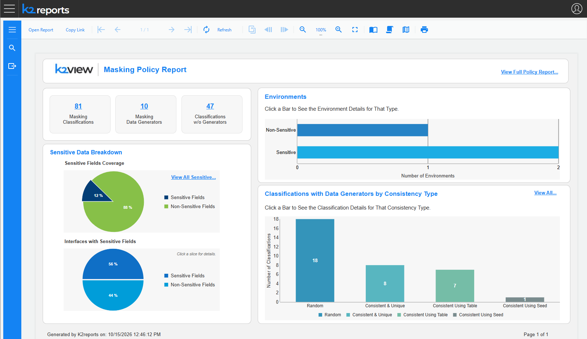
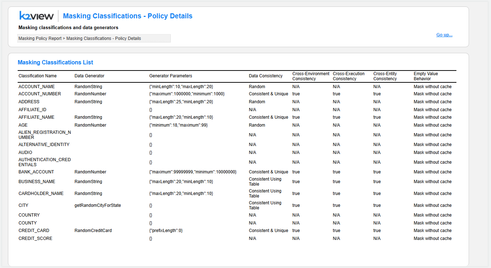
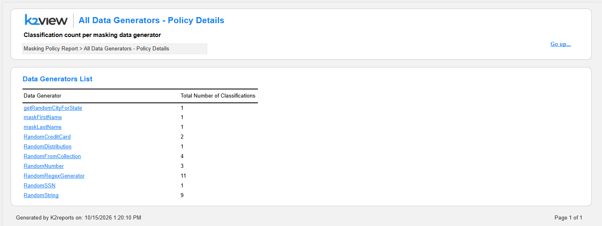
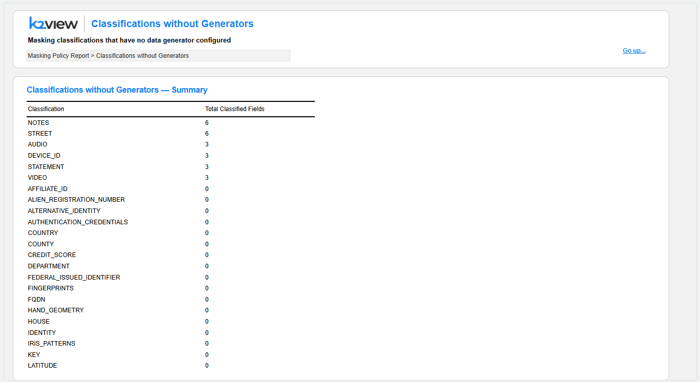
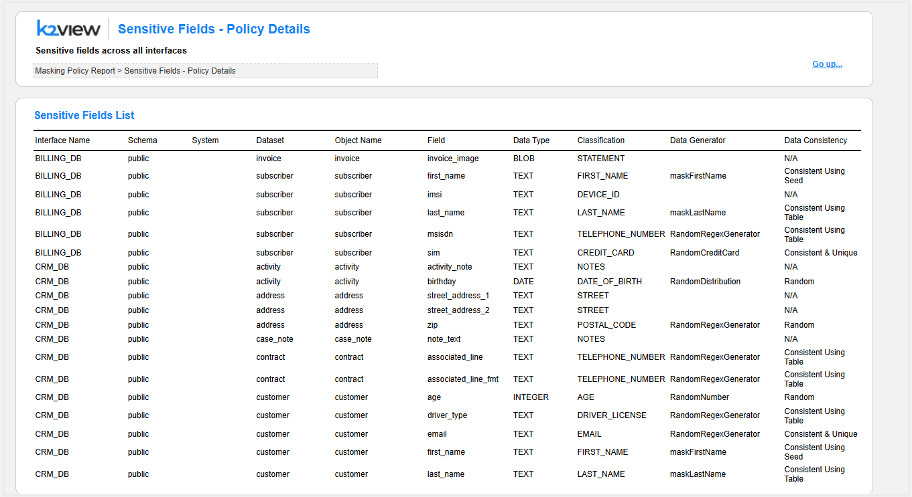
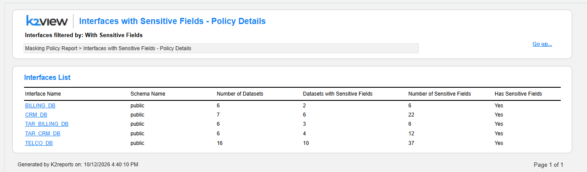
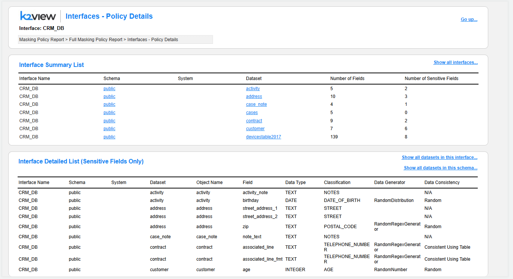

# Masking Policy Report User Guide

## Overview

The **Masking Policy Report** is a new report, available starting from TDM V10.1, that provides a comprehensive view of the masking policy defined in your project. It shows the masking classifications, the data generators attached to them, the consistency settings, the sensitive fields across all interfaces, and the sensitivity of the TDM environments. The report helps data owners, security officers and TDM administrators verify that sensitive data is properly covered by the masking policy and identify gaps, such as classifications without data generators.

The Masking Policy Report can be opened either from the **TDM** application or from the **Reports** application.

**Data sources**:

* **Masking classifications, data generators, and sensitive fields** - reflect the **current configuration** of the sensitive data as set in the **Catalog**.
* **Sensitive and non-sensitive environments** - taken from the **TDM DB**.

The Masking Policy Report is not limited to a time period. It always shows the current state of the masking policy at the time the report is generated.

**Export:** Each report can be exported into PDF or CSV format by opening the **Export** section using the relevant icon on the left-side menu.

**Navigation between the linked reports**: The navigation from the main report to the linked reports and back can be done by one of the following two options:

* By clicking the links (such as the numbers, the chart bars and slices, or the 'View all...' links) to drill down into the next level of details and 'Go up...' to return to the previous level.
* Using the native pagination icons of the Reports application.

**Navigation within each report**: Each report can be extended to multiple pages (based on the included data). Page numbers are displayed in the bottom-right corner for multi-page reports. The navigation between the pages of each report can be done by using the native navigation icons of the Reports application.

**Breadcrumb trail**: Located at the top of each report page. For example: Masking Policy Report > Masking Classifications - Policy Details. The breadcrumbs are added for orientation only and are not clickable. The breadcrumb reflects the navigation path; for example, the *Interfaces - Policy Details* report opened from the *Full Masking Policy Report* displays: Masking Policy Report > Full Masking Policy Report > Interfaces - Policy Details.

Click [here](/articles/38_reports/01_reports_overview.md) for more information about the Reports application.

---

## Main Report

The main Masking Policy Report displays the key metrics and visualizations of the masking policy, organized into several sections. Each section includes links to deep dive into the details related to the section.

**View Full Policy Report...**: The link at the top-right corner of the report opens the *Full Masking Policy Report*, which combines all the policy details in a single, printable report.

### Masking Classifications Summary

**Metrics displayed:**

- **Masking Classifications**: Total number of masking classifications defined in the Catalog. Clicking the number opens the *Masking Classifications - Policy Details* report.
- **Masking Data Generators**: Number of distinct data generators that are attached to the masking classifications. Clicking the number opens the *All Data Generators - Policy Details* report.
- **Classifications w/o Generators**: Number of masking classifications that have no data generator configured. Clicking the number opens the *Classifications without Generators* report.

### Sensitive Data Breakdown

**Sensitive Fields Coverage** (Pie Chart):

- Shows the proportion (in %) of sensitive fields vs. non-sensitive fields across all the fields in the Catalog.
- The 'View All Sensitive...' link opens the *Sensitive Fields - Policy Details* report.

**Interfaces with Sensitive Fields** (Pie Chart):

- Shows the proportion (in %) of interfaces that include sensitive fields vs. interfaces without sensitive fields.
- Clicking a slice of the chart opens the *Interfaces with Sensitive Fields - Policy Details* report  or ***Interfaces without Sensitive Fields - Policy Details* report,  (depends on the selected slice).

### Environments

Displays the number of active TDM environments per sensitivity type: Sensitive and Non-Sensitive.

**Clicking on each bar** of the chart opens the environment details for that sensitivity type: either the *Sensitive Environments - Details* or the *Non-sensitive Environments - Details* report.

### Classifications with Data Generators by Consistency Type

Displays the number of masking classifications that have a data generator, broken down by their data consistency type:

- **Random**
- **Consistent & Unique**
- **Consistent Using Table**
- **Consistent Using Seed**

**Clicking on each bar** of the chart opens the *Masking Classifications - Policy Details* report, filtered by the selected consistency type. The 'View All...' link opens the *Masking Classifications - Policy Details* report with all the classifications.

------

## Linked Reports

### General

The reports are built on three levels: Main report > Level 1 details (in each functional area) > Level 2 details.

<table>
<thead>
<tr>
<th>Level 1 Report</th>
<th>Opened From (Main Report)</th>
<th>Level 2 Reports</th>
</tr>
</thead>
<tbody>
<tr>
<td>Masking Classifications - Policy Details</td>
<td>Masking Classifications number; 'View All...' or a bar in the <i>Classifications with Data Generators by Consistency Type</i> chart</td>
<td>-</td>
</tr>
<tr>
<td>All Data Generators - Policy Details</td>
<td>Masking Data Generators number</td>
<td>Masking Classifications - Policy Details, filtered by a data generator</td>
</tr>
<tr>
<td>Classifications without Generators</td>
<td>Classifications w/o Generators number</td>
<td>-</td>
</tr>
<tr>
<td>Sensitive Fields - Policy Details</td>
<td>'View All Sensitive...' link</td>
<td>-</td>
</tr>
<tr>
<td>Interfaces with Sensitive Fields - Policy Details</td>
<td>A slice in the <i>Interfaces with Sensitive Fields</i> chart</td>
<td>Interfaces - Policy Details</td>
</tr>
<tr>
<td>Sensitive Environments - Details Non-sensitive Environments - Details</td>
<td>A bar in the <i>Environments</i> chart</td>
<td>-</td>
</tr>
<tr>
<td>Full Masking Policy Report</td>
<td>'View Full Policy Report...' link</td>
<td>Masking Classifications - Policy Details (filtered by a data generator) Interfaces - Policy Details</td>
</tr>
</tbody>
</table>

Below you can find the detailed description of each report.

### Masking Classifications - Policy Details

**Access**: Either by clicking the number of Masking Classifications in the main report, or by clicking 'View All...' or a bar in the *Classifications with Data Generators by Consistency Type* chart.

**Purpose**: Detailed list of the masking classifications and their data generator settings.

**Masking Classifications List**

Table showing the following columns:

- **Classification Name**: The masking classification, for example, ACCOUNT_NUMBER, EMAIL, FIRST_NAME.
- **Data Generator**: The data generator attached to the classification. Empty if no data generator is configured.
- **Generator Parameters**: The input parameters of the data generator, in JSON format. For example: `{"minLength":10,"maxLength":20}`.
- **Data Consistency**: The consistency type of the masked value: Random, Consistent & Unique, Consistent Using Table, or Consistent Using Seed. N/A is displayed for classifications without a data generator.
- **Cross-Environment Consistency**, **Cross-Execution Consistency**, **Cross-Entity Consistency**: Indicate whether the same masked value is kept across environments, across task executions, and across entities. N/A is displayed when not applicable, for example, for Random classifications.
- **Empty Value Behavior**: How the masking handles empty source values, for example, *Mask without cache*.

When opened from a data generator link (in the *All Data Generators - Policy Details* report or the *Full Masking Policy Report*), the report is filtered by the selected data generator (for example: *Data Generator: RandomDistribution.actor*) and includes two sections:

- **Classifications Detailed List**: The classifications that use the selected data generator, with the same columns as described above.
- **Interface Detailed List (Sensitive Fields Only)**: The sensitive fields that are assigned to these classifications. Columns: Interface Name, Schema, System, Dataset, Object Name, Field, Data Type, Classification, Data Generator, Data Consistency.

### All Data Generators - Policy Details

**Access**: By clicking the number of Masking Data Generators in the main report.

**Purpose**: Shows the number of classifications per masking data generator.

**Data Generators List**

- Table showing: Data Generator, Total Number of Classifications.
- Each data generator name is a link. Clicking it opens the *Masking Classifications - Policy Details* report filtered by the selected data generator, showing its classifications and the sensitive fields that use them.

### Classifications without Generators

**Access**: By clicking the number of Classifications w/o Generators in the main report.

**Purpose**: Identifies gaps in the masking policy — masking classifications that have no data generator configured.

**Sections include:**

**Classifications without Generators — Summary**

- Table showing: Classification, Total Classified Fields.
- Lists each classification without a data generator and the number of fields assigned to it, sorted by the number of fields in descending order. A classification with 0 fields is defined in the Catalog but is not assigned to any field.

**Dataset Fields Assigned to Classifications without Generators**

- Table showing: Classification, Interface, Schema, Source System, Dataset, Field.
- Lists the fields that are assigned to a classification without a data generator. These fields should be reviewed, as no data generator is set for their classification.

### Sensitive Fields - Policy Details

**Access**: By clicking 'View All Sensitive...' in the *Sensitive Data Breakdown* section of the main report.

**Purpose**: Lists the sensitive fields across all interfaces with their masking settings.

**Sensitive Fields List**

- Table showing: Interface Name, Schema, System, Dataset, Object Name, Field, Data Type, Classification, Data Generator, Data Consistency.
- Data Consistency is set to N/A for fields whose classification has no data generator.

### Interfaces with Sensitive/Non Sensitive Fields - Policy Details

**Access**: By clicking a slice in the *Interfaces with Sensitive Fields* chart of the main report.

**Purpose**: Lists the interfaces, filtered by the selected slice (With Sensitive Fields / Without Sensitive Fields).

**Interfaces List**

- Table showing: Interface Name, Schema Name, Number of Datasets, Datasets with Sensitive Fields, Number of Sensitive Fields, Has Sensitive Fields.
- Each interface name is a link. Clicking it opens the *Interfaces - Policy Details* report for the selected interface.

### Interfaces - Policy Details

**Access**: By clicking an interface name either in the *Interfaces with Sensitive Fields - Policy Details* report or in the *Interfaces Summary* section of the *Full Masking Policy Report*.

**Purpose**: Detailed view of the datasets and sensitive fields of the selected interface (for example: *Interface: CRM_DB*).

**Sections include:**

**Interface Summary List**

- Table showing: Interface Name, Schema, System, Dataset, Number of Fields, Number of Sensitive Fields.
- Lists the datasets of the selected interface with the number of fields and sensitive fields per dataset.
- The **Schema** and **Dataset** values are links. Clicking a schema or a dataset filters the *Interface Detailed List* section by the selected schema or dataset.
- The 'Show all interfaces...' link opens the list of all interfaces.

**Interface Detailed List (Sensitive Fields Only)**

- Table showing: Interface Name, Schema, System, Dataset, Object Name, Field, Data Type, Classification, Data Generator, Data Consistency.
- Lists the sensitive fields of the selected interface.

When filtered by a schema or a dataset, the section title displays the active filter, for example: *Interface Detailed List (Sensitive Fields Only) — Filtered by Schema: public and Dataset: customer*. The following links allow to remove the filter:

- **Show all datasets in this interface...**: Displays the sensitive fields of all datasets in the selected interface.
- **Show all datasets in this schema...**: Displays the sensitive fields of all datasets in the selected schema.

### Sensitive Environments - Details / Non-sensitive Environments - Details

**Access**: By clicking a bar in the *Environments* chart of the main report.

**Purpose**: Lists the active TDM environments with the selected sensitivity: Sensitive or Non-sensitive.

**Environments List**

- Table showing: Env Name, Sensitivity, Env Creation Date, Sensitivity Update Date, Updated by.
- **Sensitivity Update Date** and **Updated by** are populated when the environment sensitivity has been changed after the environment's creation.

### Full Masking Policy Report

**Access**: By clicking 'View Full Policy Report...' at the top-right corner of the main report.

**Purpose**: Combines all the masking policy details in a single report. This report is useful for exporting or sharing the complete masking policy, for example, for an audit or a compliance review.

**Sections include:**

**Data Generators Summary**

- Table showing: Data Generator, Total Number of Classifications.
- Each data generator name is a link that opens the *Masking Classifications - Policy Details* report filtered by the selected data generator.

**Masking Classifications List**

- The full list of the masking classifications, with the same columns as in the *Masking Classifications - Policy Details* report.

**Classifications without Generators — Summary** and **Dataset Fields Assigned to Classifications without Generators**

- The same sections as in the *Classifications without Generators* report.

**Interfaces Summary**

- Table showing: Interface Name, Schema Name, Total Number of Datasets, Number of Datasets with Sensitive Fields.
- Lists all interfaces, both with and without sensitive fields.
- Each interface name is a link that opens the *Interfaces - Policy Details* report for the selected interface.
- The 'Show all...' link opens the list of all interfaces.

**Environments Summary**

- Table showing: Env Name, Sensitivity, Env Creation Date, Sensitivity Update Date, Updated by.
- Lists all active TDM environments that can be accessed as source environments, both sensitive and non-sensitive.

---
